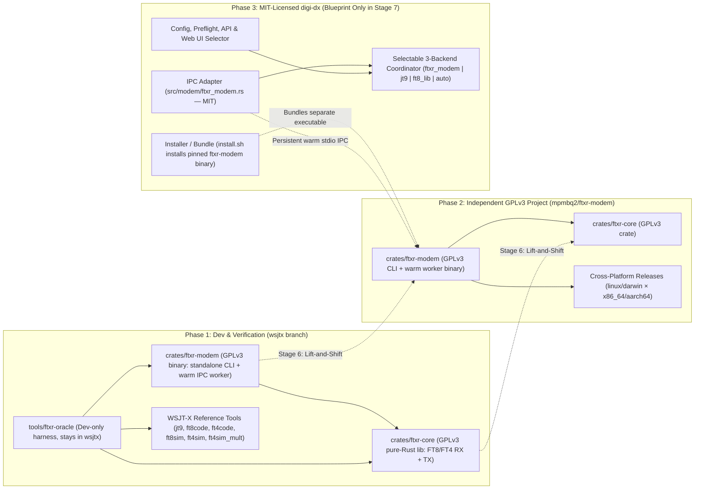

# Pure-Rust FT8 & FT4 Engine Roadmap (Develop in `wsjtx` → Independent GPLv3 Project `ftxr-modem` → Bundled 3rd Backend in `digi-dx`)

## 1. Purpose, Licensing & Independence Strategy

This roadmap defines the staged plan to build, verify, and extract a pure-Rust **FT8 + FT4** modem engine (decoder + encoder/modulator) as a standalone project (`mpmbq2/ftxr-modem`) that `digi-dx` installs and bundles as an independent dependency:

1. **Develop & validate inside `wsjtx` (Stages 0–5):** Build the Rust engine on an isolated branch alongside WSJT-X's Fortran reference tools (`jt9`, `ft8code`, `ft4code`, `ft8sim`, `ft4sim`, `ft4sim_mult`) so every stage is verified numerically and behaviorally against classic `jt9` (`lib/ft8/` and `lib/ft4/`).
2. **Lift-and-shift to an independent GPLv3 repository (Stage 6):** Extract the engine into its own standalone Rust project (`mpmbq2/ftxr-modem`, binary `ftxr-modem`) with zero `wsjtx`/Fortran/FFTW dependencies and cross-platform release binaries.
3. **Bundle & integrate as a user-selectable 3rd backend in `digi-dx` (Stage 7 — blueprint only during `wsjtx` work):** Install/bundle the `ftxr-modem` binary alongside `digi-dx` (mirroring how `digi-dx` already provisions `rigctld` and `jt9` in `mpmbq2/digi-dx:docs/deployment-and-deps.md`) and expose it alongside `jt9` (`src/modem/jt9.rs`) and `ft8_lib` (`src/modem/ft8_lib.rs`). *Note: the `digi-dx` repository is read-only reference during Stages 0–6; Stage 7 is planned as an integration blueprint without modifying `digi-dx`.*

### Licensing Architecture (MIT `digi-dx` + GPLv3 `ftxr-modem`)

> [!IMPORTANT]
> **Why `ftxr-modem` runs as an independent warm worker binary rather than a statically linked Cargo crate inside `digi-dx`:**
> - **New Rust modem project (`ftxr-modem`) — GPLv3:** Because it is explicitly GPLv3 (with proper attribution to upstream WSJT-X in [`COPYING`](../COPYING)), we can **directly port** WSJT-X's proven Fortran FT8/FT4 algorithms and perform **stage-by-stage numerical verification** against WSJT-X's Fortran internals—the fastest, lowest-risk path to true `jt9` sensitivity parity. All Rust dependencies must be GPLv3-compatible (MIT/Apache-2.0/BSD), and unused non-GPL code in upstream files (e.g., unused Numerical Recipes `bessi0` in `lib/ft8/ft8b.f90`) is explicitly excluded.
> - **`digi-dx` — MIT (`digi-dx/Cargo.toml`):** Statically linking a GPLv3 Rust crate into the `digi-dx` binary would cause the distributed `digi-dx` executable to fall under GPLv3. Instead, `digi-dx` ships **zero GPL code in its Cargo dependency tree** and communicates with the independent `ftxr-modem` binary over a **documented process/IPC boundary** (an aggregate distribution, identical in principle to `digi-dx`'s boundary with `jt9` and `rigctld`).
> - **Zero performance sacrifice:** Unlike cold per-pass `jt9` WAV spawns, `ftxr-modem` runs as a **persistent warm worker process** over stdio/local IPC—FFT plans stay warm in RAM, raw 12 kHz PCM buffers stream over a pipe in <1 ms (no temp WAV files), decodes stream back as JSON events immediately, and mid-pass cancellation takes <50 ms.
> - **Ecosystem bonus:** Because `ftxr-modem` is a completely independent project, anyone can install and use it standalone (CLI or daemon) without needing WSJT-X *or* `digi-dx`.
> - **Bundling compliance (GPLv3 §6):** When `digi-dx`'s installer or release bundle includes `ftxr-modem`, it ships `ftxr-modem`'s GPLv3 `LICENSE`, copyright/attribution notice, and tagged source repository link alongside the binary.

---

## 2. Independent Project & Lift-and-Shift Architecture

To make Stage 6 a clean extraction into an independent repository, the code developed inside `wsjtx` is structured from day one as an independent GPLv3 Cargo workspace (`rust-ftx/`) with extractable crates separated from the disposable `wsjtx`-only oracle harness:

### Architectural Invariants
- **Strict zero-coupling inside `ftxr-core` / `ftxr-modem`:** No dependencies on `wsjtx`, Qt, Fortran, FFTW, or `digi-dx`. Pure Rust (`cargo build --release`) producing a single self-contained native executable per platform.
- **Versioned, multiplexed IPC contract:** `ftxr-modem --worker` speaks a clean, versioned, explicitly framed stdio protocol (length-prefixed or header+binary frames, zero stray stdout logs, multiplexed `request_id`/`job_id` so concurrent Pass 3 decodes never block next-slot TX modulation or `cancel`, plus session/hash-table lifecycle controls).
- **Standalone CLI mode:** `ftxr-modem` also operates as a standalone CLI for decoding `.wav` files and encoding FT8/FT4 signals without `digi-dx`.
- **Mode-aware from day one:** Unified RX and TX support for both **FT8** (15 s slot) and **FT4** (7.5 s slot), matching WSJT-X (`jt9` + `gen_ft8wave`/`gen_ft4wave` + `Modulator.cpp` timing semantics).
- **Reconciler-compatible output:** Emits core fields (`snr_db`, `dt_sec`, `af_hz`, `message`), WSJT-X-compatible AP/confidence tags (`None`, `a1`–`a6`, `? a*`) matching `digi-dx`'s `SlotDecodeReconciler` (`digi-dx/src/qso/reconciler.rs`), and optional rich telemetry (FEC path, sync score, Costas frequency drift, QSB fading envelope).
- **Clean `wsjtx` footprint:** All Rust code and stage plans live in an isolated directory (`rust-ftx/`) on a development branch inside `wsjtx` so upstream WSJT-X source files remain untouched (aside from temporary, non-merged Fortran dump hooks if used during Stages 2–4). `digi-dx` is never modified during this work.

---

## 3. Staged Development Roadmap

### Stage Overview

| Stage | Location | Focus | Primary Oracle | Gate Summary |
| :--- | :--- | :--- | :--- | :--- |
| **0** | `wsjtx` | Toolchain, Workspace & Golden Corpus | `jt9`, `ft8code`, `ft4code`, `ft8sim`, `ft4sim`, `ft4sim_mult` | Oracle builds, GPLv3 workspace scaffolded, deterministic sweeps + baseline `jt9` scorecard recorded |
| **1** | `wsjtx` | 77-Bit Protocol, FEC & TX Modulator (FT8 + FT4) | `ft8code`, `ft4code`, `jt9` | 100% bit-exact packing/tones; 100% `jt9` loopback decode incl. late TX |
| **2** | `wsjtx` | Core FT8 Decoder MVP (Sync + BP + Subtraction) | Fortran intermediates + `jt9 -8 -d 1` | Stage diffs within tol; ≥99% synthetic (-15 dB), ≥90% real `-d 1`, 0% noise FPs |
| **3** | `wsjtx` | FT8 Weak-Signal Parity (OSD + Multi-Sym LLRs + AP `a1`–`a6`) | Fortran OSD + classic `jt9 -8 -d 3` | ≥95–98% of `jt9 -d 3` decodes, ≤0.5–1.0 dB threshold delta, bounded FPs |
| **4** | `wsjtx` | FT4 Decoder Parity | Fortran intermediates + `jt9 -5` | ≥95% of `jt9 -5` decodes, ≤0.5–1.0 dB threshold delta, bounded FPs |
| **5** | `wsjtx` | `ftxr-modem` Binary (CLI + Warm IPC Worker), Parallelism & Telemetry | Classic `jt9` 3-pass timing via IPC | Warm IPC Pass 1/2/3 decisively faster than `jt9`, <50 ms cancel, 1,000-slot soak |
| **6** | New GPLv3 Repo | Lift-and-Shift Extraction (`mpmbq2/ftxr-modem`) & Release Packaging | Standalone tests + final oracle check | Independent GPLv3 repo builds & passes with zero `wsjtx` deps; cross-arch releases ready |
| **7** | Blueprint (`digi-dx` read-only) | `digi-dx` Integration Blueprint (Bundled Dependency & Selectable 3rd Backend) | `digi-dx` test plan + live A/B plan | Complete integration blueprint preserving MIT `digi-dx`, `auto` order `ftxr_modem → jt9 → ft8_lib`, and documenting FT4 live-loop prerequisites |

---

### Stage 0 — Baseline Environment, Golden Corpus & Oracle Harness (in `wsjtx`)

**What we develop:**
- Install headless WSJT-X build dependencies in the dev environment (`gfortran`, `libfftw3-dev`, `libboost-dev`, `libboost-log-dev`, `libhamlib-dev`, `libusb-1.0-0-dev`, Qt5 dev packages required by `CMakeLists.txt` / `fort_qt`) and configure with `-DWSJT_SKIP_MAP65=ON` to compile only the 6 WSJT-X reference targets (`jt9`, `ft8code`, `ft4code`, `ft8sim`, `ft4sim`, `ft4sim_mult`).
- Scaffold the isolated Rust workspace inside `wsjtx` (`rust-ftx/`) with three crates:
  - `crates/ftxr-core` (GPLv3 library crate)
  - `crates/ftxr-modem` (GPLv3 standalone CLI + warm IPC worker binary crate)
  - `tools/ftxr-oracle` (dev-only test, deterministic corpus generator & benchmark harness crate — stays in `wsjtx`, never extracted)
- Add GPLv3 `LICENSE` and upstream WSJT-X attribution (`NOTICE`) files inside the extractable project layout.
- Assemble a compact committed **Golden Fixture Set** + deterministic synthetic sweep generator:
  - Committed real-world recordings: [`samples/FT8/210703_133430.wav`](../samples/FT8/210703_133430.wav), [`samples/FT4/000000_000002.wav`](../samples/FT4/000000_000002.wav), and reference FT8 fixture `191111_110200.wav` (plus a small curated set of quiet/crowded/fading fixtures kept compact for git).
  - **Deterministic synthetic sweep generator in `ftxr-oracle`:** Because WSJT-X's `ft8sim`/`ft4sim` seed their RNG from `/dev/urandom` (`lib/sgran.c` → `lib/init_random_seed.c`), `ftxr-oracle` generates reproducible AWGN sweeps (0 dB to -24 dB in 1 dB steps for FT8; 0 dB to -21 dB for FT4), crowded overlapping multi-signal slots (20+ dB dynamic range), frequency/DT offsets, truncated/late-TX slots, and pure-noise slots using clean signal waveforms (from `ft8sim`/`ft4sim` at high SNR or Rust modulator) mixed with seeded Rust PRNG AWGN—keeping large Monte Carlo WAV caches out of git.
- Capture a machine-readable **Baseline `jt9` Scorecard** using explicit standardized CLI flags:
  - Classic single-threaded FT8 (`jt9 -8`, without `-M`) and FT4 (`jt9 -5`), depths `-d 1`, `-d 2`, `-d 3`.
  - Explicit `-c b -x b` for blind/non-QSO runs (preventing `jt9.f90`'s hardcoded `K1ABC`/`W9XYZ`/`EN37` defaults from skewing benchmarks) and explicit `-c`/`-x`/`-g`/`-Q` for AP test cases, noting `jt9`'s internal `nzhsym=41/47/50` behavior on disk WAVs.

**Testing vs. `jt9`:**
- Confirm `ftxr-oracle` reproducibly runs `jt9 -8` and `jt9 -5` across the golden corpus and emits deterministic JSON baseline scorecards.

**Completion criteria:**
- All 6 WSJT-X oracle executables build and pass smoke checks.
- Compact golden fixtures, deterministic sweep generator, and `jt9` baseline scorecards are committed on the dev branch.
- `ftxr-core`, `ftxr-modem`, and `ftxr-oracle` compile cleanly with stub APIs and GPLv3 licensing metadata in place.

---

### Stage 1 — 77-Bit Message Codec, FEC Encoder & GFSK TX Modulator (FT8 + FT4)

**What we develop:**
- Direct Rust port of WSJT-X's 77-bit message packing/unpacking and thread-safe callsign hash table ([`lib/77bit/packjt77.f90`](../lib/77bit/packjt77.f90)) covering standard QSOs, directed CQs, compound/nonstandard callsigns, grids, signal reports, contests, telemetry, and free text.
- CRC-14 (`0x2757` / `0x6757`, matching `lib/crc14.cpp` / `lib/ft8/get_crc14.f90`) and LDPC(174,91) encoder shared by FT8 and FT4, plus FT4's 77-bit `rvec` scrambling vector (`lib/ft4/genft4.f90`).
- FT8 (79-symbol, 8-GFSK, `BT=2.0`, 12.64 s active, `gen_ft8wave.f90`) and FT4 (103 data/sync + 2 ramp = 105-symbol, 4-GFSK, `BT=1.0`, 5.04 s active, `gen_ft4wave.f90`) tone mapping and continuous-phase GFSK waveform generators supporting arbitrary sample rates (12 kHz / 48 kHz), configurable nominal start delay (`500 ms` FT8 / `300 ms` FT4 matching [`Modulator/Modulator.cpp`](../Modulator/Modulator.cpp), or `0 ms` raw active waveform), and **UTC-aligned late-TX start offsets** with click-free fade-in.

**Testing vs. `jt9` / WSJT-X:**
- **Differential codec fuzzing:** Fuzz thousands of messages across every 77-bit type (`i3`/`n3`) and compare packed 77-bit payloads, unpacked text, and channel tone sequences against `ft8code` and `ft4code`.
- **TX-to-`jt9` loopback:** Feed Rust-synthesized FT8 and FT4 `.wav` files—nominal starts, late starts (`1 s–5 s` for FT8; `0.5 s–1.5 s` for FT4's 5.04 s active window), and mid-slot hot-swaps—directly into `jt9 -8` and `jt9 -5`.

**Completion criteria:**
- **100% bit-exact parity** on 77-bit payloads and channel tones against `ft8code` and `ft4code` across all message types.
- **100% round-trip pack → unpack fidelity** on valid messages (including hash-table resolution workflows).
- **100% decode rate by `jt9`** on Rust-synthesized FT8 and FT4 waveforms (including late-TX and hot-swap cases), with recovered AF within ±2 Hz and DT within ±0.1 s.

---

### Stage 2 — Core FT8 Decoder MVP (Sync, Soft LLRs, BP & Subtraction)

**What we develop:**
- Direct Rust port of WSJT-X's classic FT8 receive pipeline: spectrogram & candidate search ([`lib/ft8/sync8.f90`](../lib/ft8/sync8.f90)), spectrum baseline ([`lib/ft8/get_spectrum_baseline.f90`](../lib/ft8/get_spectrum_baseline.f90), [`lib/ft8/baseline.f90`](../lib/ft8/baseline.f90)), baseband downsampling ([`lib/ft8/ft8_downsample.f90`](../lib/ft8/ft8_downsample.f90)), fine Costas sync ([`lib/ft8/sync8d.f90`](../lib/ft8/sync8d.f90)), symbol FFT & 1-symbol soft-bit LLRs ([`lib/ft8/ft8b.f90`](../lib/ft8/ft8b.f90), excluding unused Numerical Recipes `bessi0`), hybrid Belief Propagation LDPC(174,91) decoding ([`lib/ft8/decode174_91.f90`](../lib/ft8/decode174_91.f90) with `maxosd = -1` in Stage 2, preserving `zsave` hooks for Stage 3), CRC-14 check, and multi-pass signal subtraction ([`lib/ft8/subtractft8.f90`](../lib/ft8/subtractft8.f90)).

**Testing vs. `jt9` & Fortran Internals:**
- **Stage-by-stage numerical verification (eliminates silent off-by-one sensitivity loss):** Compare intermediate arrays (`cd0`, `sync`/`ibest`/`f1`, `s8`/`cs`, LLR vectors, and post-subtraction residual `dd`) directly against WSJT-X Fortran on reference `.wav` inputs to verify floating-point agreement before FEC can mask indexing bugs.
- **End-to-end differential scoring vs. `jt9 -8 -d 1`:** Compare decode sets, SNR, DT, and AF across synthetic AWGN sweeps (0 dB to -18 dB) and the real-world FT8 corpus. *(Note: in WSJT-X `ft8b.f90`, `-d 2` already enables OSD `maxosd=2`, so BP-only Stage 2 gates strictly against `-d 1`.)*
- **Late-start & partial-slot tests:** Verify decoding of 5 s late-start FT8 waveforms and 11.8 s / 13.5 s partial-slot audio.

**Completion criteria:**
- Intermediate pipeline arrays match WSJT-X Fortran within floating-point tolerance (`≤1e-4` relative error) on reference fixtures.
- **≥99% decode rate** on single-signal synthetic FT8 from 0 dB to -15 dB.
- **≥90% of `jt9 -8 -d 1` decode count** on the real-world FT8 `.wav` corpus.
- Measurement agreement with `jt9`: AF within ±3 Hz, DT within ±0.15 s, SNR within ±2 dB.
- **0% false decodes** on pure-noise slots; passes 5 s late-start and mid-slot hot-swap tests.

---

### Stage 3 — FT8 Weak-Signal Parity (OSD, Coherent Multi-Symbol LLRs, AP `a1`–`a6` & Deep Subtraction)

**What we develop:**
- Direct Rust port of [`lib/ft8/osd174_91.f90`](../lib/ft8/osd174_91.f90) (Ordered Statistics Decoding over GF(2)) integrated into `decode174_91` to recover weak frames where BP fails.
- Multi-symbol coherent bit metrics (1-, 2-, and 3-symbol complex sums, bit-by-bit normalized `bmetd`, and best-of-1..3 `bmete`) and metric normalization (`normalizebmet`).
- Single-slot A priori (`AP`) decoding hypotheses **`a1`–`a6`** (`CQ`, `MyCall`, `MyCall + DxCall`, `RRR`/`73`/`RR73` via `ft8apset.f90` + `ft8b.f90`) driven by optional QSO context, emitting WSJT-X-compatible AP/uncertainty tags (`None`, `a1`–`a6`, `? a*`). *(Cross-slot `a7` and RX-freq list decoder `a8` are explicitly deferred to a potential future enhancement.)*
- Full 3-pass subtraction (including DT-refined subtraction `lrefinedt` where applicable) and candidate prioritization parity with classic [`lib/ft8_decode.f90`](../lib/ft8_decode.f90) / [`lib/ft8/sync8.f90`](../lib/ft8/sync8.f90).

**Testing vs. `jt9` & Fortran Internals:**
- **OSD unit oracle:** Feed identical LLR arrays into Fortran `osd174_91` and Rust OSD and assert identical decoded codewords and distance metrics.
- **AWGN sensitivity cliff sweep:** Run deterministic Monte Carlo trials from -15 dB down to -24 dB in 1 dB steps and compare the 50% decode threshold curve directly against classic `jt9 -8 -d 3` (apples-to-apples without `a7`/`a8` cross-slot state).
- **Crowded-band & real-world diff:** Run `ftxr-oracle` across the entire real-world FT8 corpus and overlapping multi-signal synthetic bands.
- **False-positive sweep:** Run hundreds of pure AWGN noise slots (with and without AP `a1`–`a6` enabled) to verify OSD/AP acceptance thresholds.

**Completion criteria:**
- **100% agreement** on OSD decoded codewords given identical input LLRs on reference test vectors.
- **≥95–98% of classic `jt9 -8 -d 3` total decode count** across the full real-world FT8 `.wav` corpus (excluding any `a7`/`a8`-only decodes).
- Synthetic AWGN 50% decode threshold within **≤0.5–1.0 dB** of `jt9 -8 -d 3`.
- Crowded-band overlapping-signal decode count within **≥95%** of `jt9 -8 -d 3`.
- False-decode rate on pure noise **≤ `jt9 -8 -d 3`** (target <0.1% without AP; uncertain AP decodes accurately tagged).
- Measurement agreement with `jt9`: AF within ±2 Hz, DT within ±0.1 s, SNR within ±2 dB.

---

### Stage 4 — FT4 Decoder Parity

**What we develop:**
- Direct Rust port of WSJT-X's FT4 receive pipeline ([`lib/ft4/`](../lib/ft4/) + [`lib/ft4_decode.f90`](../lib/ft4_decode.f90)), reusing Stage 1–3 77-bit codec, CRC-14, and LDPC(174,91) BP + OSD + AP (`a1`–`a6`) engine:
  - 7.5 s (`NMAX=72,576` at 12 kHz) slot spectrogram, polynomial baseline (`ft4_baseline`), and smoothed power-spectrum peak candidate detection (`getcandidates4`).
  - FT4 downsampling (`ft4_downsample`), 3-DT-segment 4-Costas-array fine sync (`sync4d`), 1-/2-/4-symbol coherent bit metrics (`get_ft4_bitmetrics`), `rvec` descrambling, and 3-pass FT4 signal subtraction (`subtractft4`).

**Testing vs. `jt9` & Fortran Internals:**
- Stage-by-stage intermediate verification against WSJT-X FT4 Fortran on reference `.wav` inputs.
- End-to-end differential scoring against `jt9 -5` (depths 1–3) on deterministic AWGN sweeps (0 dB to -21 dB), crowded-band fixtures, and real-world FT4 recordings (including [`samples/FT4/000000_000002.wav`](../samples/FT4/000000_000002.wav)).
- Pure-noise false-positive sweep and FT4 loopback tests (nominal + `0.5 s–1.5 s` late-start TX).

**Completion criteria:**
- **≥95% of `jt9 -5` decode count** across crowded synthetic and real-world FT4 corpora.
- Synthetic AWGN 50% decode threshold within **≤0.5–1.0 dB** of `jt9 -5`.
- False-decode rate on pure noise **≤ `jt9 -5`**.
- 100% loopback decode on Rust-encoded FT4 signals (nominal and late-start).

---

### Stage 5 — `ftxr-modem` Binary (Standalone CLI + Warm IPC Worker), Parallelism & Telemetry

**What we develop:**
- **Engine performance & concurrency (`ftxr-core`):**
  - Warm reusable FFT plans and scratch buffers held across slots (zero cold-start stall).
  - `rayon`-based parallel candidate decoding over each pass's immutable spectrum snapshot (`cx`), paired with **deterministic signal-subtraction ordering** and a **thread-safe, session-scoped callsign hash table** so parallelism introduces zero nondeterminism or sensitivity regression.
  - Optional RX-frequency/QSO-first priority ordering, streaming decode callback emission, and cooperative mid-pass cancellation (`AtomicBool`).
  - Optional structured telemetry payload per decode (FEC method BP vs. OSD order, AP type, sync score, subtraction pass, Costas frequency drift Hz/cycle, and symbol amplitude/QSB envelope).
- **Standalone executable (`ftxr-modem`) with two clean modes:**
  1. **Standalone CLI mode:** Decode FT8/FT4 `.wav` files to text/JSON (matching `jt9` text output option + structured JSON) and encode FT8/FT4 messages to `.wav`/PCM directly from the command line.
  2. **Persistent warm IPC worker mode (`ftxr-modem --worker`):** Long-lived subprocess speaking a versioned, explicitly framed stdio protocol (strict zero stray stdout logging; stderr for diagnostics) with **concurrent request multiplexing** (`request_id`/`job_id`, dedicated non-blocking stdin reader thread): accepts raw 12 kHz PCM buffers + mode/depth/QSO-context commands, streams decode JSON events as each candidate finishes, honors in-flight `cancel(job_id)` commands, serves non-blocking FT8/FT4 TX waveform encode requests even while a Pass 3 decode is running, and supports session/hash-table lifecycle management (`reset_session`).

**Testing vs. `jt9`:**
- **End-to-end warm-IPC 3-pass benchmark:** Drive `ftxr-modem --worker` over its real IPC pipe across `digi-dx`'s 3-pass cadence (FT8: 11.8 s / 13.5 s / 14.8 s; plus FT4 equivalents) and compare time-to-first-decode, per-pass wall-clock duration, and reconciled decode counts against `jt9` (cold and warm wisdom). *(Initial latency targets are benchmarked on the dev host; hardware-specific embedded tuning is deferred for the initial implementation.)*
- **Standalone CLI parity tests:** Verify `ftxr-modem` CLI output on golden `.wav` files matches `ftxr-core` library results identically.
- **IPC resilience, multiplexing, cancellation & soak testing:** Verify concurrent TX encode during active Pass 3 RX decode, mid-pass cancellation (<50 ms), malformed-frame handling, clean EOF shutdown, and zero memory/thread growth over a 1,000+ slot continuous worker soak test.

**Completion criteria:**
- End-to-end latency **through the warm IPC boundary** decisively faster than `jt9` subprocess on crowded bands (initial dev-host targets: IPC transfer overhead **<2 ms**, Pass 1 **<150 ms**, Pass 2 **<250 ms**, Pass 3 deep **<500 ms**, zero cold-start stall).
- First decode streams over IPC before pass completion on multi-signal slots; concurrent TX encode completes without blocking on an in-flight decode.
- Mid-pass cancellation halts cleanly in **<50 ms**; 1,000-slot soak test completes with flat memory and zero leaked threads.
- **Zero sensitivity regression** against Stage 3 (FT8) and Stage 4 (FT4) parity scorecards.

---

### Stage 6 — Lift-and-Shift to Independent GPLv3 Repository (`mpmbq2/ftxr-modem`) & Release Packaging

**What we develop:**
- **Repository extraction:** Move `crates/ftxr-core` and `crates/ftxr-modem` out of `wsjtx` into a **new, independent GPLv3 GitHub repository** (`mpmbq2/ftxr-modem`) with:
  - GPLv3 `LICENSE`, upstream WSJT-X copyright/attribution `NOTICE`, `README.md`, CLI usage docs, and versioned IPC protocol specification (`docs/ipc-protocol.md`).
  - Self-contained unit tests and a compact fixture regression suite (representative FT8/FT4 `.wav` files + message vectors) so the independent repo tests itself with zero `wsjtx`/`jt9`/`gfortran`/`fftw3` dependency.
- **Cross-platform CI & Release artifacts:** Add GitHub Actions CI + tagged release builds matching `digi-dx`'s normalized naming convention (`ftxr-modem-<tag>-<linux|darwin>-<x86_64|aarch64>.tar.gz` with `SHA256SUMS`, bundled `LICENSE` + `NOTICE`, plus `cargo install` support).
- **Clean up `wsjtx`:** Ensure `wsjtx` `master` has zero stray changes (retaining the `feat/ftx-modem` oracle branch for future parity re-benchmarks against newer WSJT-X releases).

**Testing:**
- Clean-room build and full `cargo test` in `mpmbq2/ftxr-modem` on a Rust-only environment (no `wsjtx`, `jt9`, `gfortran`, or `fftw3`).
- Run one final `ftxr-oracle` verification pass in `wsjtx` against the tagged release binary of `mpmbq2/ftxr-modem` to confirm zero drift.

**Completion criteria:**
- Independent GPLv3 repo builds, passes CI/tests, and publishes versioned cross-platform release binaries + `SHA256SUMS`.
- Final `ftxr-oracle` run matches Stage 5 parity & latency scorecards identically.
- `wsjtx` `master` remains clean.

---

### Stage 7 — `digi-dx` Integration Blueprint (Bundled Dependency & Selectable 3rd Backend — MIT Preserved)

> [!NOTE]
> During the current `wsjtx` work, `digi-dx` is read-only reference only—**no modifications are made to `digi-dx`**. Stage 7 produces a complete, actionable implementation blueprint to be executed later inside `mpmbq2/digi-dx`.

**What the blueprint specifies:**
- **Dependency Provisioning & Bundling (MIT + GPLv3 aggregate):**
  - Update `digi-dx`'s `scripts/install.sh` (including `--from-source` handling) and `docs/deployment-and-deps.md` to install/bundle a pinned release of `mpmbq2/ftxr-modem` (e.g., `/usr/local/lib/digi-dx/ftxr-modem`, verified by SHA256 + native execution probe, with `--no-ftxr-modem` escape hatch and `DIGI_DX_FTXR_MODEM_PATH` env override — mirroring `jt9`/`rigctld`).
  - Install `ftxr-modem`'s GPLv3 `LICENSE`, attribution notice, and tagged source repository link alongside the bundled binary while keeping `digi-dx`'s own codebase and `Cargo.toml` **100% MIT** (zero GPL crates linked).
- **Backend #3 Warm IPC Adapter (`src/modem/ftxr_modem.rs`):**
  - Manage the persistent `ftxr-modem --worker` child process (auto-start, protocol version handshake, health/restart supervision on unexpected exit, clean shutdown).
  - Match current `jt9` integration semantics first: bridge streamed IPC decodes (`snr_db`, `dt_sec`, `af_hz`, `message`, AP `raw_metadata`) and `CancellationToken` directly into `digi-dx`'s `mpsc::UnboundedSender<Ft8Decode>` and `SlotDecodeReconciler` (`src/qso/reconciler.rs`), deferring rich telemetry UI fields to a follow-up UI pass.
  - Support FT8 and FT4 RX decoding and TX waveform modulation over the warm worker (including late-start TX offsets).
- **Selectable 3-Backend Coordinator & UI:**
  - Generalize `HybridFt8Decoder` (`src/modem/mod.rs`) to support explicit user selection across all 3 backends:
    - `ftxr_modem` (bundled pure-Rust GPLv3 worker — FT8 + FT4)
    - `jt9` (external WSJT-X subprocess)
    - `ft8_lib` (built-in MIT C fallback)
    - `auto` (priority order: **`ftxr_modem` → `jt9` → `ft8_lib`**)
  - Wire backend selection end-to-end: config/env (`DIGI_DX_DECODER_BACKEND`), SQLite preference persistence, preflight checks (`src/preflight/mod.rs`), REST/WebSocket API, and Web UI backend selector.
- **Documented `digi-dx` FT4 Live-Loop Prerequisites:**
  - Detail the existing FT8-hardcoded paths in `digi-dx` that must be generalized when enabling live FT4 operation alongside Stage 7 (`src/qso/mod.rs` 15 s pass lead times, 6 s minimum audio gate, `prepare_slot_pcm_12k` 180k sample cap, `FT8_TX_END_OFFSET_MS`, `MAX_LATE_TX_START_MS`, dynamic `slot_ms` reload on `set_session_mode`, `SlotParity::from_unix_secs` 15 s division, `src/modem/jt9.rs` `-5` + `'+'` marker, and `ft8_lib` FT4 fallback/guard behavior).

**Planned verification (when executed in `digi-dx`):**
- **License boundary audit:** Verify via `cargo metadata` / `Cargo.lock` that `digi-dx` links zero GPLv3 crates and remains strictly MIT.
- **Integration suite expansion:** Extend `tests/modem_integration.rs`, `tests/api_integration.rs`, `tests/qso_integration.rs`, and UI smoke checks for all 3 backends, 3-pass streaming + reconciler, worker crash-recovery, live backend switching, and side-by-side A/B evaluation.

---

## 4. Resolved Architectural Decisions

1. **Independent repo & binary name:** `mpmbq2/ftxr-modem`, executable `ftxr-modem`, crates `ftxr-core` / `ftxr-modem` / `ftxr-oracle`, `digi-dx` backend key `ftxr_modem`.
2. **RX & TX scope:** Full FT8 + FT4 RX and TX matching WSJT-X (`jt9` + waveform generators/modulator timing) served over the warm IPC worker from Stage 5.
3. **FT8 oracle & AP scope:** Port and benchmark against the **classic single-threaded `lib/ft8/` decoder (`jt9 -8 -d 3`)**, not WSJT-X 3.0's multithreaded `lib/ft8var/` (`-M`). Scope Stage 3 AP to single-slot **`a1`–`a6`** (explicitly deferring cross-slot `a7` and RX-freq list decoder `a8`).
4. **Stage 0 oracle build & corpus strategy:** Install headless WSJT-X build dependencies in the dev environment to compile the 6 oracle executables (`-DWSJT_SKIP_MAP65=ON`); keep git compact by committing only small real-world/regression fixtures and generating large Monte Carlo noise sweeps deterministically in `ftxr-oracle` with a seeded PRNG.
5. **`digi-dx` boundary:** Zero modifications to `digi-dx` during the current work (`digi-dx` is read-only reference); Stage 7 is delivered as a complete integration blueprint documenting the `digi-dx` FT4 prerequisites.
6. **`auto` priority, UI scope & hardware targets:** `auto` order is **`ftxr_modem` → `jt9` → `ft8_lib`**; initial integration mirrors existing `jt9` integration (rich telemetry UI deferred); hardware-specific latency tuning is deferred for the initial implementation.
