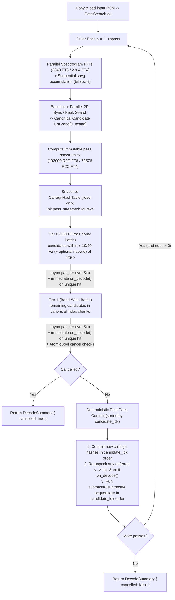
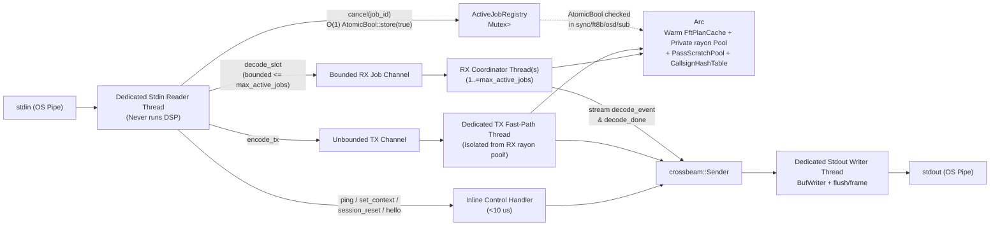

# Stage 5 Plan — `ftxr-modem` Binary (Standalone CLI + Warm IPC Worker), Parallelism & Telemetry

> **Workspace location:** `/home/antigravity/mpmbq2/wsjtx/rust-ftx/`  
> **Target crates:** `crates/ftxr-core` (GPLv3 library), `crates/ftxr-modem` (GPLv3 binary), `tools/ftxr-oracle` (dev-only benchmark/verification harness)  
> **New protocol spec doc:** `/home/antigravity/mpmbq2/wsjtx/rust-ftx/docs/ipc-protocol.md`  
> **License boundary:** `ftxr-core` & `ftxr-modem` are pure-Rust GPLv3 with exclusively GPLv3-compatible dependencies (MIT/Apache-2.0/BSD). Zero dependencies on `wsjtx`, Qt, Fortran, FFTW, or `digi-dx`.

---

## 1. Header & Scope

### 1.1 Objectives
Stage 5 transforms the verified single-threaded FT8/FT4 library from Stages 1–4 into a production-ready, low-latency, concurrent modem engine and standalone executable (`ftxr-modem`):

1. **Warm reusable `DecoderEngine` (`ftxr-core`):** Pre-plan all FT8 and FT4 `rustfft`/`realfft` transforms and precomputed DSP/FEC tables once at initialization, paired with reusable pooled scratch buffers so every slot incurs zero cold-start planning stall and near-zero steady-state heap allocation.
2. **Deterministic `rayon` parallelism & real-time control (`ftxr-core`):** Parallelize spectrogram computation, 2D sync search, and candidate decoding across each pass's immutable spectrum snapshot `cx`, with QSO-frequency priority batching, streaming decode emission, deterministic canonical-order signal subtraction and callsign hash-table commits, and cooperative mid-pass `AtomicBool` cancellation (`<50 ms`).
3. **Optional rich `DecodeTelemetry` (`ftxr-core`):** Expose per-decode FEC path (BP iterations vs. OSD order), AP tag/uncertainty, sync metrics, subtraction pass, Costas frequency drift (Hz/cycle & Hz/s), and symbol amplitude/QSB envelope with **zero runtime/allocation overhead when disabled**.
4. **Standalone `ftxr-modem` CLI (`ftxr-modem`):** Clean `decode`, `encode`, and `--version` subcommands supporting `.wav` and raw PCM (`f32le`/`i16le`), `jt9`-compatible text formatting (FT8 `'~'` and FT4 `'+'`), and structured JSON/JSONL output.
5. **Versioned Multiplexed Stdio IPC Worker (`ftxr-modem --worker`, Protocol v1):** Long-lived subprocess speaking an explicitly framed binary+JSON protocol over `stdin`/`stdout` (strict zero stray stdout logging; `stderr`-only diagnostics) with dedicated non-blocking `stdin` reader, isolated TX modulation fast-path (never blocked by an active Pass 3 RX decode), immediate O(1) `cancel(job_id)`, streaming `decode_event` emission, session/hash-table lifecycle management, and clean EOF/signal shutdown.
6. **End-to-End Benchmarks, Resilience & Soak Verification (`ftxr-oracle`):** Validate warm-IPC 3-pass cadence latency against cold and warm-wisdom `jt9`, verify zero sensitivity regression vs. Stages 3 & 4, and pass concurrency, cancellation, malformed-frame, and 1,000-slot continuous soak gates.

### 1.2 Prerequisites (Consumed from Stages 0–4)
- **Stage 0:** Workspace layout (`crates/ftxr-core`, `crates/ftxr-modem`, `tools/ftxr-oracle`), GPLv3 `LICENSE`/`NOTICE`, golden FT8/FT4 fixture corpus, deterministic AWGN sweep generator, and baseline `jt9` scorecards.
- **Stage 1:** Bit-exact 77-bit codec (`pack77`/`unpack77`), `CallsignHashTable`, CRC-14, LDPC(174,91) encoder, FT4 `rvec`, and FT8/FT4 GFSK modulators (`ft8.rs`, `ft4.rs`, `gfsk.rs`) supporting arbitrary sample rates, nominal start delays, and UTC-aligned late-TX offsets.
- **Stages 2–3:** Classic FT8 receive pipeline (`sync8`, `get_spectrum_baseline`/`baseline`, `ft8_downsample`, `sync8d`, `ft8b` with 1/2/3-sym LLRs, `decode174_91` BP + `osd174_91` OSD, AP `a1`–`a6`, `subtractft8`) meeting Stage 3 parity gates vs. `jt9 -8 -d 1/2/3`.
- **Stage 4:** Classic FT4 receive pipeline (`getcandidates4`, `ft4_baseline`, `ft4_downsample`, `sync4d`, `get_ft4_bitmetrics`, BP + OSD + AP `a1`–`a6`, `subtractft4`) meeting Stage 4 parity gates vs. `jt9 -5 -d 1/2/3`.

### 1.3 Deliverables
- Refactored, thread-safe, warm `DecoderEngine` + `FftPlanCache` + `ScratchPool` + `telemetry.rs` in `crates/ftxr-core`.
- Complete `crates/ftxr-modem` binary (`decode`, `encode`, `--worker`, `--version`).
- Authoritative IPC v1 wire protocol specification at `docs/ipc-protocol.md`.
- Stage 5 oracle benchmark, multiplexing, cancellation, malformed-frame, and 1,000-slot soak test suite in `tools/ftxr-oracle`.

### 1.4 Exit Gate Checklist
- [ ] Zero cold-start stall: first warm IPC `decode_slot` executes without FFT plan creation (plans built once before `ready`).
- [ ] Dev-host warm-IPC 3-pass latency decisively beats `jt9` subprocess on crowded FT8 bands: IPC transfer overhead **<2 ms**, Pass 1 (`-d 1`) **<150 ms**, Pass 2 (`-d 2`) **<250 ms**, Pass 3 (`-d 3`) **<500 ms**.
- [ ] Streaming emission verified: first `decode_event` arrives over IPC pipe strictly before `decode_done` on multi-signal slots, with QSO-frequency signals prioritized first.
- [ ] Multiplexed TX fast-path verified: `encode_tx` (48 kHz FT8/FT4, nominal & late-TX hot-swap) completes in **<20 ms** while a Pass 3 `-d 3` decode is actively saturating the RX worker pool.
- [ ] Cooperative mid-pass cancellation halts an active Pass 3 `-d 3` FT8/FT4 decode in **<50 ms** (target `<15 ms`).
- [ ] **Zero sensitivity regression** vs. Stage 3 (FT8) and Stage 4 (FT4) scorecards across all depths (`-d 1/2/3`) and thread counts (`1, 2, 4, N`), with **100% deterministic** decode sets across repeated parallel runs.
- [ ] Optional `DecodeTelemetry` verified accurate on synthetic drifting/fading/AP/BP/OSD signals and incurs **<1% overhead** (zero heap allocations) when disabled.
- [ ] Standalone CLI `decode` (`--format jt9|json|jsonl`) and `encode` (`.wav`/raw PCM) match `ftxr-core` identically and pass `digi-dx`'s `parse_jt9_line` rules.
- [ ] 1,000-slot continuous `--worker` soak test completes with flat RSS memory (`<5%` drift after warmup), zero leaked threads, clean malformed-frame rejection, and clean EOF shutdown (exit code `0`).

---

## 2. Source Audit & Technical Reference

Every constant, algorithm detail, concurrency invariant, and integration constraint below was verified directly against the upstream WSJT-X and read-only `digi-dx` source files.

### 2.1 Real-Time Concurrency & 3-Pass Cadence in `digi-dx` (Read-Only Reference)

| Reference File & Lines | Verified Behavior & Contract | Stage 5 Design Implication |
| :--- | :--- | :--- |
| `digi-dx/src/qso/mod.rs:45-53` | `MIN_LIVE_SLOT_SAMPLES_12K = 72_000` (6 s), `PASS_1_LEAD_MS = 3_200` (`t = 11.8 s`, `-d 1`), `PASS_2_LEAD_MS = 1_500` (`t = 13.5 s`, `-d 2`), `PASS_3_LEAD_MS = 200` (`t = 14.8 s`, `-d 3`), `LIVE_DECODE_GRACE_MS = 300` (`+300 ms` past slot boundary), `MAX_LATE_TX_START_MS = 6_000`, `FT8_TX_END_OFFSET_MS = 12_700`. | Worker must execute 3 rapid passes on progressively filled 12 kHz PCM buffers (zero-padded to 180,000 samples via `prepare_slot_pcm_12k`, lines 2596–2605) with zero cold-start penalty on Pass 1. |
| `digi-dx/src/qso/mod.rs:1707-1853` | Pass 1 (`timeout = 1500 ms`, `depth = 1`) and Pass 2 (`timeout = 1200 ms`, `depth = 2`) run sequentially; Pass 3 (`timeout = 3500 ms`, `depth = 3`) is `tokio::spawn`-ed into `active_pass3`. Main loop waits at most `LIVE_DECODE_GRACE_MS` (300 ms) past `next_slot_ms`, then **immediately** rolls capture and calls `reconcile_live_tx` while `active_pass3` may still be running! | **Critical multiplexing requirement:** `ftxr-modem --worker` MUST accept and execute `encode_tx` (both `Plan::Start` and `Plan::HotSwap`, lines 2217–2363) **concurrently without waiting for an in-flight Pass 3 RX decode**. |
| `digi-dx/src/qso/mod.rs:1900-1979` | `run_streaming_pass` creates `mpsc::UnboundedSender<Ft8Decode>`, passes `session.cancel: CancellationToken`, and ingests each streamed decode into `SlotDecodeReconciler` immediately, flushing UI roster batches every `150 ms` (`ROSTER_STREAM_FLUSH_INTERVAL`). | Decodes must stream immediately as `decode_event` frames during a pass (especially QSO-frequency decodes) rather than buffering until pass end. `CancellationToken` maps directly to IPC `cancel(job_id)`. |
| `digi-dx/src/qso/reconciler.rs:4, 22-99` | `RECONCILE_AF_TOLERANCE_HZ = 15`. Confidence ranking from `raw_metadata`: `None` -> rank `2` (verified CRC), `Some("a1".."a6")` -> rank `1` (confident AP), `Some("? a1"..)` -> rank `0` (uncertain AP). Never downgrades rank; upgrades on `snr_db`/`af_hz`/`|dt| >= 0.05`/`raw_metadata` changes. | `DecodedMessage` and IPC `decode_event` MUST emit exact WSJT-X `raw_metadata` strings (`None`, `"a1"`..`"a6"`, `"? a1"`..`"? a6"`) using WSJT-X's `qual < 0.17` uncertainty cutoff (`wsjtx/lib/decoder.f90:1744, 1824`). |
| `digi-dx/src/modem/mod.rs:22-38` | `Ft8Decode { slot_ts, snr_db: i8, dt_sec: f32, af_hz: u16, message: String, raw_metadata: Option<String>, decoder_backend: String }`; `TxIntent { af_hz: u16, slot: SlotParity, message: String }`. | IPC `decode_event` echoes `slot_ts` and carries all core fields (`snr_db`, `dt_sec`, `af_hz`, `message`, `raw_metadata`) plus exact floats (`snr_db_exact`, `af_hz`) and optional `telemetry`. |
| `digi-dx/src/modem/jt9.rs:57-70, 109-135, 273-302` | Cold `jt9` requires tempdir + 16-bit WAV write + subprocess spawn + FFTW wisdom lock (`run_lock`, `-w 0` vs `-w 1`). `parse_jt9_line` splits on `'~'`, parses `tokens[1..=3]` (`snr`, `dt`, `af`), calls `strip_decoder_metadata` (`digi-dx/src/domain/ft8.rs:98-116`), clamps `snr` to `[-50, 49]` and `af` to `[0, 5000]`. | Standalone CLI `--format jt9` must reproduce exact column formatting so `parse_jt9_line` parses every FT8 line cleanly (and FT4 uses `'+'` per `decoder.f90:1828`). |
| `digi-dx/src/modem/ft8_lib.rs:153-175` | `modulate_pcm_from_offset(msg, af_hz, 48000, offset_ms)` synthesizes active 12.64 s GFSK (`start_delay_ms = 0`), drops `round(offset_ms * sr / 1000)` samples, applies raised-cosine fade-in of `nsps / 8` samples, and returns empty `Vec` if `offset_ms` is past end. | `ModulateConfig` and IPC `encode_tx` must expose BOTH `start_delay_ms` (default `500` FT8 / `300` FT4 per `wsjtx/Modulator/Modulator.cpp:76-79`, settable to `0` for `digi-dx`) and `offset_ms` (UTC-aligned late-TX/hot-swap slicing). |

### 2.2 Complete Verified FFT Plan Inventory (WSJT-X Classic FT8 & FT4)

All FFT lengths, types, directions, and scaling factors verified from `wsjtx/lib/four2a.f90`, `lib/ft8/`, and `lib/ft4/`:

| Mode | Length `N` | Prime Factorization | Kind & Direction (`four2a` args) | WSJT-X Source Callsite(s) | Calls per Pass |
| :--- | ---: | :--- | :--- | :--- | :--- |
| **FT8** | `3_840` | $2^8 \cdot 3 \cdot 5$ | Real-to-Complex Fwd (`isign=-1, iform=0`) | `sync8.f90:38` (`NHSYM=372`), `get_spectrum_baseline.f90:33` (`NF=93`) | `465` |
| **FT8** | `192_000` | $2^9 \cdot 3 \cdot 5^3$ | Real-to-Complex Fwd (`isign=-1, iform=0`) | `ft8_downsample.f90:27` (pass spectrum `cx[0..=96000]`) | `1` |
| **FT8** | `3_200` | $2^7 \cdot 5^2$ | Complex-to-Complex Inv (`isign=+1, iform=1`) | `ft8_downsample.f90:46` (`NFFT2 = 192000/60`, scaled by $1/\sqrt{192000 \cdot 3200}$) | `2 × ncand` |
| **FT8** | `32` | $2^5$ | Complex-to-Complex Fwd (`isign=-1, iform=1`) | `ft8b.f90:159` (`NN=79` symbol spectra) | `79 × ncand` |
| **FT8** | `180_000` | $2^5 \cdot 3^2 \cdot 5^4$ | Complex-to-Complex Fwd (`isign=-1, iform=1`) | `subtractft8.f90:36` (init `cw`), `subtractft8.f90:78` (`cfilt`) | `1 × ndec_pass` (4× if `lrefinedt`) |
| **FT8** | `180_000` | $2^5 \cdot 3^2 \cdot 5^4$ | Complex-to-Complex Inv (`isign=+1, iform=1`) | `subtractft8.f90:80` (`cfilt`) | `1 × ndec_pass` (4× if `lrefinedt`) |
| **FT8** | `180_000` | $2^5 \cdot 3^2 \cdot 5^4$ | Real-to-Complex Fwd (`isign=-1, iform=0`) | `subtractft8.f90:94` (only when `lrefinedt = true`) | `0` (`3 × ndec` if `lrefinedt`) |
| **FT4** | `2_304` | $2^8 \cdot 3^2$ | Real-to-Complex Fwd (`isign=-1, iform=0`) | `getcandidates4.f90:34` (`NHSYM=122`) | `122` |
| **FT4** | `72_576` | $2^8 \cdot 3^4 \cdot 7$ | Real-to-Complex Fwd (`isign=-1, iform=0`) | `ft4_downsample.f90:34` (pass spectrum `cx[0..=36288]`) | `1` |
| **FT4** | `4_032` | $2^6 \cdot 3^2 \cdot 7$ | Complex-to-Complex Inv (`isign=+1, iform=1`) | `ft4_downsample.f90:44` (`NFFT2 = 72576/18`, scaled by $1/4032$) | `(1 + nseg_pass) × ncand` |
| **FT4** | `32` | $2^5$ | Complex-to-Complex Fwd (`isign=-1, iform=1`) | `get_ft4_bitmetrics.f90:39` (`NN=103` symbol spectra) — **shared with FT8** | `103 × ncand` |
| **FT4** | `72_576` | $2^8 \cdot 3^4 \cdot 7$ | Complex-to-Complex Fwd (`isign=-1, iform=1`) | `subtractft4.f90:47` (init `cw`), `subtractft4.f90:54` (`cfilt`) | `1 × ndec_pass` |
| **FT4** | `72_576` | $2^8 \cdot 3^4 \cdot 7$ | Complex-to-Complex Inv (`isign=+1, iform=1`) | `subtractft4.f90:56` (`cfilt`) | `1 × ndec_pass` |

> **All 12 distinct transform plans** (11 unique after sharing `C2C-32-Fwd`) are smooth small-radix sizes (`2, 3, 5, 7`), all supported natively by `rustfft` mixed-radix/butterfly kernels (no Bluestein fallback!). Every `rustfft::Fft<f32>` and `realfft::RealToComplex<f32>` plan is `Send + Sync` and takes caller-provided scratch slices, allowing lock-free sharing across all `rayon` threads.

### 2.3 Immutable Per-Pass `cx` Spectrum vs. Sequential `dd` Subtraction & Hash-Table Audit

Direct audit of WSJT-X Fortran proves **why candidate decoding within a pass is naturally data-parallel**:

1. **FT8 (`ft8_decode.f90:180-244`, `ft8b.f90:106,141,462`, `ft8_downsample.f90:23-29`):**
   - Outer pass `ipass` sets `newdat = .true.`.
   - Candidate 1 calls `ft8_downsample(dd0, newdat, f1, cd0)`, which computes the 192,000-point R2C FFT into saved `cx(0:96000)` and sets `newdat = .false.` by reference.
   - Although `ft8b` calls `subtractft8(dd0, itone, f1, xdt, .false.)` immediately upon decoding a candidate, `newdat` stays `.false.` for candidates `2..ncand`. Thus **every candidate in pass `ipass` reads the exact same immutable spectrum `cx`**, and `dd0` modifications only take effect when `ipass + 1` runs `sync8(dd)` and re-sets `newdat = .true.`.
2. **FT4 (`ft4_decode.f90:223-230, 284, 438`, `ft4_downsample.f90:32-35`):**
   - Outer pass `isp` sets `dobigfft = .true.`, computes the 72,576-point R2C FFT into `cx(0:36288)` on candidate 1, and flips `dobigfft = .false.`.
   - Again, **all candidates in pass `isp` read the exact same immutable `cx`**, while `subtractft4(dd, ...)` only affects `getcandidates4(dd)` and `cx` in pass `isp + 1`.
3. **Sequential dependencies that MUST be preserved deterministically:**
   - **Subtraction order:** Because `subtractft8`/`subtractft4` computes `camp(t) = dd(t) * conj(cref(t))` against the current `dd`, subtracting overlapping signals decoded in the same pass in arbitrary thread-completion order would cause floating-point residual nondeterminism in pass `p + 1`. Collecting pass-`p` decodes and executing `subtractft8`/`subtractft4` sequentially in canonical `candidate_idx` order makes `dd` entering pass `p + 1` **100% deterministic across runs and thread counts**.
   - **Fortran quirk fixed cleanly:** In `ft8b.f90:460-486`, `subtractft8` runs *before* the false-decode guard (`nsync <= 10 && xsnr < -25.0`) and *before* `ft8_decode.f90:219`'s `ldupe` check; similarly `ft4_decode.f90:434-445` subtracts before `idupe`. Deferring subtraction to the canonical post-pass commit step ensures rejected false decodes are never subtracted and duplicate detections within the same pass are never double-subtracted.
   - **Global `packjt77` hash-table mutations (`lib/77bit/packjt77.f90:7-16, 150-184, 335-353, 559, 643, 782-818`):** Classic Fortran mutates global `calls10(0:1023)`, `calls12(0:4095)`, `calls22(1:1000)`, `ihash22(1:1000)`, `nzhash`, `recent_calls`, `mycall13`, and `dxcall13` inside `unpack77` and `pack77`. In `ftxr-core`, there are zero globals: `QsoContext` is immutable per decode, and `CallsignHashTable` is session-scoped inside `DecoderEngine`, snapshotted read-only for each parallel pass, and updated in canonical `candidate_idx` order at pass commit (with deterministic re-unpack of any `<...>` payloads using retained `[u8; 77]` bits).
   - **Global `COMMON /boxes/` in `osd174_91.f90:336-408`:** `boxit91`/`fetchit91` store `indexes(5000,2)`, `fp(0:525000)`, `np(5000)`, `lastpat`, and `inext` in global `COMMON`/`SAVE` storage (~2.1 MB). Moreover, in standard FT8 (`norder = 2`, `ft8b.f90:427`) and FT4 (`ndeep = 2`, `ft4_decode.f90:414`), `npre2 == 0` (`osd174_91.f90:142-148`), so `boxit91`/`fetchit91` are never even called unless `ndeep >= 3`! Placing `OsdScratch` per worker thread with `box_scratch: Option<Box<OsdBoxScratch>>` (lazily allocated only if `ndeep >= 3`) eliminates both the data race and 2.1 MB/thread of unused memory.

### 2.4 WSJT-X `jt9` Output & Depth Semantics Verified

- **FT8 stdout format (`lib/decoder.f90:1741-1755`):**
  `format(i6.6,i4,f5.1,i5,' ~ ',1x,a37,1x,a2)` — e.g. `110115 -22  0.3 1993 ~  CQ PY7XC HI21                       ? a1` (when `nap != 0 && qual < 0.17`, char 37 of the 37-char field is `'?'`).
- **FT4 stdout format (`lib/decoder.f90:1821-1828`):**
  `format(i6.6,i4,f5.1,i5,' + ',1x,a37,1x,a2)` — identical except `' + '` mode marker.
- **Finish sentinel (`lib/decoder.f90:1403-1404`):**
  `<DecodeFinished>{nsynced:4}{ndecoded:4}{navg0:9}` (omitted with `-q`/`--quiet`).
- **Depth matrix:**
  - FT8 (`ft8_decode.f90:176-197`, `ft8b.f90:178-181, 281, 427-434`): `-d 1` = 2 passes, `syncmin=2.1`, `nsync>8`, BP only (`maxosd=-1`); `-d 2` = 3 passes, `syncmin=2.1`, `nsync>8`, BP+OSD (`maxosd=2, norder=2`); `-d 3` = 3 passes, `syncmin=1.3`, `nsync>6` (pass 1) / `>7` (pass 2–3), BP+OSD (`maxosd=2, norder=2`). Early passes (`early_pass=true` / `nzhsym < 50`) cap `npasses = 5` (AP disabled).
  - FT4 (`ft4_decode.f90:194-206, 324-327, 414-420`): `-d 1` = 1 pass, no subtraction, BP only, no AP; `-d 2` = 3 passes, subtraction, BP only, AP enabled; `-d 3` = 3 passes, subtraction, BP+OSD (`maxosd=2`, or `maxosd=3` within `±50 Hz` of `nfqso`, `ndeep=2`), AP enabled.

---

## 3. Architecture & Concrete Rust Design

### 3.1 File & Module Map

```text
rust-ftx/
├── Cargo.toml                             # Workspace deps (all MIT/Apache-2.0/BSD)
├── docs/
│   └── ipc-protocol.md                    # Complete v1 multiplexed stdio IPC spec (new)
├── crates/
│   ├── ftxr-core/
│   │   ├── Cargo.toml                     # + rayon (MIT/Apache-2.0)
│   │   └── src/
│   │       ├── lib.rs                     # Public API: DecoderEngine, DecodeConfig, DecodeTelemetry, ...
│   │       ├── telemetry.rs               # DecodeTelemetry, FecMethod, SymbolEnvelope, Costas drift & QSB
│   │       ├── dsp/
│   │       │   ├── mod.rs
│   │       │   └── fft.rs                 # Warm FftPlanCache + PrecomputedTables + ScratchPool
│   │       ├── protocol/
│   │       │   └── hashtable.rs           # Session-scoped thread-safe CallsignHashTable + PassHashSnapshot
│   │       ├── fec/
│   │       │   ├── bp.rs                  # Scratch-backed BP returning iterations
│   │       │   ├── osd.rs                 # Thread-safe OsdScratch (lazy box table) + cancel + winning order
│   │       │   └── decode174_91.rs        # Cancel-aware hybrid BP+OSD returning FecMethod metadata
│   │       ├── ft8/
│   │       │   ├── sync8.rs               # Parallel spectrogram & 2D sync + cancel checks
│   │       │   ├── ft8b.rs                # Immutable-cx candidate decoder + optional telemetry + cancel
│   │       │   ├── subtract.rs            # Scratch-backed subtractft8 using precomputed cw_ft8
│   │       │   └── decoder.rs             # Two-tier QSO-first rayon pass driver + deterministic commit
│   │       └── ft4/
│   │           ├── candidates.rs          # Parallel spectrogram + sequential savg sum + cancel checks
│   │           ├── bitmetrics.rs          # Scratch-backed bitmetrics + tone amplitudes for telemetry
│   │           ├── subtract.rs            # Scratch-backed subtractft4 using precomputed cw_ft4
│   │           └── decoder.rs             # Two-tier QSO-first rayon pass driver + deterministic commit
│   └── ftxr-modem/
│       ├── Cargo.toml                     # ftxr-core, clap, serde, serde_json, crossbeam-channel, tracing*
│       └── src/
│           ├── main.rs                    # Entrypoint: stderr-only tracing, CLI vs --worker dispatch
│           ├── cli.rs                     # clap CLI: decode, encode, --worker, --version
│           ├── format.rs                  # jt9-compatible text + JSON + JSONL emitters
│           ├── wav.rs                     # 16-bit PCM & 32-bit float WAV + raw PCM I/O
│           └── ipc/
│               ├── mod.rs
│               ├── framing.rs             # 16-byte FTXR header + JSON + raw binary payload codec
│               ├── protocol.rs            # v1 Inbound/Outbound DTOs & ErrorCode enum
│               └── worker.rs              # Stdin reader + isolated TX thread + RX pool + stdout writer
└── tools/
    └── ftxr-oracle/
        └── src/
            ├── ipc_client.rs              # Reference sync/async IPC v1 test harness client
            ├── bench_3pass.rs             # 3-pass cadence benchmark: warm IPC vs cold/warm jt9
            └── soak.rs                    # Multiplexing, cancel, malformed-frame & 1,000-slot soak runner
```

### 3.2 Dependencies & License Compliance

| Crate | Target | License | Purpose |
| :--- | :--- | :--- | :--- |
| `rustfft` (`6.x`) | `ftxr-core` | MIT / Apache-2.0 | Pre-planned C2C FFTs (`32`, `3200`, `4032`, `72576`, `180000`) |
| `realfft` (`3.x`) | `ftxr-core` | MIT / Apache-2.0 | Pre-planned R2C FFTs (`2304`, `3840`, `72576`, `180000`, `192000`) |
| `num-complex` (`0.4`) | `ftxr-core` | MIT / Apache-2.0 | `Complex<f32>` DSP buffers |
| `rayon` (`1.10`) | `ftxr-core` | MIT / Apache-2.0 | Private per-engine work-stealing thread pool (`rayon::ThreadPool`) |
| `serde` (`1.x`, derive) | `ftxr-core`, `ftxr-modem` | MIT / Apache-2.0 | Telemetry, CLI JSON, and IPC header serialization |
| `thiserror` (`2.x`) | `ftxr-core`, `ftxr-modem` | MIT / Apache-2.0 | Typed `FtxrError` |
| `clap` (`4.x`, derive) | `ftxr-modem` | MIT / Apache-2.0 | CLI parsing (`decode`, `encode`, `--worker`, `--version`) |
| `serde_json` (`1.x`) | `ftxr-modem` | MIT / Apache-2.0 | JSON/JSONL CLI output and IPC control headers |
| `crossbeam-channel` (`0.5`) | `ftxr-modem` | MIT / Apache-2.0 | Lock-free outbound stdout frame queue & dedicated TX fast-path channel |
| `tracing`, `tracing-subscriber` (`0.1`/`0.3`) | `ftxr-modem` | MIT | Structured diagnostics pinned strictly to `stderr` |

Zero GPL-incompatible dependencies; zero C/Fortran/FFTW dependencies.

### 3.3 Core Engine Architecture (`crates/ftxr-core`)

#### 3.3.1 Warm `FftPlanCache`, `PrecomputedTables`, and `ScratchPool` (`src/dsp/fft.rs`)

```rust
use std::sync::{Arc, Mutex};
use num_complex::Complex;
use realfft::{RealFftPlanner, RealToComplex};
use rustfft::{Fft, FftPlanner};

/// All FT8 + FT4 FFT plans constructed once at DecoderEngine startup.
/// Every plan is immutable, Send + Sync, and executes with caller-owned scratch.
pub struct FftPlanCache {
    // FT8 plans
    pub r2c_3840: Arc<dyn RealToComplex<f32>>,    // sync8 + get_spectrum_baseline
    pub r2c_192000: Arc<dyn RealToComplex<f32>>,  // ft8_downsample pass spectrum cx
    pub c2c_inv_3200: Arc<dyn Fft<f32>>,          // ft8_downsample baseband IFFT
    pub c2c_fwd_180000: Arc<dyn Fft<f32>>,        // subtractft8 LPF forward
    pub c2c_inv_180000: Arc<dyn Fft<f32>>,        // subtractft8 LPF inverse
    pub r2c_180000: Arc<dyn RealToComplex<f32>>,  // subtractft8 lrefinedt residual energy

    // FT4 plans
    pub r2c_2304: Arc<dyn RealToComplex<f32>>,    // getcandidates4 spectrogram
    pub r2c_72576: Arc<dyn RealToComplex<f32>>,   // ft4_downsample pass spectrum cx
    pub c2c_inv_4032: Arc<dyn Fft<f32>>,          // ft4_downsample baseband IFFT
    pub c2c_fwd_72576: Arc<dyn Fft<f32>>,         // subtractft4 LPF forward
    pub c2c_inv_72576: Arc<dyn Fft<f32>>,         // subtractft4 LPF inverse

    // Shared FT8 + FT4
    pub c2c_fwd_32: Arc<dyn Fft<f32>>,            // 79-sym FT8 & 103-sym FT4 symbol FFTs
}

/// Read-only windows, Costas templates, subtraction filters, and OSD generator matrix.
pub struct PrecomputedTables {
    // FT8
    pub ft8_taper: [f32; 101],                    // ft8_downsample raised-cosine taper
    pub ft8_baseline_win: Vec<f32>,               // 3840 scaled Nuttall window
    pub ft8_csync: [[Complex<f32>; 32]; 7],       // sync8d Costas waveforms
    pub ft8_ctwk_grid: [[Complex<f32>; 32]; 11],  // ifr = -5..=5 (0.5 Hz steps)
    pub ft8_sub_cw: Vec<Complex<f32>>,            // 180_000 pre-FFT'd LPF transfer fn
    pub ft8_sub_endcorr: Vec<f32>,                // 2001 edge correction weights
    pub ft8_gfsk_pulse_12k: Vec<f32>,             // 3 * 1920 = 5760 GFSK pulse (BT=2.0)
    pub ft8_one_512: [[bool; 9]; 512],            // 3-symbol bit-metric mask

    // FT4
    pub ft4_cand_win: Vec<f32>,                   // 2304 Nuttall window
    pub ft4_down_win: Vec<f32>,                   // 4032 frequency-domain brickwall+taper
    pub ft4_csync: [[Complex<f32>; 64]; 4],       // sync4d 4x4 Costas waveforms (a..d)
    pub ft4_ctwk2: [[Complex<f32>; 64]; 33],      // idf = -16..=16 (1 Hz steps)
    pub ft4_sub_cw: Vec<Complex<f32>>,            // 72_576 pre-FFT'd LPF transfer fn
    pub ft4_gfsk_pulse_12k: Vec<f32>,             // 3 * 576 = 1728 GFSK pulse (BT=1.0)
    pub ft4_one_256: [[bool; 8]; 256],            // 4-symbol bit-metric mask

    // Shared FEC
    pub osd_gen_91x174: [[u8; 174]; 91],          // Systematic generator matrix (immutable!)
}
```

**Pooled Scratch Strategy (Zero Steady-State Heap Allocations, Clean Drop):**
- **`CandidateScratchPool`** (`Mutex<Vec<Box<CandidateScratch>>>`, pre-sized to `pool_threads`):
  - Checked out per `rayon` worker via `map_init(|| engine.checkout_candidate_scratch(), ...)` with RAII drop-guard returning the scratch to the pool when the worker finishes!
  - Holds FT8/FT4 per-candidate baseband arrays (`cd0[3200]`, `cd2[4032]`, `cb[4032]`, `cd[3296]`), `fft3200`/`fft4032`/`fft32` scratch, `cs`/`s8`/`s4`/`s2`, LLR buffers, BP arrays (`tov`, `toc`, `tanhtoc`, `zsave`), and `OsdScratch` (`genmrb[91][174]`, `g2[174][91]`, lazy `box_scratch: Option<Box<OsdBoxScratch>>`).
  - Footprint: **~135 KiB per worker thread** (vs. >2.2 MiB if `fp[525001]` were eagerly allocated).
- **`PassScratchPool`** (`Mutex<Vec<Box<PassScratch>>>`, pre-warmed with 1 instance, max retained 2):
  - Checked out once per `decode_slot` call via RAII guard.
  - Holds pass-level buffers: `dd: Vec<f32>` (180,000), `cx: Vec<Complex<f32>>` (96,001), `r2c_big_scratch`, `s_spec` (`1920 * 372` f32), `savg`/`sbase`, `sub_cref` (`151,680` Complex), `sub_cfilt` (`180,000` Complex), `sub_fft_scratch`.
  - Footprint: **~10.5 MiB** once per concurrent RX slot, reused verbatim across 1,000+ slots without re-allocating!

#### 3.3.2 `DecoderEngine` Public API (`crates/ftxr-core/src/lib.rs`)

```rust
#[derive(Debug, Clone, Copy, PartialEq, Eq, Hash, Serialize, Deserialize)]
#[serde(rename_all = "lowercase")]
pub enum Mode {
    Ft8,
    Ft4,
}

#[derive(Debug, Clone, Default, PartialEq, Eq, Serialize, Deserialize)]
pub struct QsoContext {
    pub my_call: Option<String>,
    pub dx_call: Option<String>,
    pub my_grid: Option<String>,
    pub dx_grid: Option<String>,
    /// WSJT-X nQSOProgress: 0=CALLING(CQ), 1=REPLYING, 2=REPORT, 3=ROGER_REPORT, 4=ROGERS, 5=SIGNOFF
    pub qso_progress: u8,
    /// WSJT-X ncontest: 0=NONE, 1=NA_VHF, 2=EU_VHF, 3=FD, 4=RTTY, 5=WW_DIGI, 6=FOX, 7=HOUND, 8=ARRL_DIGI
    pub contest_mode: u8,
}

#[derive(Debug, Clone, Copy, PartialEq, Eq, Serialize, Deserialize)]
pub enum ApTag {
    A1, A2, A3, A4, A5, A6,
}

impl ApTag {
    pub fn from_wsjtx_iaptype(iaptype: u8) -> Option<Self>;
    pub fn as_str(self) -> &'static str; // "a1" .. "a6"
    /// Formats WSJT-X / digi-dx raw_metadata ("a1" or "? a1").
    pub fn format_metadata(self, uncertain: bool) -> String;
}

#[derive(Debug, Clone, PartialEq, Serialize, Deserialize)]
pub struct DecodeConfig {
    pub mode: Mode,
    pub depth: u8,                     // 1..=3
    pub f_min_hz: f32,                 // default 200.0
    pub f_max_hz: f32,                 // default 3000.0 (CLI default 4000.0 matching jt9)
    pub qso_freq_hz: f32,              // nfqso, default 1500.0
    pub tx_freq_hz: f32,               // nftx, default 1500.0
    pub enable_ap: bool,               // default true
    pub ap_cq_only: bool,              // default false
    pub ap_width_hz: Option<f32>,      // None => 75.0 (FT8) / 50.0 (FT4)
    pub early_pass: bool,              // true mirrors nzhsym < 50 (suppresses AP in FT8)
    pub qso_first: bool,               // prioritize candidates near qso_freq_hz first
    pub enable_telemetry: bool,        // default false (zero overhead when false)
    pub qso_context: QsoContext,
}

#[derive(Debug, Clone, PartialEq, Serialize, Deserialize)]
pub struct DecodedMessage {
    pub mode: Mode,
    pub snr_db: i8,                    // Rounded & clamped (-25/-21..=49) matching jt9
    pub snr_db_exact: f32,             // Unrounded SNR estimate
    pub dt_sec: f32,                   // Time offset relative to nominal 0.5 s
    pub af_hz: f32,                    // Refined audio frequency (Hz)
    pub af_hz_rounded: u16,            // nint(af_hz) clamped 0..=5000
    pub message: String,               // Normalized unpacked text (no trailing AP/? suffix)
    pub ap_tag: Option<ApTag>,
    pub uncertain: bool,               // true when ap_tag.is_some() && quality < 0.17
    pub raw_metadata: Option<String>,  // Pre-formatted for digi-dx: None | "a1".."a6" | "? a1".."? a6"
    pub sync_score: f32,
    pub quality: f32,                  // 1.0 - (hard_errors + soft_distance) / 60.0
    pub telemetry: Option<DecodeTelemetry>,
}

#[derive(Debug, Clone, PartialEq, Serialize, Deserialize)]
pub struct DecodeSummary {
    pub decodes: Vec<DecodedMessage>,
    pub cancelled: bool,
    pub passes_run: u8,
    pub candidates_evaluated: u32,
    pub elapsed_ms: f32,
    pub first_decode_ms: Option<f32>,
}

#[derive(Debug, Clone, PartialEq, Serialize, Deserialize)]
pub struct ModulateConfig {
    pub mode: Mode,
    pub af_hz: f32,                    // 100.0..=4900.0 (validated for mode bandwidth)
    pub sample_rate: u32,              // >= 8000 (12_000 or 48_000 typical)
    pub start_delay_ms: u32,           // default 500 (FT8) / 300 (FT4); 0 for active-only TX
    pub offset_ms: u64,                // UTC-aligned late-TX / hot-swap skip offset
    pub pad_to_slot: bool,             // pad to 15.0 s (FT8) / 7.5 s (FT4)
    pub amplitude: f32,                // (0.0..=1.0], default 1.0
}

pub struct EngineConfig {
    /// Worker threads for the private RX rayon pool. None => auto heuristic.
    pub threads: Option<usize>,
}

pub struct DecoderEngine {
    plans: Arc<FftPlanCache>,
    tables: Arc<PrecomputedTables>,
    rx_pool: rayon::ThreadPool,
    pass_scratch_pool: Arc<PassScratchPool>,
    cand_scratch_pool: Arc<CandidateScratchPool>,
    hash_table: Arc<RwLock<CallsignHashTable>>,
    num_threads: usize,
}

impl DecoderEngine {
    pub fn new(config: EngineConfig) -> Result<Self, FtxrError>;
    pub fn num_threads(&self) -> usize;

    /// Decode a 12 kHz PCM slot, streaming each unique decode via `on_decode` as it finishes,
    /// while honoring cooperative `cancel`. Safe to call concurrently from multiple threads.
    pub fn decode_slot_streaming<F>(
        &self,
        samples_12k: &[f32],
        cfg: &DecodeConfig,
        cancel: &AtomicBool,
        on_decode: F,
    ) -> Result<DecodeSummary, FtxrError>
    where
        F: Fn(&DecodedMessage) + Send + Sync;

    /// Convenience non-streaming wrapper (no cancel).
    pub fn decode_slot(
        &self,
        samples_12k: &[f32],
        cfg: &DecodeConfig,
    ) -> Result<DecodeSummary, FtxrError>;

    /// Synthesize FT8/FT4 GFSK waveform. Pure & non-blocking w.r.t. active RX decodes.
    pub fn modulate(
        &self,
        message: &str,
        cfg: &ModulateConfig,
    ) -> Result<ModulatedWaveform, FtxrError>;

    /// Clear session callsign hash table (e.g., on band change or session reset).
    pub fn reset_session(&self) -> usize;
    pub fn hash_table_len(&self) -> usize;
}
```

**Thread-count auto heuristic (`EngineConfig::threads = None`):**
- Let `avail = std::thread::available_parallelism().map(usize::from).unwrap_or(1)`.
- If `avail <= 2` -> `avail`; if `avail <= 4` -> `avail - 1`; if `avail > 4` -> `(avail - 1).min(8)`.
- Leaving 1 logical core free on `>=3`-core hosts guarantees that OS audio capture/playback, `digi-dx`'s Tokio runtime, the IPC `stdin`/`stdout` threads, and the dedicated `encode_tx` fast-path thread never experience scheduler starvation during a Pass 3 burst.

#### 3.3.3 Deterministic `rayon` Parallelism & Two-Tier Priority Pipeline

Inside `ft8::decoder::decode_ft8_streaming` and `ft4::decoder::decode_ft4_streaming`:



**Key determinism & latency guarantees:**
1. **Bit-exact spectrogram & sync parallelization:** Per-step FFTs (`j = 0..NHSYM`) write disjoint rows `s[j][..]` in parallel; `savg` is summed sequentially over `j = 0..NHSYM` (`<0.1 ms`), preserving IEEE-754 addition order identically across `threads = 1..N`. In FT8 `sync8`, each frequency bin `i = ia..ib` writes only its own `(jpeak[i], red[i], jpeak2[i], red2[i])`, so `par_iter` over `i` is 100% bit-exact.
2. **Immutable pass spectrum `cx` + read-only `PassHashSnapshot`:** During Tier 0 and Tier 1, worker threads share `&[Complex<f32>]` `cx`, `&[f32]` `sbase`, `&FftPlanCache`, `&PrecomputedTables`, and `&PassHashSnapshot` with **zero write contention**.
3. **Immediate streaming without duplicates:** A lightweight `Mutex<HashSet<String>>` (`streamed_messages`, pre-seeded with messages from earlier passes) deduplicates hits in ~200 ns before invoking `on_decode(&decoded)`. Any message containing `"<...>"` is held until the post-pass hash commit (~tens of ms later) so a callsign decoded elsewhere in the same pass can resolve it cleanly before emission!
4. **Canonical deterministic commit:** All raw candidate hits `(candidate_idx, CandidateHit { bits77, tones, f1, xdt, decoded, ... })` are sorted ascending by `candidate_idx`:
   - `CallsignHashTable` writes execute strictly in `candidate_idx` order (acquiring the write lock once for the batch, `<10 µs`).
   - Any held `<...>` hits are re-unpacked from `bits77` against the updated table, deduplicated, and streamed via `on_decode`.
   - Unique non-duplicate decodes execute `subtractft8` / `subtractft4` sequentially onto `dd` in `candidate_idx` order.
   - **Result:** The residual `dd` entering pass `p + 1`, the final decode set, and the session hash-table state are **100% identical** between `--threads 1` and `--threads 8`!
5. **Cooperative cancellation checkpoints (`<50 ms`, target `<15 ms`):**
   `cancel.load(Ordering::Relaxed)` is checked:
   - Every 16 frames in spectrogram/baseline FFT loops.
   - Every 32 frequency bins in `sync8` 2D search.
   - Before every candidate in Tier 0 and Tier 1 `rayon` loops.
   - At the top of every LLR/AP inner pass (`ft8b` `ipass = 1..npasses`, `ft4` `iseg = 1..3` and `ipass = 1..npasses`).
   - Before each OSD invocation in `decode174_91` (`i = 1..nosd`).
   - Every 16 outer pattern iterations inside `osd174_91` (`while iflag >= 0`).
   - Before each `subtractft8`/`subtractft4` call in the post-pass commit loop.

#### 3.3.4 Thread-Safe Session-Scoped `CallsignHashTable` (`src/protocol/hashtable.rs`)

- Mirrors `lib/77bit/packjt77.f90:7-16, 150-184` exactly:
  - `calls10: [Option<ArrayString13>; 1024]` (10-bit hash table)
  - `calls12: [Option<ArrayString13>; 4096]` (12-bit hash table)
  - `calls22: VecDeque<(u32, ArrayString13)>` (max `MAXHASH = 1000`, most-recent-first, update-in-place on matching `n22`)
  - Uses inline stack-allocated `[u8; 13]` + `u8` len (`CompactCall`) instead of `String` so snapshotting the entire table for a pass is a single flat `memcpy` (~80 KiB, **<15 µs**) with zero per-entry heap allocations!
- **`my_call` / `dx_call` isolation:** Never mutated inside the hash table! Passed explicitly via `&QsoContext` into `unpack77(bits77, nrx, ctx, &hash_snapshot)` implementing the exact override rules of `packjt77.f90:163, 166, 335-353, 394-400, 538-541, 644-658, 683`.
- **TX modulation lock-freedom:** `DecoderEngine::modulate` packs using a temporary local call list (zero blocking on RX) and optionally inserts any nonstandard TX callsign via a non-blocking `<5 µs` write lock after packing.

#### 3.3.5 Optional Rich `DecodeTelemetry` (`src/telemetry.rs`)

```rust
#[derive(Debug, Clone, Copy, PartialEq, Eq, Serialize, Deserialize)]
#[serde(tag = "method", rename_all = "snake_case")]
pub enum FecMethod {
    Bp { iterations: u8 },
    Osd { order: u8, bp_pass: u8 },
}

#[derive(Debug, Clone, PartialEq, Serialize, Deserialize)]
pub struct SymbolEnvelope {
    /// Mean linear tone magnitude across active decoded symbols.
    pub mean_amp: f32,
    /// Peak-to-mean ratio in dB (20 * log10(max / mean)).
    pub peak_to_mean_db: f32,
    /// QSB fading depth in dB (P90 - P10 of active non-zero bucket dB levels).
    pub qsb_depth_db: f32,
    /// Standard deviation of active bucket levels in dB.
    pub qsb_std_db: f32,
    /// 8-bucket normalized amplitude envelope in dB relative to peak (0.0 dB = peak).
    /// Covers active symbols (79 FT8 => ~1.58 s/bucket; 103 FT4 => ~0.62 s/bucket).
    pub buckets_db: [f32; 8],
    /// Number of buckets containing active signal energy (useful on partial/late slots).
    pub active_buckets: u8,
}

#[derive(Debug, Clone, PartialEq, Serialize, Deserialize)]
pub struct DecodeTelemetry {
    pub fec: FecMethod,
    pub hard_errors: u8,
    pub soft_distance: f32,
    /// Inner metric/AP pass index (FT8: 1..=13, FT4: 1..=7).
    pub metric_pass: u8,
    /// Outer subtraction pass index (1..=3).
    pub subtraction_pass: u8,
    pub ap_type: Option<u8>,              // 1..=6 when AP-assisted, None otherwise
    pub sync_score: f32,                  // Coarse sync metric (FT8) or sync4d smax (FT4)
    pub fine_sync_power: f32,             // FT8 sync8d peak power / FT4 sync4d peak
    pub hard_sync_hits: u8,               // Correct hard Costas symbols (0..=21 FT8, 0..=16 FT4)
    pub hard_sync_max: u8,                // 21 (FT8) or 16 (FT4)
    /// Costas-estimated linear frequency drift across the active transmission.
    pub freq_drift_hz_per_sec: Option<f32>,
    pub freq_drift_hz_per_slot: Option<f32>, // drift_hz_per_sec * 12.64 (FT8) or * 4.944 (FT4)
    pub qsb_envelope: SymbolEnvelope,
}
```

**Zero-overhead implementation rules:**
1. `FecMethod`, `hard_errors`, `soft_distance`, `metric_pass`, `hard_sync_hits`, and `subtraction_pass` are scalar register values already produced by `decode174_91` and `ft8b`/`ft4` (zero extra work!).
2. **Costas frequency drift & QSB envelope execute ONLY inside `if cfg.enable_telemetry`** and ONLY *after* a candidate passes CRC and `unpack77` (never on non-decoding candidates, and 0 cycles / 0 allocations when `enable_telemetry == false`):
   - **FT8 Costas drift:** On the already-downsampled `cd0` (`fs2 = 200 Hz`, 32 samp/sym) at `ibest`, evaluate per-block Costas correlation power for block 1 (sym `0..7`, $t_1 = 0.56\text{ s}$), block 2 (sym `36..43`, $t_2 = 6.32\text{ s}$), and block 3 (sym `72..79`, $t_3 = 12.08\text{ s}$) over `df ∈ [-4.0, +4.0]` Hz (`0.5 Hz` step, 17 grid points) using precomputed phase rotators + 3-point parabolic `peakup` interpolation to obtain `(df_m, power_m)` for each in-bounds Costas block. Compute power-weighted linear regression slope $\hat{m}$ (Hz/s) whenever $\ge 2$ blocks are in-bounds with sufficient SNR (handles late-TX where block 1 is absent or early Pass 1 where block 3 is truncated!); report `freq_drift_hz_per_slot = slope * 12.64`. Cost: `<35 µs` per decoded signal.
   - **FT4 Costas drift:** Identical per-block correlation on `cd` (`fs = 666.67 Hz`) across the 4 Costas blocks (sym `0..4`, `33..37`, `66..70`, `99..103`; times `0.096, 1.680, 3.264, 4.848 s`) reusing `PrecomputedTables::ft4_csync` and `ft4_ctwk2[-8..=8]`, parabolic `peakup`, and power-weighted linear regression; `freq_drift_hz_per_slot = slope * 4.944`. Cost: `<25 µs` per decoded signal.
   - **QSB envelope:** Reads decoded-tone magnitudes directly from already-computed `s8[itone[k]][k]` (FT8, 79 symbols) or `s4[i4tone[k]][k]` (FT4, 103 symbols) — zero extra FFTs! Groups into 8 contiguous buckets, computes RMS magnitude per bucket, marks active buckets (`rms > 0.05 * peak_rms`), converts to dB relative to peak (`20 * log10(rms / peak_rms)` clamped to `-40.0 dB`), and computes `qsb_depth_db` (P90 − P10 across active buckets) and `qsb_std_db`. Cost: `<2 µs` per decoded signal.

---

### 3.4 Standalone CLI Specification (`crates/ftxr-modem`)

#### 3.4.1 Command Synopsis

```text
ftxr-modem --version [--json]
ftxr-modem --worker [--threads <N>] [--max-active-jobs <N>] [--log-level <LEVEL>]
ftxr-modem decode [OPTIONS] <INPUT>...
ftxr-modem encode [OPTIONS] <MESSAGE>
```

#### 3.4.2 `ftxr-modem decode` Options & Output Formats

| Flag | Default | Description |
| :--- | :--- | :--- |
| `-m, --mode <ft8\|ft4>` | `ft8` | Operating mode (`ft8` or `ft4`) |
| `-d, --depth <1\|2\|3>` | `3` | Decode depth (`1`=fast BP, `2`=normal, `3`=deep BP+OSD) |
| `-L, --f-min <HZ>` | `200.0` | Lower passband edge (Hz) |
| `-H, --f-max <HZ>` | `4000.0` | Upper passband edge (Hz, matches `jt9` default `4000`) |
| `-f, --qso-freq <HZ>` | `1500.0` | QSO/RX focus frequency `nfqso` (Hz) |
| `--tx-freq <HZ>` | `1500.0` | TX frequency `nftx` for AP windowing (Hz) |
| `-c, --my-call <CALL>` | none | Own station callsign for AP `a2`–`a6` & hash resolution |
| `-x, --dx-call <CALL>` | none | DX station callsign for AP `a3`–`a6` & hash resolution |
| `-Q, --qso-progress <0..5>` | `0` | WSJT-X QSO progress state (`0`=CQ .. `5`=Signoff) |
| `-X, --contest <0..8>` | `0` | WSJT-X contest mode (`0`=None) |
| `--no-ap` / `--ap-cq-only` | AP on | Disable AP entirely, or restrict AP to `a1` (CQ) only |
| `--ap-width <HZ>` | mode default | Override AP window (`75.0` FT8 / `50.0` FT4) |
| `--early-pass` | `false` | Mirror early partial-slot decode (`nzhsym < 50`, disables AP) |
| `--no-qso-first` | `false` | Disable QSO-frequency priority batching |
| `--utc <HHMMSS>` | from filename | Override UTC label in `jt9` output (default parsed from `YYMMDD_HHMMSS.wav` or `000000`) |
| `--raw-pcm <f32le\|i16le>` | WAV auto | Treat `<INPUT>` (or `-` stdin) as raw 12,000 Hz mono PCM instead of WAV |
| `--format <jt9\|json\|jsonl>` | `jt9` | Output format: `jt9` text, single JSON document, or streaming JSON lines |
| `--telemetry` | `false` | Compute and include `DecodeTelemetry` (used with `json`/`jsonl`) |
| `--threads <N>` | auto | Override RX `rayon` thread count |
| `--reset-between-files` | `false` | Reset session `CallsignHashTable` between multiple input files |
| `-q, --quiet` | `false` | Suppress `<DecodeFinished>` footer in `jt9` format |

**Output format details:**
- **`jt9` format (exact parity with `wsjtx/lib/decoder.f90:1754-1755, 1827-1828, 1403-1404`):**
  - Streams each line immediately upon `on_decode` and flushes `stdout`:
    - FT8: `format!("{utc:06}{snr:4}{dt:5.1}{af:5} ~  {msg37:<37} {annot:<2}")`
    - FT4: `format!("{utc:06}{snr:4}{dt:5.1}{af:5} +  {msg37:<37} {annot:<2}")`
    - When `uncertain == true` (`ap_tag.is_some() && qual < 0.17`), byte 36 (0-indexed) of `msg37` is `'?'`.
  - Footer (unless `-q`): `format!("<DecodeFinished>{nsync:4}{ndec:4}{navg:9}")`.
- **`jsonl` format:** One compact JSON `DecodedMessage` per line streamed immediately on `on_decode`, followed by a summary object `{"type":"summary", ...}`.
- **`json` format:** Single JSON object `{"version":1,"mode":...,"files":[...]}` printed on completion.
- **Sample rate validation:** `wav.rs` reads 16-bit PCM (format tag `1`) and 32-bit IEEE float (format tag `3`) WAVs (downmixing stereo to mono, skipping arbitrary RIFF chunks). If `sample_rate != 12_000`, `decode` fails cleanly with exit code `2` and an explicit message on `stderr`.

#### 3.4.3 `ftxr-modem encode` Options

| Flag | Default | Description |
| :--- | :--- | :--- |
| `-m, --mode <ft8\|ft4>` | `ft8` | Operating mode |
| `--af-hz <HZ>` | `1500.0` | Base audio carrier frequency (Hz) |
| `--sample-rate <HZ>` | `12000` | Output sample rate (e.g., `12000`, `48000`) |
| `--start-delay-ms <MS>` | `500` FT8 / `300` FT4 | Nominal start delay before symbol 0 (`0` for active-only TX) |
| `--offset-ms <MS>` | `0` | UTC-aligned late-TX / hot-swap slice offset with smooth fade-in |
| `--full-slot` | `false` | Pad waveform with trailing silence to full 15.0 s (FT8) or 7.5 s (FT4) |
| `--amplitude <0..1>` | `1.0` | Peak waveform amplitude |
| `-o, --output <PATH>` | required | Output `.wav` path, or `-` with `--raw-pcm <f32le\|i16le>` |
| `--raw-pcm <f32le\|i16le>` | none | Emit raw little-endian PCM instead of 16-bit WAV |
| `--json-meta` | `false` | Emit JSON metadata (`normalized_message`, `i3`, `n3`, `tones`, `sample_count`, `duration_ms`) to stdout (or stderr when `-o -`) |

---

### 3.5 Versioned Multiplexed Stdio IPC Protocol Specification (`ftxr-modem --worker`, v1)

This section serves as the blueprint for `docs/ipc-protocol.md` and `crates/ftxr-modem/src/ipc/`.

#### 3.5.1 Stream Hygiene & Wire Framing

- **`stdout` is exclusively binary-framed protocol output.** `tracing_subscriber` writes strictly to `stderr`; no `println!` is allowed anywhere in `ftxr-core` or `ftxr-modem --worker`.
- **Unified Frame Envelope (both directions: Client → Worker on `stdin`, Worker → Client on `stdout`):**

```text
 0                   1                   2                   3
 0 1 2 3 4 5 6 7 8 9 0 1 2 3 4 5 6 7 8 9 0 1 2 3 4 5 6 7 8 9 0 1
+-+-+-+-+-+-+-+-+-+-+-+-+-+-+-+-+-+-+-+-+-+-+-+-+-+-+-+-+-+-+-+-+
|                    magic = "FTXR" (4 bytes)                   |
+-+-+-+-+-+-+-+-+-+-+-+-+-+-+-+-+-+-+-+-+-+-+-+-+-+-+-+-+-+-+-+-+
|   protocol_version (u16 LE)   |         flags (u16 LE)        |
+-+-+-+-+-+-+-+-+-+-+-+-+-+-+-+-+-+-+-+-+-+-+-+-+-+-+-+-+-+-+-+-+
|                      json_len (u32 LE)                        |
+-+-+-+-+-+-+-+-+-+-+-+-+-+-+-+-+-+-+-+-+-+-+-+-+-+-+-+-+-+-+-+-+
|                      bin_len  (u32 LE)                        |
+-+-+-+-+-+-+-+-+-+-+-+-+-+-+-+-+-+-+-+-+-+-+-+-+-+-+-+-+-+-+-+-+
|               json_header (UTF-8 JSON, json_len bytes)        |
|                             ...                               |
+-+-+-+-+-+-+-+-+-+-+-+-+-+-+-+-+-+-+-+-+-+-+-+-+-+-+-+-+-+-+-+-+
|         binary_payload (raw LE PCM, bin_len bytes, opt.)      |
|                             ...                               |
+-+-+-+-+-+-+-+-+-+-+-+-+-+-+-+-+-+-+-+-+-+-+-+-+-+-+-+-+-+-+-+-+
```

- **Hard protocol constants (`framing.rs`):**
  - `MAGIC: [u8; 4] = *b"FTXR";`
  - `PROTOCOL_VERSION: u16 = 1;`
  - `HEADER_BYTES: usize = 16;`
  - `MAX_JSON_LEN: u32 = 1_048_576;` (1 MiB)
  - `MAX_BIN_LEN: u32 = 16_777_216;` (16 MiB — covers >60 s of 48 kHz `f32` PCM while blocking OOM attacks)
  - `flags: u16` must be `0` in v1 (non-zero reserved bits rejected with `INVALID_FRAME`).
- **Framing error policy:**
  - **Stream desync (bad `magic`, `json_len == 0`, `json_len > MAX_JSON_LEN`, `bin_len > MAX_BIN_LEN`, unexpected mid-frame EOF):** Emit `error { code: "INVALID_FRAME", fatal: true }`, flush stdout, and exit with status `3` (cannot safely resync byte stream).
  - **Valid frame envelope with bad JSON / bad field / invalid message / unknown `op` / `bin_len` mismatch:** Drain the frame cleanly, emit `error { request_id, job_id, code, message, fatal: false }`, and **keep the worker session alive**!

#### 3.5.2 Message Catalog (Protocol v1)

All JSON headers use `"op"` as the serde tag (`#[serde(tag = "op", rename_all = "snake_case")]`).

##### 1. Handshake (`hello` → `ready`)
*Must be the first request on a new worker process (requests before `hello` return `error { code: "NOT_INITIALIZED", fatal: false }`).*

- **Client → Worker (`bin_len = 0`):**
  ```json
  {
    "op": "hello",
    "request_id": 1,
    "client_name": "digi-dx",
    "client_version": "0.9.0",
    "supported_versions": [1],
    "threads": null,
    "enable_telemetry_default": false
  }
  ```
- **Worker → Client (`bin_len = 0`):**
  ```json
  {
    "op": "ready",
    "request_id": 1,
    "protocol_version": 1,
    "engine_version": "0.1.0",
    "modes": ["ft8", "ft4"],
    "capabilities": [
      "streaming_decode",
      "multiplex_cancel",
      "concurrent_tx_encode",
      "telemetry_v1",
      "ap_a1_a6",
      "pcm_f32le",
      "pcm_i16le"
    ],
    "worker_threads": 6,
    "max_active_decode_jobs": 2,
    "warm_fft_plans": true,
    "plan_init_ms": 9.4
  }
  ```
  *(If `1` is not in `supported_versions`, respond with `error { request_id, code: "VERSION_MISMATCH", fatal: true }` and exit with status `4`.)*

##### 2. Session Context & Reset (`set_context`, `session_reset` → `ok`)
- **`set_context` (`bin_len = 0`):**
  ```json
  {
    "op": "set_context",
    "request_id": 2,
    "my_call": "N1MPM",
    "dx_call": "K1ABC",
    "my_grid": "FN33",
    "dx_grid": "FN42",
    "qso_progress": 2,
    "contest_mode": 0,
    "qso_freq_hz": 1420.0,
    "tx_freq_hz": 1800.0
  }
  ```
  → `{"op": "ok", "request_id": 2}`
- **`session_reset` (`bin_len = 0`):**
  ```json
  {
    "op": "session_reset",
    "request_id": 3,
    "clear_hash_table": true,
    "clear_context": false,
    "cancel_active_jobs": true
  }
  ```
  → `{"op": "ok", "request_id": 3, "cleared_hash_entries": 42, "cancelled_jobs": [101]}`

##### 3. Multiplexed Streaming RX Decode (`decode_slot` → 0..N `decode_event` + 1 `decode_done`)
- **Client → Worker (`bin_len = sample_count * bytes_per_sample`):**
  ```json
  {
    "op": "decode_slot",
    "request_id": 10,
    "job_id": 1001,
    "mode": "ft8",
    "slot_ts": 1795212900,
    "pass_hint": 3,
    "depth": 3,
    "sample_rate": 12000,
    "sample_format": "f32le",
    "sample_count": 180000,
    "f_min_hz": 200.0,
    "f_max_hz": 3000.0,
    "qso_freq_hz": 1420.0,
    "tx_freq_hz": 1800.0,
    "enable_ap": true,
    "ap_cq_only": false,
    "ap_width_hz": 75.0,
    "early_pass": false,
    "qso_first": true,
    "telemetry": false,
    "timeout_ms": 3500,
    "qso_context": null
  }
  ```
  *(Validation: `sample_rate == 12000`, `depth in 1..=3`, `bin_len == sample_count * (4 if f32le else 2)`, `sample_count <= 180_000` for FT8 / `<= 72_576` for FT4 — longer inputs fail with `INVALID_ARGUMENT`; shorter partial-slot inputs are zero-padded inside the engine; `job_id` must be unique among active jobs.)*
- **Worker → Client (streamed immediately per unique decode, `bin_len = 0`):**
  ```json
  {
    "op": "decode_event",
    "request_id": 10,
    "job_id": 1001,
    "slot_ts": 1795212900,
    "mode": "ft8",
    "seq": 0,
    "decode": {
      "snr_db": -14,
      "snr_db_exact": -14.23,
      "dt_sec": 0.41,
      "af_hz": 1420.5,
      "af_hz_rounded": 1421,
      "message": "N1MPM K1ABC -08",
      "ap_tag": "a3",
      "uncertain": false,
      "raw_metadata": "a3",
      "sync_score": 2.41,
      "quality": 0.87
    },
    "telemetry": null
  }
  ```
- **Worker → Client (terminal event, `bin_len = 0`):**
  ```json
  {
    "op": "decode_done",
    "request_id": 10,
    "job_id": 1001,
    "slot_ts": 1795212900,
    "mode": "ft8",
    "status": "completed",
    "decoded_count": 28,
    "passes_run": 3,
    "candidates_evaluated": 194,
    "elapsed_ms": 212.4,
    "first_decode_ms": 18.7,
    "cancel_latency_ms": null
  }
  ```
  *(`status` is `"completed"`, `"cancelled"`, or `"timed_out"`. `decode_done` is ALWAYS emitted after all `decode_event` frames for `job_id`.)*

##### 4. Non-Blocking Mid-Pass Cancellation (`cancel` → `cancel_ack` + job `decode_done`)
- **Client → Worker (`bin_len = 0`):**
  ```json
  {"op": "cancel", "request_id": 11, "job_id": 1001}
  ```
- **Worker → Client (immediate on stdin reader thread, `bin_len = 0`):**
  ```json
  {"op": "cancel_ack", "request_id": 11, "job_id": 1001, "found": true, "already_finished": false}
  ```
  Followed within `<50 ms` by `decode_done { job_id: 1001, status: "cancelled", cancel_latency_ms: ... }`.

##### 5. Concurrent Non-Blocking TX Modulation Fast-Path (`encode_tx` → `encode_result`)
- **Client → Worker (`bin_len = 0`):**
  ```json
  {
    "op": "encode_tx",
    "request_id": 12,
    "mode": "ft8",
    "message": "K1ABC N1MPM R-14",
    "af_hz": 1800.0,
    "sample_rate": 48000,
    "sample_format": "f32le",
    "start_delay_ms": 0,
    "offset_ms": 320,
    "pad_to_slot": false,
    "amplitude": 1.0
  }
  ```
- **Worker → Client (`bin_len = sample_count * bytes_per_sample`):**
  ```json
  {
    "op": "encode_result",
    "request_id": 12,
    "mode": "ft8",
    "normalized_message": "K1ABC N1MPM R-14",
    "i3": 1,
    "n3": 0,
    "tones": [3, 1, 4, 0, 6, 5, 2, "..."],
    "sample_rate": 48000,
    "sample_format": "f32le",
    "sample_count": 591360,
    "duration_ms": 12320.0,
    "elapsed_ms": 4.8
  }
  ```
  *(Raw LE PCM bytes follow immediately in the same frame's `binary_payload`; `sample_count = 0, bin_len = 0` when `offset_ms` is past active TX end, matching `digi-dx/src/modem/ft8_lib.rs:164-166`.)*

##### 6. Health, Errors & Shutdown (`ping` → `pong`, `shutdown` → `ok`, `error`)
- `ping { request_id }` → `pong { request_id, active_decode_jobs, hash_table_entries, uptime_ms }`
- `shutdown { request_id }` → cancels active jobs, joins RX/TX threads cleanly, emits `ok { request_id }`, flushes stdout, exits `0`.
- `error { request_id, job_id, code, message, fatal }` where `code ∈ {"VERSION_MISMATCH", "NOT_INITIALIZED", "INVALID_FRAME", "INVALID_ARGUMENT", "INVALID_MESSAGE", "OVERLOADED", "INTERNAL_ERROR"}`.

#### 3.5.3 Multiplexed Worker Threading Architecture (`crates/ftxr-modem/src/ipc/worker.rs`)



**Why this 4-role threading architecture eliminates EVERY live-loop hazard:**
1. **Pass 3 vs. TX Start/Hot-Swap isolation:** `TXTHR` is a dedicated OS thread with its own channel (`TXQ`). Even if Pass 3 (`depth = 3`) is saturating all `rx_pool` threads, `READER` immediately enqueues `encode_tx` onto `TXQ`, `TXTHR` runs GFSK synthesis (`~3–8 ms` for 48 kHz FT8), and `WRITER` flushes `encode_result` back to the client in `<15 ms`!
2. **Sub-millisecond `cancel` dispatch:** `READER` flips `job.cancel.store(true, Ordering::Release)` and pushes `cancel_ack` directly into `OUTQ` without touching `RXQ` or `TXQ`.
3. **Optional internal job deadlines:** When `decode_slot.timeout_ms` is set, a lightweight single shared **Deadline Monitor Thread** (sleeping on a `Condvar` until the earliest active job deadline) flips the job's `timed_out: AtomicBool` + `cancel: AtomicBool` without spawning a thread per job!
4. **Atomic stdout framing:** `WRITER` is the ONLY thread holding `std::io::stdout().lock()`, writing each complete `FTXR` frame contiguously and flushing immediately so streamed `decode_event` frames reach `digi-dx` with zero buffering delay.
5. **Graceful EOF / `shutdown`:** When `READER` observes clean `EOF` at a frame boundary (or `shutdown`), it flips `cancel` on every entry in `ActiveJobRegistry`, closes `RXQ` and `TXQ`, joins `RXCOORD`, `TXTHR`, and deadline monitor threads, drops `OUTQ` so `WRITER` drains remaining frames (for `shutdown`) and flushes `stdout`, and exits with code `0`.

---

## 4. Ordered Implementation Tasks

Execute tasks sequentially; keep every stage gate green before moving to the next task.

### Task 1 — Warm `FftPlanCache`, `PrecomputedTables`, and `ScratchPool` (`ftxr-core`)
- **Files:** `crates/ftxr-core/Cargo.toml`, `crates/ftxr-core/src/dsp/fft.rs`, `crates/ftxr-core/src/dsp/mod.rs`.
- **Work:**
  1. Add `rayon = "1.10"` to `crates/ftxr-core/Cargo.toml`.
  2. Implement `FftPlanCache::new()` pre-planning all 12 transforms (`r2c_3840`, `r2c_192000`, `c2c_inv_3200`, `c2c_fwd_180000`, `c2c_inv_180000`, `r2c_180000`, `r2c_2304`, `r2c_72576`, `c2c_inv_4032`, `c2c_fwd_72576`, `c2c_inv_72576`, `c2c_fwd_32`).
  3. Implement `PrecomputedTables::new(&plans)` computing FT8/FT4 windows, Costas waveforms, frequency tweak tables, pre-FFT'd subtraction filters (`cw_ft8`, `cw_ft4`, `endcorrection`), GFSK pulses, multi-symbol masks (`one_512`, `one_256`), and immutable `osd_gen_91x174`.
  4. Implement `PassScratchPool` and `CandidateScratchPool` with RAII `PoolGuard<T>` drop handles; make `OsdScratch::box_scratch` lazy (`Option<Box<OsdBoxScratch>>`).
- **Acceptance criteria:** Unit test asserts `FftPlanCache::new()` + `PrecomputedTables::new()` completes in `<100 ms` on dev host, passes `Send + Sync` compile-time assertions, and verifies zero steady-state allocations on repeated scratch checkout/return cycles.

### Task 2 — Thread-Safe Session-Scoped `CallsignHashTable` & Snapshot (`ftxr-core`)
- **Files:** `crates/ftxr-core/src/protocol/hashtable.rs`, `crates/ftxr-core/src/protocol/unpack77.rs`, `crates/ftxr-core/src/protocol/pack77.rs`.
- **Work:**
  1. Refactor `CallsignHashTable` to store inline `CompactCall` entries (zero per-call heap allocations) and provide `snapshot(&self) -> PassHashSnapshot` (`<20 µs` flat copy), `commit_calls(&mut self, calls: &[CompactCall])`, `clear(&mut self) -> usize`, and `len(&self) -> usize`.
  2. Ensure `unpack77` takes `(&[u8; 77], UnpackMode, &QsoContext, &PassHashSnapshot)` and returns `(String, Vec<CompactCall>, bool)` — **pure, read-only, zero mutation** during parallel candidate evaluation, returning discovered `from`-callsigns to be committed deterministically post-pass!
  3. Ensure `pack77` takes `(&str, &QsoContext)` purely without requiring a mutable hash-table lock during TX modulation, returning any nonstandard callsigns for optional post-pack registration.
- **Acceptance criteria:** All Stage 1 `ft8code`/`ft4code` differential codec tests pass 100%; new multi-threaded unit test verifies identical hash-table contents and `<...>` resolution regardless of thread scheduling.

### Task 3 — Cancel-Aware, Scratch-Backed FEC with Method/Order Metadata (`ftxr-core`)
- **Files:** `crates/ftxr-core/src/fec/bp.rs`, `crates/ftxr-core/src/fec/osd.rs`, `crates/ftxr-core/src/fec/decode174_91.rs`.
- **Work:**
  1. Refactor `bp_decode`, `osd174_91`, and `decode174_91` to take `scratch: &mut FecScratch` and `cancel: &AtomicBool`.
  2. Track `iterations: u8` on BP success and `best_order: u8` (`0` for `m0`, `iorder` for `n1 == iflag`, `iorder + 1` for `npre1`, `nord + npre1 + npre2` for `npre2`) on OSD success; return `FecDecodeOutcome { message91, cw, method: FecMethod, hard_errors, dmin, cancelled }`.
  3. Add relaxed `cancel.load(Ordering::Relaxed)` checks before each OSD pass and every 16 iterations of the OSD outer pattern loop.
- **Acceptance criteria:** Stage 3 OSD unit oracle retains **100% codeword agreement** with Fortran `osd174_91`; unit tests confirm `FecMethod::Bp { iterations }` vs. `FecMethod::Osd { order, bp_pass }` classification and `<5 ms` mid-OSD abort when `cancel` flips.

### Task 4 — `DecodeTelemetry` Module (Costas Drift & QSB Envelope) (`ftxr-core`)
- **Files:** `crates/ftxr-core/src/telemetry.rs`, `crates/ftxr-core/src/lib.rs`.
- **Work:**
  1. Define `DecodeTelemetry`, `FecMethod`, and `SymbolEnvelope` with `serde::{Serialize, Deserialize}`.
  2. Implement `estimate_ft8_costas_drift(cd0, ibest, tables)` and `estimate_ft4_costas_drift(cd, tables)` using per-block Costas frequency sweep + parabolic `peakup` + power-weighted linear regression (gracefully handling late-start/partial-slot missing blocks).
  3. Implement `compute_symbol_envelope(tone_mags: &[f32]) -> SymbolEnvelope` producing 8 normalized dB buckets, `mean_amp`, `peak_to_mean_db`, `qsb_depth_db`, `qsb_std_db`, and `active_buckets`.
- **Acceptance criteria:** Synthetic unit tests inject known linear frequency drifts (`0.0`, `+1.5`, `-2.0 Hz/slot`) and sinusoidal QSB fading (`6 dB` and `12 dB` depth) into FT8 and FT4 waveforms and assert drift accuracy within `±0.25 Hz/slot` and QSB depth within `±1.5 dB`.

### Task 5 — Parallel Deterministic FT8 & FT4 Decoders + `DecoderEngine` (`ftxr-core`)
- **Files:** `crates/ftxr-core/src/ft8/{sync8.rs, ft8b.rs, subtract.rs, decoder.rs}`, `crates/ftxr-core/src/ft4/{candidates.rs, bitmetrics.rs, subtract.rs, decoder.rs}`, `crates/ftxr-core/src/lib.rs`.
- **Work:**
  1. Refactor FT8 `sync8`, `get_spectrum_baseline`, `ft8_downsample`, `ft8b`, and `subtractft8` to use `&FftPlanCache`, `&PrecomputedTables`, pooled scratch, immutable `&[Complex<f32>]` `cx`, and `&AtomicBool` cancellation.
  2. Refactor FT4 `getcandidates4`, `ft4_downsample`, `sync4d`, `get_ft4_bitmetrics`, and `subtractft4` identically.
  3. Implement the two-tier QSO-first `rayon` candidate sweep + immediate deduplicated `on_decode` streaming + canonical `candidate_idx`-ordered post-pass commit (hash commit, `<...>` re-unpack, sequential `subtractft8`/`subtractft4`).
  4. Wire `DecoderEngine` owning `FftPlanCache`, `PrecomputedTables`, private `rayon::ThreadPool`, scratch pools, and `RwLock<CallsignHashTable>`, exposing `decode_slot_streaming`, `decode_slot`, `modulate`, `reset_session`, and `hash_table_len`.
  5. Enforce `cfg.enable_telemetry` guard so telemetry functions are never called and `telemetry: None` incurs zero allocations when disabled.
- **Acceptance criteria:**
  - Single-thread (`threads=1`) vs. multi-thread (`threads=4, 8`) produces **identical decode sets, SNRs, DTs, AFs, and hash-table states** on all golden FT8 & FT4 fixtures.
  - Zero regression vs. Stage 3 (FT8) and Stage 4 (FT4) parity scorecards.
  - Telemetry-disabled vs. telemetry-enabled overhead test confirms `<1%` delta when disabled.

### Task 6 — Standalone `ftxr-modem` CLI (`decode`, `encode`, `--version`)
- **Files:** `crates/ftxr-modem/Cargo.toml`, `crates/ftxr-modem/src/{main.rs, cli.rs, format.rs, wav.rs}`.
- **Work:**
  1. Implement `wav.rs`: 16-bit PCM & 32-bit IEEE float WAV reader (mono + stereo downmix + extra RIFF chunk skipping), 16-bit mono WAV writer, and raw `f32le`/`i16le` PCM I/O.
  2. Implement `format.rs`: exact `jt9`-compatible formatter (FT8 `'~'`, FT4 `'+'`, 37-char `?` placement, `a1`–`a6`, `<DecodeFinished>`), UTC parser from `YYMMDD_HHMMSS.wav`, and `json`/`jsonl` formatters.
  3. Implement `cli.rs` & `main.rs` wiring `decode`, `encode`, `--version` (plus `--json`), and `--worker`, configuring `tracing_subscriber` strictly to `std::io::stderr`.
- **Acceptance criteria:** CLI integration tests verify: (a) `ftxr-modem decode` on golden FT8/FT4 `.wav` files matches `ftxr-core` identically; (b) `jt9` text output lines parse cleanly with `digi-dx`'s exact `parse_jt9_line` rules (replicated in test assertions); (c) `ftxr-modem encode` → `ftxr-modem decode` and → `jt9` loopback achieves 100% decode rate across FT8 & FT4 (nominal, late-TX, `--start-delay-ms 0`, `--full-slot`, raw PCM).

### Task 7 — Versioned Multiplexed Stdio IPC v1 Worker & Protocol Spec (`ftxr-modem`)
- **Files:** `docs/ipc-protocol.md`, `crates/ftxr-modem/src/ipc/{mod.rs, framing.rs, protocol.rs, worker.rs}`.
- **Work:**
  1. Write `docs/ipc-protocol.md` documenting the complete v1 framing, message schemas, error codes, concurrency guarantees, and client lifecycle rules.
  2. Implement `framing.rs` (`read_frame`, `write_frame` enforcing `MAGIC`, `PROTOCOL_VERSION`, `flags == 0`, `MAX_JSON_LEN`, `MAX_BIN_LEN`, strict error taxonomy).
  3. Implement `protocol.rs` with typed serde enums `InboundMessage` and `OutboundMessage`, `ErrorCode`, and `PcmFormat`.
  4. Implement `worker.rs` with the 4-role architecture:
     - Warm `DecoderEngine::new` initialized before entering read loop (timing recorded for `ready.plan_init_ms`).
     - Dedicated `stdin` reader thread handling `hello`, `ping`, `set_context`, `session_reset`, immediate `cancel`, `shutdown`, and dispatching `encode_tx` (to dedicated `TXTHR`) and `decode_slot` (to bounded RX pool).
     - Shared `Condvar`-driven deadline monitor thread for per-job `timeout_ms`.
     - Dedicated `stdout` writer thread owning `BufWriter<StdoutLock>` and flushing every frame.
     - Clean EOF shutdown joining all threads with zero zombies and exit code `0`.
- **Acceptance criteria:** Unit & subprocess integration tests verify handshake, version mismatch rejection, `f32le` & `i16le` decode streaming, concurrent `encode_tx` during active Pass 3 decode, `<50 ms` `cancel(job_id)`, `timeout_ms` expiration, `session_reset`, malformed JSON recovery, bad magic fatal exit, clean EOF exit `0`, and strict zero stray bytes on `stdout`.

### Task 8 — Oracle 3-Pass Benchmark, Concurrency & 1,000-Slot Soak Harness (`ftxr-oracle`)
- **Files:** `tools/ftxr-oracle/src/{ipc_client.rs, bench_3pass.rs, soak.rs, main.rs}`.
- **Work:**
  1. Implement a clean reference IPC v1 client (`ipc_client.rs`) spawning `ftxr-modem --worker` with piped `stdin`/`stdout`/`stderr`, supporting concurrent `decode_slot`, `encode_tx`, `cancel`, and streaming `decode_event` timestamps.
  2. Implement `bench_3pass.rs` reproducing `digi-dx`'s exact 3-pass cadence (FT8: 11.8 s `-d 1` / 13.5 s `-d 2` / 14.8 s `-d 3`, zero-padded to 180,000 samples; FT4: 5.5 s `-d 1` / 6.3 s `-d 2` / 7.2 s `-d 3`, zero-padded to 72,576 samples) on crowded real-world and synthetic fixtures, measuring:
     - IPC transfer overhead (write + read round-trip of 720 KiB `f32le` / 360 KiB `i16le` PCM)
     - Time-to-first-decode (`first_decode_ms`) & QSO-frequency time-to-decode
     - Wall-clock Pass 1, Pass 2, Pass 3 duration (warm IPC vs. cold `jt9 -w 0`, cold `jt9 -w 1`, and warm-wisdom `jt9 -w 1`)
     - Reconciled decode count parity (using a local replica of `SlotDecodeReconciler` logic!).
  3. Implement `soak.rs`: continuous 1,000-slot `--worker` soak mixing FT8 & FT4 crowded/quiet/noise slots, interleaved concurrent `encode_tx` calls (nominal & late hot-swap), random mid-pass `cancel` injections, periodic `session_reset`, and Linux `/proc/<pid>/status` `VmRSS` + `Threads` sampling every 50 slots.
- **Acceptance criteria:** All Stage 5 exit gates pass and emit machine-readable JSON benchmark & soak reports in `rust-ftx/target/stage5-reports/` (gitignored).

---

## 5. Verification, Oracle Testing & Numerical Gates

### 5.1 Unit & Component Tests (`cargo test --workspace`)

| Test Suite | Scope | Pass / Fail Criteria |
| :--- | :--- | :--- |
| `ftxr-core::dsp::fft` | Warm plan initialization & scratch reuse | All 12 plans build cleanly; `Send + Sync` verified; repeated scratch pool cycles perform 0 reallocations. |
| `ftxr-core::protocol::hashtable` | Concurrent read snapshots + deterministic commit | 100% identical lookup results across 1 vs. 8 threads; `my_call`/`dx_call` overrides match `packjt77.f90`; `clear()` resets count to `0`. |
| `ftxr-core::fec` | BP/OSD scratch + cancel + `FecMethod` metadata | 100% identical codewords vs. Stage 3 Fortran OSD vectors; `FecMethod::Bp` vs `Osd { order: 0..=2 }` accurate; mid-OSD cancel aborts in `<5 ms`. |
| `ftxr-core::telemetry` | Drift & QSB estimation + zero-overhead guard | Synthetic FT8/FT4 drift within `±0.25 Hz/slot` (including 3 s late-start missing Costas 1); QSB depth within `±1.5 dB`; `enable_telemetry = false` produces `None` with `<1%` wall-time delta. |
| `ftxr-core::determinism` | Multi-thread reproducibility (`threads = 1, 2, 4, 8`) | Exact 100% byte-for-byte identical `DecodedMessage` vectors (message, SNR, DT, AF, AP tag, quality) across all thread counts on golden FT8 & FT4 `.wav` fixtures. |
| `ftxr-modem::cli` | Standalone `decode`, `encode`, `--version` | `jt9` text lines match `decoder.f90` column format & parse cleanly under `digi-dx` parser rules; JSON/JSONL schema valid; FT8/FT4 encode→decode loopback 100%. |
| `ftxr-modem::ipc` | Framing, handshake, errors, EOF, stdout purity | 100% of stdout bytes parse as valid `FTXR` frames; bad JSON returns `fatal: false` & keeps worker alive; bad magic returns `fatal: true` & exits `3`; version mismatch exits `4`; EOF exits `0`. |

### 5.2 Differential & Oracle Verification (`ftxr-oracle`)

1. **Zero Sensitivity Regression Gate (vs. Stage 3 & Stage 4 Scorecards):**
   - Run `ftxr-modem decode --format jsonl` and `ftxr-modem --worker` (multi-threaded) against the full Stage 0–4 FT8 (`jt9 -8 -d 1/2/3 -c b -x b` + AP cases) and FT4 (`jt9 -5 -d 1/2/3 -c b -x b` + AP cases) corpora.
   - **Pass criteria:** Exact match (0 decode loss, 0 added false positives) against Stage 3 (FT8: `≥95–98%` of classic `jt9 -8 -d 3`, `≤0.5–1.0 dB` AWGN cliff delta) and Stage 4 (FT4: `≥95%` of `jt9 -5 -d 3`, `≤0.5–1.0 dB` cliff delta).
2. **End-to-End Warm-IPC 3-Pass Benchmark (`ftxr-oracle bench-3pass`):**
   - Fixtures: crowded real-world FT8 (`samples/FT8/210703_133430.wav`, `191111_110200.wav`), crowded synthetic 25-signal FT8 (20+ dB dynamic range), and real-world FT4 (`samples/FT4/000000_000002.wav`).
   - Compare 4 configurations on the dev host:
     1. `ftxr-modem --worker` (warm IPC, `f32le` and `i16le`)
     2. Cold `jt9 -8 -w 0` (per-pass spawn, `FFTW_ESTIMATE`, matching `digi-dx` cold Pass 1/2)
     3. Cold `jt9 -8 -w 1` (fresh wisdom dir, measuring cold-start stall)
     4. Warm `jt9 -8 -w 1` (cached `jt9_wisdom.dat`, per-pass WAV write + spawn)
   - **Numeric Pass Gates (dev host, release build):**
     - Warm IPC raw PCM transfer + frame overhead (720 KiB `f32le` / 360 KiB `i16le`): **<2 ms** (p95).
     - Cold-start stall on first `decode_slot` after `ready`: **0 ms** (`decode_1` within `±15%` of steady-state median).
     - Crowded FT8 Pass 1 (`11.8 s`, `-d 1`): **<150 ms** (p95).
     - Crowded FT8 Pass 2 (`13.5 s`, `-d 2`): **<250 ms** (p95).
     - Crowded FT8 Pass 3 (`14.8 s`, `-d 3`): **<500 ms** (p95).
     - Streaming latency: `first_decode_ms < 0.5 * elapsed_ms` on multi-signal slots, and QSO-frequency candidate streams in Tier 0 (`<50 ms` on Pass 3!).
     - Decisively faster than both cold and warm-wisdom `jt9` across all 3 passes with reconciled decode count `≥95%` of `jt9`.
3. **Multiplexing & TX Hot-Swap Latency Gate:**
   - Start a heavy crowded Pass 3 `-d 3` FT8 decode (`job_id = 1`).
   - While `job_id = 1` is actively running (`+10 ms` after dispatch), issue 5 back-to-back `encode_tx` requests (48 kHz FT8 nominal, 48 kHz FT8 `offset_ms = 350`, 48 kHz FT8 hot-swap `offset_ms = 2400`, 48 kHz FT4 nominal, 48 kHz FT4 `offset_ms = 400`).
   - **Pass criteria:** Every `encode_tx` returns `encode_result` in **<20 ms** (typical `<10 ms`) **before** `job_id = 1` finishes, and every returned PCM waveform decodes 100% cleanly in `jt9`!
4. **Cooperative Mid-Pass Cancellation Gate:**
   - Launch heavy crowded `-d 3` FT8 and FT4 decode jobs; send `cancel(job_id)` at `t = 5, 20, 50, 100 ms` into the decode (20 trials each).
   - **Pass criteria:** `cancel_ack` arrives in **<2 ms**; `decode_done { status: "cancelled" }` arrives in **<50 ms** (p99, target `<15 ms`); subsequent `decode_slot` on the same worker succeeds cleanly with zero state corruption!
5. **1,000-Slot Continuous Soak & Resilience Gate (`ftxr-oracle soak --slots 1000`):**
   - Run 1,000 slots continuously through one `ftxr-modem --worker` process:
     - Mix of FT8 (70%), FT4 (30%), crowded/quiet/pure-noise slots, depth 1/2/3, telemetry on/off.
     - Inject concurrent `encode_tx` every 3rd slot, mid-pass `cancel` every 10th slot, `session_reset` every 50th slot, and deliberate recoverable bad-JSON / invalid-message / unsupported-sample-rate errors every 25th slot.
   - Sample `/proc/<pid>/status` (`VmRSS`, `Threads`) after warmup (slot 50) and every 50 slots through slot 1,000.
   - **Pass criteria:**
     - Zero crashes, zero hangs, zero unexpected protocol errors, zero stray stdout bytes.
     - `Threads` remains strictly constant after slot 50 (0 leaked threads).
     - `VmRSS` growth from slot 50 to slot 1,000 is **<5%** (flat memory plateau).
     - Clean `shutdown` (and separate EOF test) exits with status `0` in `<100 ms`.

---

## 6. Risks, Gotchas & Cross-Stage Handoff

### 6.1 Key Risks & Mitigations

| Risk / Gotcha | Impact | Concrete Mitigation |
| :--- | :--- | :--- |
| **Hidden Fortran `SAVE`/`COMMON` state ported as globals** (`osd174_91` `/boxes/`, `packjt77` hash arrays, `subtractft8` `/heap8/`) | Data races, nondeterminism, or corrupted decodes under `rayon` | Enforce `#![forbid(unsafe_code)]` in `ftxr-core` and zero `static mut` / mutable lazy globals; keep all scratch in `PassScratchPool`/`CandidateScratchPool` and hash state in `DecoderEngine::hash_table`. |
| **Thread-pool oversubscription starving TX or OS audio** | `encode_tx` stalls behind Pass 3 OSD tasks; audio dropouts | Isolate `encode_tx` on a dedicated non-`rayon` OS thread (`TXTHR`) and cap `rx_pool` at `avail - 1` (max 8) on multi-core hosts. |
| **Cancellation latency spike inside deep OSD** | Exceeding `<50 ms` cancel gate during `-d 3` order-2 OSD | Check `cancel.load(Ordering::Relaxed)` every 16 outer pattern iterations inside `osd174_91`, between OSD passes, between inner AP passes, and between subtractions. |
| **Accidental stdout pollution in `--worker` mode** | Corrupts binary `FTXR` framing and breaks `digi-dx` IPC client | Configure `tracing_subscriber` to `stderr`, forbid `println!`/`print!` in `ftxr-core` and `ipc/`, and assert 100% pure-frame stdout in automated tests. |
| **Pass-internal `<...>` hash-table race** | Callsign decoded on worker B fails to resolve `<...>` emitted by worker A on same pass | Snapshot `CallsignHashTable` read-only per pass; defer streaming of `<...>` decodes until canonical `candidate_idx` post-pass commit, then re-unpack retained `bits77` before emitting. |
| **Partial-slot Pass 1/2 AP false positives** | AP hypotheses firing on truncated 11.8 s audio before Costas 3 arrives | Honor `early_pass: true` (matching WSJT-X `nzhsym < 50`, `ft8b.f90:281`) to cap inner passes to non-AP (`npasses = 5`) on Pass 1/2. |
| **Deadlock on `stdout` pipe backpressure if client stops reading** | Worker blocks forever when client sends `cancel` before draining `decode_event`s | Use a dedicated `stdout` writer thread fed by `crossbeam-channel` so `READER` never blocks on `stdout` writes and can always process `cancel` / `shutdown` / `EOF` immediately! |

### 6.2 Cross-Stage Handoff Contracts

#### Consumed from Stages 1–4
- Stage 1 `protocol` (`pack77`, `unpack77`, `crc14`, `ldpc`, `rvec`) and `modulate` (`ft8`, `ft4`, `gfsk`) with explicit `start_delay_ms` + `offset_ms`.
- Stages 2–3 FT8 DSP/sync/LLR/BP/OSD/AP(`a1`–`a6`)/subtraction pipeline and numerical parity baselines.
- Stage 4 FT4 DSP/sync/bitmetrics/AP(`a1`–`a6`)/subtraction pipeline and numerical parity baselines.

#### Exposed to Stage 6 (Lift-and-Shift Extraction to `mpmbq2/ftxr-modem`)
- `crates/ftxr-core`, `crates/ftxr-modem`, `docs/ipc-protocol.md`, `LICENSE`, and `NOTICE` are **100% self-contained** with zero `wsjtx`/`ftxr-oracle` references—ready for direct lift-and-shift into `mpmbq2/ftxr-modem` and cross-platform release packaging (`ftxr-modem-<tag>-<linux|darwin>-<x86_64|aarch64>.tar.gz` + `SHA256SUMS`).
- Standalone `ftxr-modem --version` and self-contained unit/integration tests run cleanly on Rust-only CI runners without `jt9`/`gfortran`/`fftw3`.

#### Exposed to Stage 7 (`digi-dx` Integration Blueprint — Read-Only Reference)
- **Frozen IPC v1 contract (`docs/ipc-protocol.md`):** `digi-dx`'s future MIT-licensed `src/modem/ftxr_modem.rs` client connects to `/usr/local/lib/digi-dx/ftxr-modem --worker` (overridable via `DIGI_DX_FTXR_MODEM_PATH`), negotiates `protocol_version: 1`, streams `decode_slot` (`f32le` 12 kHz PCM) → `decode_event` directly into `mpsc::UnboundedSender<Ft8Decode>` and `SlotDecodeReconciler` using pre-formatted `raw_metadata` (`None` / `"a1"`–`"a6"` / `"? a1"`–`"? a6"`), maps `CancellationToken` to `cancel(job_id)`, calls non-blocking `encode_tx` (`start_delay_ms: 0`, `offset_ms: into_slot_ms`) for both initial TX and mid-slot hot-swap even during an overlapping Pass 3 decode, and calls `session_reset` on band/mode/session transitions.
- **Deferred UI telemetry ready on demand:** `telemetry: false` is the Stage 7 initial default (mirroring `jt9` core fields + AP metadata with zero overhead); enabling `telemetry: true` later requires zero IPC protocol version bump (`telemetry_v1` capability already shipped in v1).
