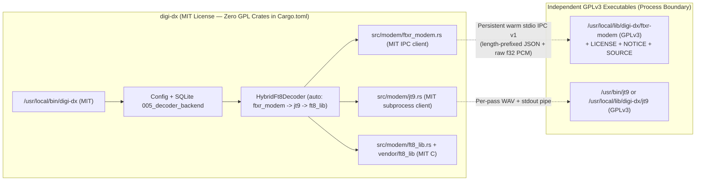

# Stage 7 — `digi-dx` Integration Blueprint (Bundled `ftxr-modem` & Selectable 3rd Backend)

> [!IMPORTANT]
> **Read-Only Reference Boundary:** This document is a complete, code-grounded **implementation blueprint** authored inside `wsjtx/rust-ftx/plans/` for future execution inside `mpmbq2/digi-dx`. Zero files in `/home/antigravity/mpmbq2/digi-dx` are modified during Stages 0–6.

---

## 1. Header & Scope

- **Stage:** 7 — `digi-dx` Integration Blueprint (Bundled GPLv3 Dependency & Selectable 3rd Backend — MIT Preserved)
- **Target Execution Repository:** `mpmbq2/digi-dx` (MIT-licensed single-process daemon + embedded Preact/Vite Web UI)
- **Prerequisites (Consumed from Stages 5 & 6):**
  1. Tagged standalone release of `mpmbq2/ftxr-modem` (GPLv3) publishing cross-platform tarballs named `ftxr-modem-<tag>-<linux|darwin>-<x86_64|aarch64>.tar.gz`, `SHA256SUMS`, and bundled `LICENSE` + `NOTICE`.
  2. Stabilized `ftxr-modem --worker` versioned stdio IPC protocol v1 (`docs/ipc-protocol.md`) supporting multiplexed `FTXR` 16-byte framing (`request_id`/`job_id`), streaming `decode_slot`/`decode_event`/`decode_done`, cooperative `cancel(job_id)`, concurrent `encode_tx`/`encode_result` (FT8 + FT4, `start_delay_ms` + `offset_ms`), `set_context`, `session_reset`, and clean `shutdown`.
  3. Stabilized `ftxr-modem --version` CLI output (machine-parseable single line) and Stage 3/4 sensitivity parity verified against classic `jt9 -8 -d 3` (FT8) and `jt9 -5 -d 3` (FT4).
- **Explicit Phased Delivery Split inside `digi-dx`:**
  - **Phase 7A — Core FT8 `jt9`-Parity Integration & Selectable 3-Backend Architecture (Immediate Execution Scope):**
    - Preserves `digi-dx`'s **100% MIT** Cargo dependency tree while bundling/installing pinned `ftxr-modem` as an independent aggregate executable at `/usr/local/lib/digi-dx/ftxr-modem` alongside `LICENSE`/`NOTICE`.
    - Adds MIT-licensed warm worker supervisor `src/modem/ftxr_modem.rs`.
    - Generalizes `HybridFt8Decoder` (`src/modem/mod.rs`) to 3 selectable backends (`ftxr_modem`, `jt9`, `ft8_lib`) + `auto` (`ftxr_modem` → `jt9` → `ft8_lib`).
    - Wires backend selection end-to-end: `DIGI_DX_FTXR_MODEM_PATH`, `DIGI_DX_DECODER_BACKEND`, SQLite migration `005_decoder_backend.sql`, `preflight`, REST/WS API, CommandBus (`station.set_decoder_backend`), and Web UI selector + status badges.
    - Matches existing `jt9` decode semantics (core fields `snr_db`, `dt_sec`, `af_hz`, `message`, AP `raw_metadata` feeding `SlotDecodeReconciler`); rich telemetry UI panels are explicitly deferred.
    - Adds an explicit Phase 7A safety guard if a user starts live FT4 before Phase 7B lands (or documents exact Phase 7B activation criteria).
  - **Phase 7B — `digi-dx` FT4 Live-Loop Prerequisites (Unlocks Full Live FT4 RX/TX):**
    - Remediates all 14 FT8-hardcoded timing, buffer, parity, TX modulator, `jt9 -5` `'+'` marker, `ft8_lib` FT4 bridge, and ADIF 3.1.4 `MFSK`/`FT4` paths audited in Section 2 & designed in Section 3.5.

### Exit Gate Checklist

#### Phase 7A Exit Gates (MIT Aggregate + 3-Backend FT8 Parity)
- [ ] **License boundary:** `cargo metadata` audit confirms zero GPL/LGPL/AGPL crates anywhere in `digi-dx/Cargo.toml` or `Cargo.lock`; `digi-dx` package license remains `MIT`.
- [ ] **Aggregate compliance (GPLv3 §6):** `scripts/install.sh` installs pinned `ftxr-modem` to `/usr/local/lib/digi-dx/ftxr-modem` verified by SHA-256 + execution probe, alongside `LICENSE`, `NOTICE`, and tagged source repository pointer; `--no-ftxr-modem`, `--from-source`, `--dry-run`, and `--uninstall` all pass.
- [ ] **Warm worker lifecycle:** `src/modem/ftxr_modem.rs` passes protocol v1 handshake, 3-pass streaming + `SlotDecodeReconciler`, concurrent Pass 3 RX + TX `modulate` multiplexing, `<50 ms` `CancellationToken` cancellation without killing the worker, SIGKILL crash-recovery/backoff respawn, and clean daemon shutdown with zero orphan processes.
- [ ] **3-backend routing & `auto` priority:** `HybridFt8Decoder` resolves `auto` as `ftxr_modem` → `jt9` → `ft8_lib`, supports explicit pinning to any of the 3 backends, and switches dynamically via `station.set_decoder_backend` persisted in SQLite (`005_decoder_backend.sql`) with `DIGI_DX_DECODER_BACKEND` env precedence.
- [ ] **Preflight, API & UI:** `digi-dx preflight` probes all 3 backends (with `ft8_decoder_jt9` downgraded from `Warn` to `Info` when `ftxr_modem` is healthy); `SystemHealthGrid.tsx` shows green OK badge for `ftxr_modem`; Web UI selector persists across reload and passes Playwright smoke tests.
- [ ] **Test & lint suite:** `make lint`, `cargo test`, `make ui-check`, and `npm --prefix ui run test:browser` all pass green.

#### Phase 7B Exit Gates (Full Live FT4 RX/TX)
- [ ] **Dynamic mode & timing:** `run_live_loop` dynamically reloads `slot_ms` and `SlotTimingProfile` on `session.set_mode`, using FT4's 7.5 s slot, 3.0 s minimum audio gate, 5.4 s / 6.3 s / 7.25 s pass triggers, 1,500 ms late-TX cutoff, and 5,400 ms TX end offset (never overrunning into the next RX slot).
- [ ] **Sub-second FT4 slot identity & parity:** Odd FT4 slots (`xx:xx:07.5`, `xx:xx:22.5`, `xx:xx:37.5`, `xx:xx:52.5`) preserve millisecond slot boundaries (`slot_start_ms`) and correct `SlotParity::Odd` across `qso/mod.rs`, `qso/sequencer.rs`, `modem/simulator.rs`, `SlotClockBar.tsx`, and `LiveBatchFeed.tsx`.
- [ ] **All 3 backends FT4-ready:** `ftxr_modem` (native FT4 RX+TX), `jt9 -5` (72,576-sample WAV + `' + '` line parser), and `ft8_lib` (`FTX_PROTOCOL_FT4` + `ft4_encode` bridge OR explicit `UnsupportedMode` guard) verified by integration tests.
- [ ] **ADIF 3.1.4 compliance:** Completed FT4 QSOs persist `mode = "FT4"` in `qso_log` and export `<MODE:4>MFSK <SUBMODE:3>FT4` in `/api/v1/qsos/export.adi` and QRZ uploads.

---

## 2. Source Audit & Technical Reference

All file paths, line numbers, symbols, and constants below were verified directly from `/home/antigravity/mpmbq2/digi-dx` and `/home/antigravity/mpmbq2/wsjtx`.

### 2.1 `digi-dx` Architecture & Current Wiring Inventory

| Subsystem | Verified File & Lines | Current Symbols / Behavior | Integration Impact |
| :--- | :--- | :--- | :--- |
| **Package & Build** | `Cargo.toml:1-45`, `build.rs:1-56`, `vendor/ft8_lib/LICENSE:1-22` | `license = "MIT"`; statically compiles MIT `kgoba/ft8_lib` via `cc` into `libdigidx_ft8.a`. Zero GPL crates in dependency graph. | Must stay 100% MIT. Add zero GPL crates; communicate with `ftxr-modem` strictly over stdio IPC. |
| **Config & CLI** | `src/config.rs:7-68`, `src/cli.rs:27-62`, `src/main.rs:46-77` | `DaemonConfig` reads `DIGI_DX_RIGCTL_PATH`, `DIGI_DX_RIGCTLD_PATH`, `DIGI_DX_JT9_PATH`, `DIGI_DX_QRZ_API_KEY`. `run_preflight_cmd` builds `DaemonConfig` via `from_serve_args`. | Add `ftxr_modem_path` (`DIGI_DX_FTXR_MODEM_PATH`) and `decoder_backend` (`DIGI_DX_DECODER_BACKEND`) to `DaemonConfig`. |
| **Modem Coordinator** | `src/modem/mod.rs:22-212` | `Ft8Decode` (`slot_ts`, `snr_db`, `dt_sec`, `af_hz`, `message`, `raw_metadata`, `decoder_backend`), `DecodePassOptions` (`depth`, `timeout`, `generate_wisdom_if_missing`, `fallback_on_empty_timeout`), `HybridFt8Decoder` (`primary: Option<Jt9SubprocessDecoder>`, `fallback: Ft8LibEmbeddedDecoder`). `active_backend_name()` returns `"jt9"` or `"ft8_lib_fallback"`. | Generalize to 3 backends + `DecoderBackendPreference`; add `ModemMode`, `DecodeQsoContext`, and `modulate_pcm_from_offset` routing. |
| **`jt9` Adapter** | `src/modem/jt9.rs:23-332` | Writes temp `YYMMDD_HHMMSS.wav`, runs `jt9 -8 -d <1..3> -w <0|1> -L 200 -H 3000 -F 300 -f 1500 -a <dir> -t <tmp> <wav>` serialized by `run_lock`. `parse_jt9_line:286` splits strictly on `'~'`. Does not pass `-c`/`-x`/`-g`/`-Q`. | Phase 7A: unchanged for FT8. Phase 7B: `-5` for FT4, 72,576-sample WAV (`21*3456`), and `'+'` / `'~'` marker parsing. |
| **`ft8_lib` Adapter** | `src/modem/ft8_lib.rs:12-272`, `vendor/ft8_lib/digidx_bridge.c:90-204` | `Ft8LibTxModulator` (79-sym, `0.160 s`, `BT=2.0`, starts active tones at `t = 0`, no 500 ms lead silence; `modulate_pcm_from_offset` slices by `offset_ms`). `digidx_bridge.c:128` hardcodes `.protocol = FTX_PROTOCOL_FT8`, line 100 hardcodes `ft8_encode`. | `vendor/ft8_lib/ft8/{constants.h,encode.h,encode.c,decode.c}` and `common/monitor.c` **already compile** `FTX_PROTOCOL_FT4`, `ft4_sync_score`, `ft4_extract_likelihood`, and `ft4_encode` into `libdigidx_ft8.a`! |
| **Preflight** | `src/preflight/mod.rs:52-141, 595-650, 875-904` | `PreflightReport` has `active_ft8_decoder: String` and `checks: Vec<PreflightCheck>`. `check_jt9_decoder` emits `CheckStatus::Warn` if `jt9` missing. `resolve_executable(name, override_path, extra_candidates)` checks override → `PATH` → `extra_candidates`. | Add `check_ftxr_modem_decoder` + `check_ft8_lib_decoder`; downgrade missing `jt9` to `Info` when `ftxr_modem` passes; add `configured_decoder_backend` and `decoder_backends` to `PreflightReport`. Note: 4 integration test files construct `PreflightReport` as a struct literal (`tests/{api,qso,supervisor,watchdog}_integration.rs`). |
| **SQLite Store** | `src/store/mod.rs:14-17, 96-102, 307-461, 953-975`, `src/store/migrations/001..004` | Sequential transactional migrations in `StateStore::apply_migrations` (latest: `4` / `004_qrz_sync`). Station-level prefs live as columns on singleton table `station_config (id = 1)` (cf. `qrz_api_key` added in `004_qrz_sync.sql`). `QrzSyncService::resolve_api_key` (`src/qrz/mod.rs:476`) establishes `Env` > `Database` > `None` precedence. | Add `005_decoder_backend.sql` adding `decoder_backend TEXT NOT NULL DEFAULT 'auto' CHECK (...)` to `station_config`; mirror `QrzSyncService` `Env` > `Database` precedence. |
| **Server & WS** | `src/server/mod.rs:34-148, 162-337`, `src/server/routes.rs:19-111`, `src/server/ws.rs:138-170` | `serve_daemon` runs preflight, constructs `SessionManager` with `config.jt9_path` and `data_dir/jt9`, serves REST `/api/v1/{health,preflight,station,commands,...}` and WS `/api/v1/ws` sending initial `snapshot`. Graceful shutdown calls `sessions.stop_if_active().await`. | Pass `ftxr_modem_path` + resolved `DecoderBackendPreference` into `SessionManager` / `HybridFt8Decoder`; shut down `ftxr-modem` worker cleanly during `serve_daemon` teardown; expose backend status in `/health`, `/preflight`, `/station`, and WS `snapshot`. |
| **CommandBus** | `src/command_bus/mod.rs:68-92, 162-279, 456-561, 1749-1831` | Dispatches typed commands with bearer auth (`DIGI_DX_AUTH_TOKEN`), idempotency cache, validation, per-radio lease check (`requires_lease`), and SQLite `command_audit`. `station.update_config` and `qrz.update_config` do **not** require a radio lease. | Add `station.set_decoder_backend` (non-lease, validated) and `WsBroadcastEvent::DecoderBackendUpdated`. |
| **QSO Loop & Reconciler** | `src/qso/mod.rs:45-54, 1669-2605`, `src/qso/reconciler.rs:22-109`, `src/qso/sequencer.rs:13-866` | 3-pass streaming decode (`Pass 1/2/3`) into `SlotDecodeReconciler` (`confidence_rank`: `None` = 2, `a*` = 1, `? a*` = 0; dedupe by `slot_ts` + `message` + `|Δaf| <= 15 Hz`). `reconcile_live_tx` calls `Ft8LibTxModulator::modulate_pcm_from_offset` directly (`qso/mod.rs:2230, 2334`). | Pass `DecodeQsoContext` for AP `a1`–`a6`; route TX modulation through `HybridFt8Decoder`; Phase 7B fixes all FT4 loop hardcodings (Section 2.2). |
| **Web UI** | `ui/src/types.ts`, `ui/src/hooks/useDaemonSocket.ts`, `ui/src/components/{SystemHealthGrid,SetupSplash,StationAndHardwarePanel,PreflightPanel,OperatingConsole,SlotClockBar}.tsx`, `ui/src/components/modern-ft8/{ModernFt8Console,RadioControlBar,LiveBatchFeed,CycleProgressBar}.tsx` | **Critical UI bug already present:** `SystemHealthGrid.tsx:44` evaluates `const isFallback = decoder !== "jt9";`, which would mislabel `ftxr_modem` as amber `"Fallback (ft8_lib)"`! AP tags (`decoder_metadata`) are already rendered in `OperatingConsole.tsx:669-685` and `LiveBatchFeed.tsx:177-188`. | Fix `SystemHealthGrid.tsx` 3-backend badge mapping; add backend selector in `StationAndHardwarePanel.tsx` / `SetupSplash.tsx`; show active backend pill in `OperatingConsole.tsx` and `RadioControlBar.tsx`. |
| **Installer & Deploy** | `scripts/install.sh:1-769`, `docs/deployment-and-deps.md:1-343`, `deploy/{digi-dx.env.example,systemd/digi-dx.service,launchd/com.digidx.daemon.plist}` | `install.sh` downloads `digi-dx-<tag>-<os>-<arch>.tar.gz` + `SHA256SUMS`, verifies SHA-256, installs `wsjtx` unless `--no-jt9`, writes `systemd` unit (`ProtectSystem=strict`, `KillMode=mixed`, `TimeoutStopSec=10`) or macOS `launchd` plist (`PATH=/opt/homebrew/bin:/usr/local/bin:/usr/bin:/bin`). | Add pinned `ftxr-modem` tarball fetch + SHA-256 + `--version` probe + `LICENSE`/`NOTICE`/`SOURCE` install to `/usr/local/lib/digi-dx/`; add `--no-ftxr-modem` & `--ftxr-from-source`; update `deployment-and-deps.md` & `digi-dx.env.example`. |
| **CI & Tests** | `.github/workflows/ci.yml:1-74`, `Makefile:1-67`, `tests/{modem,api,qso,supervisor,watchdog}_integration.rs`, `ui/scripts/browser-smoke.mjs` | CI runs `ui-check`, `ui-build`, `make lint` (`rustfmt`, `clippy -D warnings`, `bash -n`, `shellcheck`), `./scripts/install.sh --dry-run --from-source --no-jt9`, `cargo test`, and Playwright `browser-smoke.mjs`. | Add `cargo metadata` license check to `Makefile` + CI; extend `modem_integration.rs`, `api_integration.rs`, `qso_integration.rs`, and `browser-smoke.mjs`. |

### 2.2 Complete Audit of `digi-dx`'s FT4 Live-Loop Prerequisites (14 Hardcoded Hazards)

Although `digi-dx`'s UI (`RadioControlBar.tsx:215`, `ModernFt8Console.tsx:212`) and `command_bus/mod.rs:2066-2098` already accept `"FT4"` and `SlotClockSpec.slot_ms = 7_500`, **live FT4 RX and TX are currently broken** across 14 concrete code sites:

| # | Exact File & Lines | Current FT8-Hardcoded Behavior | Failure Mode under Live FT4 (7.5 s slot) |
| :--- | :--- | :--- | :--- |
| **1** | `src/qso/mod.rs:45-46, 1873, 1882, 1893` | `MIN_LIVE_SLOT_SAMPLES_12K = 72_000` (6.0 s) & `MIN_LIVE_SLOT_REAL_AUDIO_MS = 6_000` (6.0 s) | At FT4 Pass 1 (`t = 5.4 s`, 64,800 samples) and even Pass 2 (`t = 6.0 s` with resampler buffering lag), `should_decode_slot()` and `snapshot_prepared_slot_pcm()` return `false`/`None`, silently skipping FT4 decodes. |
| **2** | `src/qso/mod.rs:47-50, 1708, 1738, 1767, 1811` | `PASS_1_LEAD_MS = 3_200`, `PASS_2_LEAD_MS = 1_500`, `PASS_3_LEAD_MS = 200`, `LIVE_DECODE_GRACE_MS = 300`, pass timeouts `1500/1200/3500 ms` | For a 7,500 ms FT4 slot: Pass 1 fires at `4.3 s` (before FT4's `0.3 + 5.04 = 5.34 s` active transmission even ends!), Pass 2 at `6.0 s`, and a 3.5 s Pass 3 timeout can overrun half of the next FT4 slot. |
| **3** | `src/qso/mod.rs:2596-2605`, `src/audio/dsp.rs:12` | `prepare_slot_pcm_12k` truncates/pads every slot to `FT8_SLOT_SAMPLES_12K = 180_000` (15.0 s) | Appends 7.5–9.0 s of trailing zero-padding onto FT4 audio, doubling FFT/spectrogram work and distorting noise-floor/baseline estimation; `jt9 -5` only reads `21 * 3456 = 72_576` samples (`wsjtx/lib/jt9.f90:306`, `ft4_params.f90:12`). |
| **4** | `src/qso/mod.rs:1673-1680, 1854-1858` | `run_live_loop` reads `(slot_ms, epoch_ms)` **once** before the loop and never re-reads `rt.clock.spec()` on `session.set_mode` | Calling `session.set_mode("FT4")` updates `SessionRuntime.clock` & UI (`7_500 ms`), but `run_live_loop` stays stuck on `15_000 ms` slots forever (unlike `run_demo_loop:1515-1531`, which already reloads dynamically). |
| **5** | `src/qso/mod.rs:53, 2502` | `FT8_TX_END_OFFSET_MS = 12_700` used unconditionally in `wait_for_live_tx_end()` | **Severe on-air hazard:** In FT4 (7.5 s slot, 5.04 s active signal ending at `~5.34 s`), PTT stays asserted until `t = +12.7 s`, transmitting **5.2 seconds into the peer's reply slot**! |
| **6** | `src/qso/mod.rs:52, 1081, 2182, 2223, 2328` | `MAX_LATE_TX_START_MS = 6_000` | In FT4, a 5.04 s transmission starting at `t = 0.3 s` ends at `5.34 s`. Allowing late TX/hot-swap up to `6.0 s` initiates TX after the FT4 waveform has zero remaining symbols. Safe FT4 cutoff is `1_500 ms`. |
| **7** | `src/qso/mod.rs:2230, 2334`, `src/modem/ft8_lib.rs:12-175` | `reconcile_live_tx` directly invokes `Ft8LibTxModulator::modulate_pcm_from_offset` (hardcoded FT8 79-sym, `0.160 s`, `BT=2.0`, 8-GFSK) | Transmits an **FT8** waveform even when `digital_mode == "FT4"`! Also starts tones at `t = 0` instead of WSJT-X's nominal `500 ms` (FT8) / `300 ms` (FT4) (`wsjtx/Modulator/Modulator.cpp:76-79`). |
| **8** | `src/domain/clock.rs:25-31`, `src/qso/mod.rs:212, 1325, 1443, 1574, 2147`, `src/qso/sequencer.rs:450`, `src/modem/simulator.rs:70, 76` | `SlotParity::from_unix_secs(secs)` divides integer seconds by **15** (`secs.0.div_euclid(15).rem_euclid(2)`), AND `slot_ts` truncates `slot_start_ms` via `div_euclid(1000)` | **Subtle half-second truncation bug:** FT4 slots start at `0.0, 7.5, 15.0, 22.5, 30.0, 37.5, 45.0, 52.5 s`. Truncating `7_500 ms` → `UnixSecs(7)` yields `7 / 15 % 2 = 0` (`Even`) AND even `7_000 / 7_500 = 0` (`Even`)! `15_000 ms` → `UnixSecs(15)` yields `15 / 15 % 2 = 1` (`Odd`) instead of `Even`! Every single parity check in TX composition, QSO replies, roster, and demo simulator breaks under FT4. |
| **9** | `ui/src/components/SlotClockBar.tsx:25`, `ui/src/components/modern-ft8/LiveBatchFeed.tsx:96-102` | `SlotClockBar.tsx:25` computes `Math.floor(unixSecs / 15) % 2 === 0`; `LiveBatchFeed.tsx:97` computes `Math.floor((tsSec * 1000) / 7500) % 2 === 0` fallback on integer `ts_sec` | Legacy `SlotClockBar` displays wrong Even/Odd parity during FT4; `LiveBatchFeed` fallback misclassifies `:07.5` (`tsSec = 7`) and `:22.5` (`tsSec = 22`) if `slot` is missing or wrong. |
| **10** | `src/modem/jt9.rs:110, 286` | `cmd.arg("-8")` hardcoded; `parse_jt9_line` splits strictly on `trimmed.split_once('~')?` | Cannot invoke `jt9 -5` for FT4, and even if `-5` were passed, `wsjtx/lib/decoder.f90:1828` formats FT4 lines as `format(i6.6,i4,f5.1,i5,' + ',1x,a37,1x,a2)` — using **`' + '`** instead of `' ~ '` — so 100% of FT4 decodes would be silently dropped! |
| **11** | `vendor/ft8_lib/digidx_bridge.c:100, 128`, `src/modem/ft8_lib.rs:216` | `digidx_bridge.c` hardcodes `FTX_PROTOCOL_FT8` and `ft8_encode` | Embedded `ft8_lib` fallback cannot decode or encode FT4 until bridged to `FTX_PROTOCOL_FT4` / `ft4_encode` (or guarded with `UnsupportedMode`). |
| **12** | `src/qso/sequencer.rs:16, 506, 807, 851` | `mode: "FT8".to_string()` hardcoded in `build_qso_record` (`:851`); `last_cq_tx_slot_ts` reply window hardcoded `+ 30` (`:506`); `OCCUPIED_LOOKBACK_SECS = 60` (`:16`); `begin_af_survey` adds `+ 5_000 ms` (`:807`) | Completed FT4 QSOs are mislogged in SQLite `qso_log` as `"FT8"`; CQ-reply detection window is 4 FT4 slots instead of 2; AF survey hold buffer (+5 s) nearly spans a whole extra FT4 slot. |
| **13** | `src/domain/adif.rs:66` | `format_adif_field("MODE", rec.mode.trim())` | Emits `<MODE:3>FT4`, which violates **ADIF 3.1.4** (and is rejected by LoTW/QRZ/ClubLog)! ADIF 3.1.4 mandates `<MODE:4>MFSK <SUBMODE:3>FT4` for FT4 while keeping `<MODE:3>FT8` for FT8. |
| **14** | `src/audio/manager.rs:92`, `src/watchdog/mod.rs:20` | `seed_leading_silence` caps at `FT8_SLOT_SAMPLES_12K`; `PttWatchdog` `DEFAULT_MAX_TX_DURATION_MS = 13_400` | Mid-slot FT4 startup seeding is fine if bounded by `slot_samples_12k`, and `PttWatchdog` should optionally enforce a tighter ~6,200 ms ceiling during FT4 TX for extra RF safety. |

---

## 3. Architecture & Concrete Rust/TypeScript/Installer Design

### 3.1 MIT + GPLv3 Aggregate Boundary & Distribution Packaging



#### Strict License Boundary Rules
1. **`digi-dx/Cargo.toml` & `Cargo.lock`:** **ZERO** dependency on `ftxr-core`, `ftxr-modem`, or any GPL/LGPL/AGPL crate. Every dependency in `digi-dx`'s Cargo graph remains MIT / Apache-2.0 / BSD / ISC / Zlib / Unicode-3.0 / MPL-2.0-free-of-GPL (audited automatically in CI).
2. **Aggregate Installation Layout (Linux & macOS identical):**
   - `/usr/local/lib/digi-dx/ftxr-modem` (`0755`) — standalone native executable from `mpmbq2/ftxr-modem` release tarball.
   - `/usr/local/lib/digi-dx/ftxr-modem-licenses/LICENSE` (`0644`) — full GNU GPLv3 text bundled from the `ftxr-modem` release archive.
   - `/usr/local/lib/digi-dx/ftxr-modem-licenses/NOTICE` (`0644`) — upstream WSJT-X + `ftxr-modem` copyright/attribution notice.
   - `/usr/local/lib/digi-dx/ftxr-modem-licenses/SOURCE.txt` (`0644`) — pinned version tag, SHA-256 digest, and corresponding source repository URL (`https://github.com/mpmbq2/ftxr-modem/tree/<tag>`) satisfying GPLv3 §6.
3. **Executable Resolution Order (mirrors `jt9` in `src/preflight/mod.rs:875`):**
   1. `DIGI_DX_FTXR_MODEM_PATH` environment variable (if set and executable — if set to a non-existent path, do **not** fall through to `PATH`, preserving deterministic test isolation just like `resolve_executable` lines 880–885!).
   2. `ftxr-modem` on `PATH`.
   3. Fallback candidate paths: `["/usr/local/lib/digi-dx/ftxr-modem"]`.
4. **Native Execution & Version Probe:**
   - Run `ftxr-modem --version` (bounded 2 s timeout). Expected stdout line format: `ftxr-modem <semver> (ipc-v1)` (parsed safely even if extra git/target metadata follows).
   - Rejects wrong-architecture binaries (`Exec format error`) cleanly during preflight and installer verification.

#### Exact Changes to `scripts/install.sh`
1. **Top-level constants & CLI flags (lines 7–23, 48–114):**
   ```bash
   FTXR_MODEM_REPO="${DIGI_DX_FTXR_MODEM_REPO:-mpmbq2/ftxr-modem}"
   FTXR_MODEM_VERSION="${DIGI_DX_FTXR_MODEM_VERSION:-v0.1.0}" # pinned per digi-dx release
   FTXR_LIB_DIR="/usr/local/lib/digi-dx"
   FTXR_BINARY_PATH="${FTXR_LIB_DIR}/ftxr-modem"
   FTXR_LICENSE_DIR="${FTXR_LIB_DIR}/ftxr-modem-licenses"
   NO_FTXR_MODEM=0
   FTXR_FROM_SOURCE=0
   ```
   Add CLI flags:
   - `--no-ftxr-modem`: Skip installing bundled `ftxr-modem` binary (fall back to `jt9` or built-in `ft8_lib`).
   - `--ftxr-modem-version <tag>`: Override pinned `mpmbq2/ftxr-modem` release tag.
   - `--ftxr-from-source`: Compile `ftxr-modem` from tagged source via `cargo install --git https://github.com/${FTXR_MODEM_REPO} --tag ${FTXR_MODEM_VERSION} --locked ftxr-modem` (or local `DIGI_DX_FTXR_MODEM_SRC` checkout) instead of downloading the prebuilt tarball.
2. **Interaction with `--from-source`:**
   - Running `scripts/install.sh --from-source` compiles `digi-dx` + UI locally AND **still provisions the pinned prebuilt `ftxr-modem` release tarball** (fast, verified by SHA-256) unless `--no-ftxr-modem` or `--ftxr-from-source` is specified.
   - If prebuilt tarball download fails when `--from-source` is set and `cargo` is present, print a clear hint (`re-run with --ftxr-from-source or --no-ftxr-modem`).
3. **New `provision_ftxr_modem()` step (called right after `provision_binary` in `main()`, updating step counter to `1/8..8/8` or keeping `Step 3/7` as "Provisioning digi-dx & ftxr-modem binaries"):**
   - If `NO_FTXR_MODEM -eq 1`: log info and return `0`.
   - Download `ftxr-modem-${FTXR_MODEM_VERSION}-${OS_NAME}-${ARCH_NORM}.tar.gz` and `SHA256SUMS` from `https://github.com/${FTXR_MODEM_REPO}/releases/download/${FTXR_MODEM_VERSION}/`.
   - Verify SHA-256 via `sha256sum -c` / `shasum -a 256 -c` (identical to lines 435–441).
   - Extract into `tmp_dir`; assert `ftxr-modem`, `LICENSE`, and `NOTICE` exist in archive.
   - `run_sudo install -d -m 0755 "$FTXR_LIB_DIR" "$FTXR_LICENSE_DIR"`.
   - `run_sudo install -m 0755 "$tmp_dir/ftxr-modem" "$FTXR_BINARY_PATH"`.
   - `run_sudo install -m 0644 "$tmp_dir/LICENSE" "$FTXR_LICENSE_DIR/LICENSE"`.
   - `run_sudo install -m 0644 "$tmp_dir/NOTICE" "$FTXR_LICENSE_DIR/NOTICE"`.
   - Write `$FTXR_LICENSE_DIR/SOURCE.txt` containing repo URL, pinned tag, and verified tarball SHA-256.
   - Run native probe `"$FTXR_BINARY_PATH" --version` (plus `file -b` if present); on probe failure, remove the bad binary and warn (graceful fallback to `jt9` / `ft8_lib`, never bricking install).
   - Under `--dry-run`, log planned download/checksum/install commands without touching network or filesystem (keeping CI's `./scripts/install.sh --dry-run --from-source --no-jt9` deterministic offline).
4. **Update `do_uninstall()` (lines 721–748):**
   - Remove `$FTXR_BINARY_PATH` and `$FTXR_LICENSE_DIR` (and `rmdir "$FTXR_LIB_DIR" 2>/dev/null || true`) on both Linux and macOS, while continuing to preserve `/var/lib/digi-dx`, `/etc/digi-dx`, and `~/Library/Application Support/digi-dx`.

#### Exact Changes to Deploy Templates & `docs/deployment-and-deps.md`
- `deploy/digi-dx.env.example`: add commented defaults:
  ```dotenv
  # Decoder backend selection: auto (ftxr_modem -> jt9 -> ft8_lib), ftxr_modem, jt9, or ft8_lib
  # When set, overrides the SQLite preference selected in the Web UI:
  # DIGI_DX_DECODER_BACKEND=auto
  # DIGI_DX_FTXR_MODEM_PATH=/usr/local/lib/digi-dx/ftxr-modem
  ```
- `deploy/systemd/digi-dx.service`: no hardening relaxations needed! Verify `ProtectSystem=strict` permits read/exec on `/usr/local/lib/digi-dx/ftxr-modem` (yes: `/usr` is mounted `ro` with exec), `KillMode=mixed` cleanly reaps any stray child if `digi-dx` exceeds `TimeoutStopSec=10`, and `ftxr-modem --worker` performs zero filesystem writes (so `ReadWritePaths` does not need changes).
- `deploy/launchd/com.digidx.daemon.plist`: no `PATH` change required because `digi-dx` explicitly searches `/usr/local/lib/digi-dx/ftxr-modem` in fallback paths; optionally document `DIGI_DX_FTXR_MODEM_PATH` and `DIGI_DX_DECODER_BACKEND` in `docs/deployment-and-deps.md`.
- `docs/deployment-and-deps.md`:
  - Add **`ftxr-modem` (Pure-Rust GPLv3 worker)** row to §2.1 Runtime Dependencies matrix as **Bundled / Primary Default** (auto-installed to `/usr/local/lib/digi-dx/ftxr-modem` via `install.sh`, zero Qt/FFTW/Fortran runtime libs, MIT + GPLv3 aggregate boundary note).
  - Demote `wsjtx`/`jt9` in §2.1 from "Primary" to **Optional Secondary Backend** (user-selectable via UI or `DIGI_DX_DECODER_BACKEND=jt9`).
  - Document `--no-ftxr-modem`, `--ftxr-modem-version`, `--ftxr-from-source` in §3.1, manual install commands in §5.3, and the 3 decoder preflight checks (`ft8_decoder_ftxr_modem`, `ft8_decoder_jt9`, `ft8_decoder_ft8_lib`) in §6.

---

### 3.2 Warm Worker IPC Client (`src/modem/ftxr_modem.rs` — MIT)

#### Wire Framing Contract (Consumed Verbatim from Stage 5 `ftxr-modem --worker` Protocol v1)
Every message on stdin (parent → worker) and stdout (worker → parent) uses Stage 5's canonical 16-byte `FTXR` binary-safe frame header (zero base64 overhead, zero ambiguity with JSON newlines):

```text
+---------------+------------+----------+---------------+--------------+------------------------+--------------------------+
| magic: [u8;4] | version:u16| flags:u16| json_len: u32 | bin_len: u32 | json_payload: [u8; J]  | binary_payload: [u8; B]  |
| b"FTXR"       | LE (1)     | LE (0)   | LE            | LE           | (UTF-8 JSON object)    | (raw LE f32/i16 PCM)     |
+---------------+------------+----------+---------------+--------------+------------------------+--------------------------+
```

- **Hard Frame Guards (MIT client defensive validation):** `magic == b"FTXR"`, `version == 1`, `json_len <= 256 KiB`, `bin_len <= 16 MiB` (enough for 15 s @ 48 kHz = 2.88 MB TX PCM or 15 s @ 12 kHz = 720 KB RX PCM with generous headroom). Any violation triggers protocol-error teardown + supervisor restart.
- **Zero Stray Stdout Guarantee:** `ftxr-modem --worker` writes exclusively `FTXR`-framed messages to stdout; all diagnostics go to stderr, which `ftxr_modem.rs` drains line-by-line into `tracing::debug!` / `tracing::warn!`.

#### JSON Control Header Schemas (Protocol v1 — Exact Match to Stage 5)
1. **Handshake (immediately after spawn):**
   - Request (`bin_len = 0`):
     `{ "op": "hello", "request_id": 1, "client": "digi-dx", "supported_versions": [1] }`
   - Response (`bin_len = 0`):
     `{ "op": "ready", "request_id": 1, "protocol_version": 1, "engine_version": "0.1.0", "modes": ["ft8", "ft4"], "capabilities": ["streaming_decode", "multiplex_cancel", "concurrent_tx_encode", "telemetry_v1", "ap_a1_a6", "pcm_f32le", "pcm_i16le"], "worker_threads": 6, "max_active_decode_jobs": 2, "warm_fft_plans": true }`
2. **Streaming Slot Decode (`bin_len = samples_12k.len() * 4`, raw LE `f32` mono 12 kHz PCM):**
   - Request:
     ```json
     {
       "op": "decode_slot",
       "request_id": 42,
       "job_id": 1001,
       "mode": "ft8",
       "slot_ts": 1795212900,
       "pass_hint": 3,
       "depth": 3,
       "sample_rate": 12000,
       "sample_format": "f32le",
       "sample_count": 180000,
       "f_min_hz": 200.0,
       "f_max_hz": 3000.0,
       "qso_freq_hz": 1420.0,
       "tx_freq_hz": 1800.0,
       "enable_ap": true,
       "ap_cq_only": false,
       "ap_width_hz": 75.0,
       "early_pass": false,
       "qso_first": true,
       "telemetry": false,
       "timeout_ms": 3500,
       "qso_context": null
     }
     ```
   - Streamed Decode Event (`0..N` frames per `job_id`, `bin_len = 0`):
     ```json
     {
       "op": "decode_event",
       "request_id": 42,
       "job_id": 1001,
       "slot_ts": 1795212900,
       "mode": "ft8",
       "seq": 0,
       "decode": {
         "snr_db": -14,
         "snr_db_exact": -14.23,
         "dt_sec": 0.41,
         "af_hz": 1420.5,
         "af_hz_rounded": 1421,
         "message": "N1MPM JA1ABC PM95",
         "ap_tag": "a1",
         "uncertain": false,
         "raw_metadata": "a1",
         "sync_score": 2.41,
         "quality": 0.87
       },
       "telemetry": null
     }
     ```
     *Note (Phase 7A parity scope):* `ftxr_modem.rs` maps `decode.raw_metadata` directly to `Ft8Decode.raw_metadata` (`None` / `Some("a1")`..`Some("a6")` / `Some("? a1")`..`Some("? a6")`) and sets `decoder_backend: "ftxr_modem".to_string()`. The optional `telemetry` object is requested as `false` and ignored via `#[serde(default)]` in Phase 7A so rich telemetry UI can be layered later with zero wire breakage.
   - Terminal Completion (`bin_len = 0`):
     `{ "op": "decode_done", "request_id": 42, "job_id": 1001, "slot_ts": 1795212900, "mode": "ft8", "status": "completed", "decoded_count": 12, "passes_run": 3, "elapsed_ms": 145.0 }`
     *(`status` ∈ `"completed" | "cancelled" | "timed_out"`.)*
3. **Cooperative Cancellation (`bin_len = 0`, non-blocking even while Pass 3 runs):**
   - Request: `{ "op": "cancel", "request_id": 43, "job_id": 1001 }`
   - Immediate ack: `{ "op": "cancel_ack", "request_id": 43, "job_id": 1001, "found": true, "already_finished": false }`
   - Worker flips the target job's `AtomicBool`, halts candidate processing in `<50 ms`, and emits `decode_done` with `"status": "cancelled"`.
4. **Concurrent TX Modulation (`bin_len = 0`, isolated OS thread — never blocked by an active Pass 3 decode!):**
   - Request:
     ```json
     {
       "op": "encode_tx",
       "request_id": 44,
       "mode": "ft8",
       "message": "CQ N1MPM FN33",
       "af_hz": 1500.0,
       "sample_rate": 48000,
       "sample_format": "f32le",
       "start_delay_ms": 0,
       "offset_ms": 1200,
       "pad_to_slot": false,
       "amplitude": 1.0
     }
     ```
   - Response (`bin_len = sample_count * 4`, raw LE `f32` PCM):
     `{ "op": "encode_result", "request_id": 44, "mode": "ft8", "normalized_message": "CQ N1MPM FN33", "sample_rate": 48000, "sample_format": "f32le", "sample_count": 549120, "duration_ms": 11440.0, "elapsed_ms": 4.8 }`
5. **Session Context, Hash-Table Reset, Health & Graceful Shutdown:**
   - `{ "op": "set_context", "request_id": 45, "my_call": "N1MPM", "dx_call": "JA1ABC", ... }` → `{ "op": "ok", "request_id": 45 }`
   - `{ "op": "session_reset", "request_id": 46, "clear_hash_table": true, "clear_context": false, "cancel_active_jobs": true }` → `{ "op": "ok", "request_id": 46, "cleared_hash_entries": ..., "cancelled_jobs": [...] }` (called on session start/stop, band QSY, or FT8↔FT4 switch to avoid stale callsign hash collisions).
   - `{ "op": "ping", "request_id": 47 }` → `{ "op": "pong", "request_id": 47, ... }`
   - `{ "op": "shutdown", "request_id": 48 }` → worker cancels active jobs, emits `{ "op": "ok", "request_id": 48 }`, flushes stdout, and exits `0`.
   - Error frame for any request: `{ "op": "error", "request_id": 44, "job_id": null, "code": "INVALID_MESSAGE", "message": "...", "fatal": false }`.

#### Concrete Rust Types & Supervision Design (`src/modem/ftxr_modem.rs`)

```rust
pub const FTXR_IPC_PROTOCOL_VERSION: u32 = 1;
const MAX_HEADER_BYTES: usize = 256 * 1024;
const MAX_BINARY_BYTES: usize = 16 * 1024 * 1024;
const HANDSHAKE_TIMEOUT: Duration = Duration::from_secs(3);
const MODULATE_TIMEOUT: Duration = Duration::from_secs(2);
const SHUTDOWN_WAIT_TIMEOUT: Duration = Duration::from_millis(500);
const RESPAWN_BACKOFFS_MS: &[u64] = &[100, 500, 2_000];
const MAX_CRASHES_IN_WINDOW: usize = 5;
const CRASH_WINDOW: Duration = Duration::from_secs(60);

#[derive(Debug, Clone)]
pub struct FtxrWorkerConfig {
    pub binary_path: PathBuf,
    pub freq_min_hz: u16,
    pub freq_max_hz: u16,
}

#[derive(Debug, Clone)]
pub struct FtxrWorkerHealth {
    pub running: bool,
    pub pid: Option<u32>,
    pub worker_version: Option<String>,
    pub supported_modes: Vec<String>,
    pub restarts: u64,
    pub circuit_open_until: Option<Instant>,
}

enum PendingRequest {
    Decode {
        slot_ts: UnixSecs,
        slot_parity: Option<SlotParity>, // Phase 7B carries exact parity for FT4
        stream_tx: mpsc::UnboundedSender<Ft8Decode>,
        collected: Vec<Ft8Decode>,
        done_tx: oneshot::Sender<Result<Vec<Ft8Decode>, ModemError>>,
    },
    Modulate {
        done_tx: oneshot::Sender<Result<Vec<f32>, ModemError>>,
    },
    Simple {
        done_tx: oneshot::Sender<Result<(), ModemError>>,
    },
}

struct OutboundFrame {
    header_json: Vec<u8>,
    binary: Vec<u8>,
}

struct LiveWorker {
    pid: Option<u32>,
    worker_version: String,
    supported_modes: Vec<String>,
    out_tx: mpsc::Sender<OutboundFrame>,
    pending: Arc<AsyncMutex<HashMap<u64, PendingRequest>>>,
    alive: Arc<AtomicBool>,
    child_handle: Arc<AsyncMutex<Option<tokio::process::Child>>>,
    reader_task: JoinHandle<()>,
    writer_task: JoinHandle<()>,
    stderr_task: JoinHandle<()>,
}

pub struct FtxrWorkerClient {
    config: FtxrWorkerConfig,
    next_req_id: AtomicU64,
    state: AsyncMutex<WorkerSupervisorState>,
    shutdown: AtomicBool,
}
```

#### Key Concurrency & Crash-Recovery Invariants
1. **Multiplexed Lock-Free Dispatch:** `state` mutex is held **only** to clone `out_tx` / `pending` handles (or lazily spawn/respawn the worker if `!alive`). It is **never** held across a decode or modulate call! Thus an active Pass 3 `decode_slot` (`request_id = 42`) and a concurrent next-slot `modulate` (`request_id = 44`) or `cancel` (`request_id = 43`) share the same `writer_task` / `reader_task` with zero head-of-line blocking.
2. **Cooperative Cancellation (`CancellationToken`):** Inside `decode_slot_streaming`, `tokio::select!` races `done_rx` against `cancel.cancelled()` and `sleep_until(deadline)`:
   - On `cancel.cancelled()`: enqueue `{ "op": "cancel", "request_id": cancel_req_id, "job_id": job_id }` on `out_tx`, wait up to `100 ms` for `decode_done` (so any already-decoded frames flush cleanly), remove `job_id` from `pending` if still present, and return `Ok(partial_or_empty)` **without killing the warm worker**.
   - On `timeout`: send `cancel(job_id)` to stop wasted CPU on the worker; if streamed decodes were already collected, return `Ok(collected)` (matching `jt9.rs:202-210`); otherwise return `Err(ModemError::DecoderTimeout(ms))`.
3. **Crash Detection & Backoff Respawn:**
   - When `reader_task` hits unexpected EOF or frame corruption (e.g., worker SIGKILL/panic), it sets `alive = false`, drains every entry in `pending` with `Err(ModemError::WorkerCrashed(...))`, and kills/reaps the process group.
   - The caller (`HybridFt8Decoder`) may fall back for that single failed pass if `fallback_on_empty_timeout` is enabled (or `decode_slot` retries once after respawn).
   - On the next request, `ensure_worker()` observes `!alive`, records crash timestamp in a `VecDeque<Instant>` pruned to `CRASH_WINDOW` (60 s):
     - If `crashes < MAX_CRASHES_IN_WINDOW`: sleeps backoff `RESPAWN_BACKOFFS_MS[min(crashes, 2)]` (`100 ms` → `500 ms` → `2 s`), respawns `ftxr-modem --worker` in its own Unix process group (`process_group(0)` + `kill_on_drop(true)`), performs `hello` / `ready` handshake, and resumes warm operation.
     - If `crashes >= MAX_CRASHES_IN_WINDOW`: opens a 30 s circuit breaker (`ModemError::WorkerUnavailable`) and emits a `WsBroadcastEvent::PreflightAlert` (`severity: "warn"`) so `HybridFt8Decoder` in `auto` mode smoothly degrades to `jt9` / `ft8_lib` instead of fork-bombing.
4. **Graceful Daemon Shutdown (`FtxrWorkerClient::shutdown(&self)`):**
   - Sets `self.shutdown = true`, sends `{ "op": "shutdown" }`, drops `out_tx` (closing worker stdin EOF), awaits `child.wait()` up to `500 ms`, then falls back to `kill_process_group(pid)` + `child.kill()` so `digi-dx` never leaves orphan `ftxr-modem` processes on `SIGINT`/`SIGTERM`.

---

### 3.3 Generalized 3-Backend Coordinator (`src/modem/mod.rs`)

#### New Domain Types in `src/modem/mod.rs`

```rust
#[derive(Debug, Clone, Copy, PartialEq, Eq, Default, Serialize, Deserialize)]
#[serde(rename_all = "UPPERCASE")]
pub enum ModemMode {
    #[default]
    Ft8,
    Ft4,
}

impl ModemMode {
    pub fn as_str(self) -> &'static str {
        match self {
            Self::Ft8 => "FT8",
            Self::Ft4 => "FT4",
        }
    }
    pub fn parse(raw: &str) -> Option<Self> {
        match raw.trim().to_ascii_uppercase().as_str() {
            "FT8" => Some(Self::Ft8),
            "FT4" => Some(Self::Ft4),
            _ => None,
        }
    }
}

#[derive(Debug, Clone, Copy, PartialEq, Eq, Default, Serialize, Deserialize)]
#[serde(rename_all = "snake_case")]
pub enum DecoderBackendPreference {
    #[default]
    Auto,
    FtxrModem,
    Jt9,
    Ft8Lib,
}

impl DecoderBackendPreference {
    pub fn as_str(self) -> &'static str {
        match self {
            Self::Auto => "auto",
            Self::FtxrModem => "ftxr_modem",
            Self::Jt9 => "jt9",
            Self::Ft8Lib => "ft8_lib",
        }
    }

    pub fn parse(raw: &str) -> Result<Self, String> {
        match raw.trim().to_ascii_lowercase().as_str() {
            "auto" => Ok(Self::Auto),
            "ftxr_modem" => Ok(Self::FtxrModem),
            "jt9" => Ok(Self::Jt9),
            "ft8_lib" | "ft8_lib_fallback" => Ok(Self::Ft8Lib),
            other => Err(format!(
                "Invalid decoder backend '{other}' (expected auto, ftxr_modem, jt9, or ft8_lib)"
            )),
        }
    }
}

#[derive(Debug, Clone, Copy, PartialEq, Eq, Serialize, Deserialize)]
#[serde(rename_all = "snake_case")]
pub enum DecoderBackendSource {
    Env,
    Database,
    Default,
}

#[derive(Debug, Clone, Default, Serialize, Deserialize)]
pub struct DecodeQsoContext {
    pub my_call: Option<String>,
    pub my_grid: Option<String>,
    pub dx_call: Option<String>,
    pub dx_grid: Option<String>,
    pub rx_freq_hz: Option<u16>,
    /// WSJT-X nQSOProgress mapping: 0=CALLING, 1=REPLYING, 2=REPORT, 3=ROGER_REPORT, 4=ROGERS, 5=SIGNOFF
    pub qso_progress: u8,
}
```

Extend `DecodePassOptions` (deriving `Clone`, removing `Copy` because of `Option<DecodeQsoContext>`, or boxing/cloning cheaply):
```rust
#[derive(Debug, Clone)]
pub struct DecodePassOptions {
    pub mode: ModemMode,
    pub depth: u8,
    pub timeout: Duration,
    pub generate_wisdom_if_missing: bool,
    pub fallback_on_empty_timeout: bool,
    pub qso_context: Option<DecodeQsoContext>,
}
```

#### Backend Naming Consistency Contract
To preserve 100% backwards compatibility with existing `digi-dx` tests (`tests/modem_integration.rs:41, 125`, `tests/api_integration.rs:37`) while keeping the roadmap's canonical keys:
- **Preference keys (config/env/SQLite/API selector):** `"auto"`, `"ftxr_modem"`, `"jt9"`, `"ft8_lib"`.
- **Reported active/per-decode `decoder_backend` strings:**
  - `"ftxr_modem"` (when decoded by `ftxr-modem`)
  - `"jt9"` (when decoded by WSJT-X `jt9`)
  - `"ft8_lib_fallback"` (when decoded by embedded MIT `ft8_lib` — preserving existing `Ft8LibEmbeddedDecoder::backend_name()` and all existing integration test assertions!).

#### `HybridFt8Decoder` Generalization (`src/modem/mod.rs`)

```rust
#[derive(Debug, Clone)]
pub struct HybridDecoderConfig {
    pub ftxr_modem_override: Option<PathBuf>,
    pub jt9_override: Option<PathBuf>,
    pub jt9_data_dir: Option<PathBuf>,
    pub preference: DecoderBackendPreference,
}

pub struct HybridFt8Decoder {
    ftxr: Option<Arc<FtxrWorkerClient>>,
    jt9: Option<Jt9SubprocessDecoder>,
    ft8_lib: Ft8LibEmbeddedDecoder,
    preference: RwLock<DecoderBackendPreference>,
}
```

- **Resolution & `auto` Priority Order (`resolve_chain`):**
  1. `DecoderBackendPreference::Auto`: try available backends in exact priority order **`ftxr_modem` → `jt9` → `ft8_lib`**.
  2. `DecoderBackendPreference::FtxrModem`: primary `ftxr_modem`; if runtime crash/empty timeout with `fallback_on_empty_timeout == true`, warn and degrade to `jt9` → `ft8_lib` so an active QSO never goes deaf; if binary absent at selection time, `station.set_decoder_backend` rejects selection upfront with clear `ValidationFailed`.
  3. `DecoderBackendPreference::Jt9`: primary `jt9`; on failure/timeout with `fallback_on_empty_timeout == true`, degrade to `ft8_lib` (exact existing behavior).
  4. `DecoderBackendPreference::Ft8Lib`: **only** `ft8_lib` (never calls external subprocesses; ideal for deterministic A/B benchmarking or strict offline/MIT-only operation).
- **`active_backend_name(&self) -> &'static str`:** Returns the first available backend in `resolve_chain()` (`"ftxr_modem"`, `"jt9"`, or `"ft8_lib_fallback"`).
- **Runtime Switching (`set_preference(&self, pref: DecoderBackendPreference) -> Result<&'static str, ModemError>`):**
  - Validates availability if `pref` is `FtxrModem` (requires `self.ftxr.is_some()`) or `Jt9` (requires `self.jt9.is_some()`).
  - Updates `self.preference` write lock atomically; the **very next decode pass** uses the newly selected backend with zero daemon restart!
- **TX Modulation Routing (`modulate_pcm_from_offset`):**
  - If resolved primary backend is `ftxr_modem` (and circuit breaker is closed): invoke `ftxr.encode_tx(mode, message, af_hz, sample_rate, start_delay_ms, offset_ms).await`. On worker error, log warning and fall back to `Ft8LibTxModulator::modulate_pcm_from_offset` (for FT8; and FT4 once Phase 7B bridges `ft4_encode`).
  - If resolved backend is `jt9` or `ft8_lib`: invoke `Ft8LibTxModulator` (since `jt9` has no TX modulator).
  - *Timing consistency note:* In Phase 7A (FT8 `jt9`-parity mode), pass `start_delay_ms = 0` to `ftxr_modem` to match existing `Ft8LibTxModulator` and `FT8_TX_END_OFFSET_MS = 12_700` identically; in Phase 7B, align both modulators to WSJT-X nominal start delays (`500 ms` FT8 / `300 ms` FT4) with matching `tx_end_offset_ms` (`13_200 ms` FT8 / `5_400 ms` FT4).
- **Session Reset Hook:** `HybridFt8Decoder::reset_session(&self).await` forwards `session_reset` to `ftxr` if running (called on session start, session stop, band change, and FT8↔FT4 mode switch).
- **Backwards-Compatible Constructors:** Keep `HybridFt8Decoder::new(jt9_override)` and `HybridFt8Decoder::with_data_dir(jt9_override, jt9_data_dir)` delegating to `from_config` (with `ftxr_modem_override: None` or env-checked — wait: for `hybrid_decoder_falls_back_to_ft8_lib_when_jt9_missing` in `tests/modem_integration.rs:117-133`, `HybridFt8Decoder::new(Some("/nonexistent/digi-dx/jt9"))` asserts `active_backend_name() == "ft8_lib_fallback"`! So `HybridFt8Decoder::new` MUST disable `ftxr_modem` or pass `ftxr_modem_override: Some("/nonexistent")` or explicit constructor `HybridFt8Decoder::from_config(...)` used by `SessionManager`, preserving existing test compatibility! **Critical catch documented in Section 6!**).

---

### 3.4 End-to-End Config, SQLite, Preflight, API/WS & Web UI Wiring

#### 1. Configuration (`src/config.rs`)
Add two fields to `DaemonConfig` (`src/config.rs:7-24`):
```rust
pub ftxr_modem_path: Option<PathBuf>,
pub decoder_backend_env: Option<DecoderBackendPreference>,
```
Populated in `DaemonConfig::from_serve_args`:
- `ftxr_modem_path: env_path("DIGI_DX_FTXR_MODEM_PATH")`
- `decoder_backend_env: env_nonempty("DIGI_DX_DECODER_BACKEND").and_then(|v| match DecoderBackendPreference::parse(&v) { Ok(p) => Some(p), Err(e) => { warn!(value = %v, error = %e, "ignoring invalid DIGI_DX_DECODER_BACKEND"); None } })`

#### 2. SQLite Migration (`src/store/migrations/005_decoder_backend.sql` & `src/store/mod.rs`)
```sql
-- Persist operator-selected FT8/FT4 decoder backend preference on station_config singleton.
ALTER TABLE station_config
    ADD COLUMN decoder_backend TEXT NOT NULL DEFAULT 'auto'
    CHECK (decoder_backend IN ('auto', 'ftxr_modem', 'jt9', 'ft8_lib'));
```
- Register `const DECODER_BACKEND_MIGRATION_SQL: &str = include_str!("migrations/005_decoder_backend.sql");` and apply as migration version `5` (`"005_decoder_backend"`) inside `StateStore::apply_migrations()` (`src/store/mod.rs:384`).
- Add `pub decoder_backend: String` (default `"auto"`) to `StationConfig` (`src/store/mod.rs:97`), update `SELECT` in `get_station_config()` and `update_station_config()`, and add:
  - `pub fn get_decoder_backend(&self) -> Result<String, StoreError>`
  - `pub fn set_decoder_backend(&self, backend: &str) -> Result<StationConfig, StoreError>`
- **Effective Precedence Resolution (mirrors `QrzSyncService::resolve_api_key` at `src/qrz/mod.rs:476`):**
  1. If `config.decoder_backend_env` is `Some(pref)` → `(pref, DecoderBackendSource::Env)`
  2. Else read `store.get_decoder_backend()` → `(parsed_pref, if != "auto" { Database } else { Default })`

#### 3. Preflight Reporting (`src/preflight/mod.rs`)
Add structured per-backend discovery to `PreflightReport`:
```rust
#[derive(Debug, Clone, Serialize, Deserialize)]
pub struct DecoderBackendStatus {
    pub id: String,              // "ftxr_modem" | "jt9" | "ft8_lib"
    pub label: String,           // "ftxr-modem (Pure Rust)" | "WSJT-X jt9" | "ft8_lib (Embedded MIT)"
    pub available: bool,
    pub active: bool,
    pub version: Option<String>,
    pub path: Option<String>,
    pub supports_ft4: bool,      // true for ftxr_modem, true for jt9 (Phase 7B), false/true for ft8_lib
    pub license: String,         // "GPL-3.0" | "GPL-3.0" | "MIT"
    pub detail: String,
}

#[derive(Debug, Clone, Serialize, Deserialize)]
pub struct PreflightReport {
    pub overall_status: OverallStatus,
    pub checked_at_utc: String,
    pub platform: PlatformInfo,
    pub active_ft8_decoder: String,
    #[serde(default)]
    pub configured_decoder_backend: String,
    #[serde(default)]
    pub decoder_backend_source: String,
    #[serde(default)]
    pub decoder_backends: Vec<DecoderBackendStatus>,
    pub checks: Vec<PreflightCheck>,
}
```
- **Checks emitted in `run_preflight_with_preference(cfg, probe_audio, db_pref)`** (keeping `run_preflight(cfg, probe_audio)` wrapper that opens SQLite to read `decoder_backend` if DB exists, else `"auto"`):
  1. `ft8_decoder_ftxr_modem`: resolves `DIGI_DX_FTXR_MODEM_PATH` → `PATH` → `/usr/local/lib/digi-dx/ftxr-modem`, runs `--version`.
     - If found & probe succeeds → `CheckStatus::Pass` (`severity: Warn`), records version & path.
     - If missing/failed → `CheckStatus::Info` if `jt9` passes, else `CheckStatus::Warn` (so users who explicitly chose `--no-ftxr-modem` with `jt9` aren't nagged, while users with neither `ftxr_modem` nor `jt9` get an actionable remediation warning).
  2. `ft8_decoder_jt9`: unchanged probe (`jt9 -h`), EXCEPT when `ftxr_modem` passed **and** configured preference is not explicitly `jt9`, missing `jt9` reports `CheckStatus::Info` (`severity: Info`, `"jt9 not installed (optional; ftxr_modem active)"`) instead of `Warn`, so default installs achieve clean `OverallStatus::Ok`!
  3. `ft8_decoder_ft8_lib`: always `CheckStatus::Info` (`severity: Info`, `"Built-in MIT kgoba/ft8_lib fallback available"`).
  4. If effective preference explicitly pins an unavailable backend (e.g., `DIGI_DX_DECODER_BACKEND=ftxr_modem` when binary is missing), emit `CheckStatus::Warn` on that backend's check noting fallback to next available backend.
- Update the 4 integration test helper literals constructing `PreflightReport` (`tests/api_integration.rs:30`, `tests/qso_integration.rs:31`, `tests/supervisor_integration.rs:26`, `tests/watchdog_integration.rs:33`) — adding a `PreflightReport::for_test(...)` helper eliminates boilerplate across all 4 files.

#### 4. CommandBus, REST & WebSocket API (`src/command_bus/mod.rs`, `src/server/{routes,ws}.rs`)
- **New CommandBus Kind:** `"station.set_decoder_backend"`
  - Auth: subject to `DIGI_DX_AUTH_TOKEN`; **exempt from per-radio lease** (station-level setting, identical to `station.update_config` and `qrz.update_config`).
  - Payload: `{ "backend": "auto" | "ftxr_modem" | "jt9" | "ft8_lib" }`.
  - Validation (`validate_command`): `DecoderBackendPreference::parse(backend)` must succeed.
  - Execution (`exec_station_set_decoder_backend`):
    1. If `backend` is explicitly `"ftxr_modem"` or `"jt9"` and that backend is unavailable in `sessions.hybrid_decoder()`, reject with `ErrorCode::ValidationFailed` (`"Requested decoder backend 'ftxr_modem' is not installed or failed native probe"`).
    2. Persist into SQLite via `store.set_decoder_backend(pref.as_str())`.
    3. Recompute effective preference (honoring `DIGI_DX_DECODER_BACKEND` env override if set; if overridden by env, still persist DB choice and return `overridden_by_env: true` + `effective_preference` in ack `result`).
    4. Apply to live `HybridFt8Decoder::set_preference(effective_pref)` and update active `SessionRuntime.decoder_backend` (if live, non-demo session is running).
    5. Refresh in-memory `AppState.preflight` `active_ft8_decoder` / `configured_decoder_backend` / `decoder_backends` flags.
    6. Broadcast `WsBroadcastEvent::DecoderBackendUpdated { configured_backend, effective_preference, active_backend, source, decoder_backends, updated_at_utc }` (and `WsBroadcastEvent::SlotClockUpdated` if a live session is active so `session.decoder_backend` updates immediately in connected browsers).
- **Updated REST & WS Payloads:**
  - `GET /api/v1/health`: keep `active_ft8_decoder` (existing field), add `configured_decoder_backend` and `decoder_backend_source`.
  - `GET /api/v1/station`: add `decoder_backend` (DB value), `decoder_backend_source`, `active_ft8_decoder`.
  - `GET /api/v1/preflight`: returns updated `PreflightReport` with `decoder_backends: [...]`.
  - `WS /api/v1/ws` `snapshot`: automatically carries updated `station`, `preflight`, and `session.decoder_backend`.

#### 5. Web UI Updates (`ui/src/`)
1. **`ui/src/types.ts`:**
   - Add `export type DecoderBackendPreference = "auto" | "ftxr_modem" | "jt9" | "ft8_lib";`
   - Add `DecoderBackendStatus` interface matching Rust struct.
   - Extend `PreflightReport`, `HealthResponse`, and `StationConfig` with optional/typed `configured_decoder_backend`, `decoder_backend_source`, `decoder_backends`.
2. **`ui/src/hooks/useDaemonSocket.ts`:**
   - Handle `evType === "decoder_backend_updated"`: update `station`, `preflight` (`active_ft8_decoder`, `configured_decoder_backend`, `decoder_backend_source`, `decoder_backends`), `health.active_ft8_decoder`, and active live `session.decoder_backend` + push event log line.
   - Fix line 475 default fallback string from `String(parsed.decoder_backend ?? "jt9")` to `String(parsed.decoder_backend ?? "unknown")`.
3. **`ui/src/components/SystemHealthGrid.tsx`:**
   - Replace the broken binary check at line 44 (`const isFallback = decoder !== "jt9";`) with an explicit 3-backend formatter helper (`formatDecoderBadge(decoder)`):
     - `"ftxr_modem"` → `badge-ok`, label `"ftxr-modem (Pure Rust)"`, subtext `"Warm IPC worker active (~-24 dB FT8/FT4)"`
     - `"jt9"` → `badge-ok`, label `"WSJT-X jt9"`, subtext `"High-sensitivity jt9 subprocess active"`
     - `"ft8_lib_fallback"` / `"ft8_lib"` → `badge-warn`, label `"Fallback (ft8_lib)"`, subtext `"Embedded MIT fallback — install ftxr-modem or wsjtx for deep weak-signal parity"`
4. **`ui/src/components/StationAndHardwarePanel.tsx` & `SetupSplash.tsx`:**
   - Add a **Decoder Engine** card/section right below Station Identity (keeping the layout compact):
     - `<select data-testid="decoder-backend-select">` with options:
       - `Auto (ftxr_modem → jt9 → ft8_lib)` (`"auto"`)
       - `ftxr-modem (Pure Rust)` (`"ftxr_modem"`, disabled with `(not installed)` suffix if `!available`)
       - `WSJT-X jt9` (`"jt9"`, disabled with `(not installed)` if `!available`)
       - `ft8_lib (Embedded MIT)` (`"ft8_lib"`, always available)
     - Shows inline availability + version pills for all 3 backends from `preflight.decoder_backends`.
     - If `decoder_backend_source === "env"`, displays a clear info note: `"Locked by DIGI_DX_DECODER_BACKEND env var"`.
     - Dispatches `station.set_decoder_backend` via `daemon.sendCommand` (respecting `authToken` when `authRequired`).
5. **`ui/src/components/OperatingConsole.tsx` & `ui/src/components/modern-ft8/RadioControlBar.tsx`:**
   - `OperatingConsole.tsx:357-360`: already renders `activeSession?.decoder_backend ?? daemon.preflight?.active_ft8_decoder ?? "auto"` — wrap in a clean `<span data-testid="op-decoder-badge">` with human-friendly label.
   - `RadioControlBar.tsx`: add a compact read-only backend badge (`data-testid="mft8-decoder-badge"`) next to the station/mode pill (`ftxr-modem`, `jt9`, `ft8_lib`, or `SIM` in demo mode).
   - **Deferred scope preserved:** `OperatingConsole.tsx:669-685` and `LiveBatchFeed.tsx:177-188` already display `decoder_metadata` (`a1`–`a6`, `? a*`); no rich telemetry UI columns (FEC method, sync score, drift, QSB) are added in Stage 7.

---

### 3.5 FT4 Live-Loop Remediation Blueprint (Phase 7B)

To unlock full live FT4 RX and TX without breaking any FT8 invariant, implement a single mode-parameterized timing model and eliminate every 15-second / integer-second assumption found in Section 2.2:

#### 1. Central `SlotTimingProfile` (`src/qso/mod.rs`)

| Parameter | FT8 (`ModemMode::Ft8`) | FT4 (`ModemMode::Ft4`) | WSJT-X Reference Basis |
| :--- | :---: | :---: | :--- |
| `slot_ms` | `15_000` | `7_500` | `DEFAULT_SLOT_MS` / `FT4_SLOT_MS` |
| `slot_samples_12k` | `180_000` (15.0 s) | `90_000` (7.5 s) | `ftxr_modem` / `ft8_lib` full slot |
| `jt9_wav_samples_12k` | `180_000` (`jt9.f90:310` caps 179,712) | `72_576` (`21 * 3456`) | `wsjtx/lib/ft4/ft4_params.f90:12`, `jt9.f90:306` |
| `min_live_slot_samples_12k` | `72_000` (6.0 s) | `36_000` (3.0 s) | ≥55% of active waveform |
| `min_live_slot_real_audio_ms` | `6_000` | `3_000` | Prevents decoding tiny tail fragments on join |
| `pass_leads_ms` `[P1, P2, P3]` | `[3_200, 1_500, 200]` (`11.8 / 13.5 / 14.8 s`) | `[2_100, 1_200, 250]` (`5.4 / 6.3 / 7.25 s`) | FT4 active ends at `0.3 + 5.04 = 5.34 s` |
| `pass_timeouts_ms` `[P1, P2, P3]` | `[1_500, 1_200, 3_500]` | `[800, 800, 1_800]` | Ensures Pass 3 finishes well before next FT4 slot |
| `decode_grace_ms` | `300` | `200` | Wait past boundary before TX starts |
| `tx_lead_delay_ms` | `500` *(or `0` in 7A)* | `300` | `wsjtx/Modulator/Modulator.cpp:76,79` |
| `tx_active_ms` | `12_640` (`79 * 160 ms`) | `5_040` (`105 * 48 ms`) | `gen_ft8wave.f90` / `gen_ft4wave.f90` |
| `tx_end_offset_ms` | `tx_lead_delay_ms + 12_700` (`13_200` w/ 500 ms lead) | `tx_lead_delay_ms + 5_100` (`5_400` w/ 300 ms lead) | +60 ms audio drain past final ramp symbol |
| `max_late_tx_start_ms` | `6_000` | `1_500` | Guarantees ≥3.8 s of FT4 symbols remain for decode |
| `occupied_lookback_secs` | `60` (4 slots) | `30` (4 slots) | `sequencer.rs:16` generalized |
| `cq_reply_window_secs` | `30` (2 slots) | `15` (2 slots) | `sequencer.rs:506` generalized |
| `survey_tail_ms` | `5_000` | `2_500` | `sequencer.rs:807` generalized |
| `watchdog_max_tx_ms` | `13_400` | `6_200` | `watchdog/mod.rs:20` mode-aware ceiling |

#### 2. Sub-Second FT4 Slot Identity & Parity (`src/domain/clock.rs`, `src/modem/mod.rs`, `src/qso/`, `ui/`)
- Add `slot_start_ms: Option<i64>` and `slot_parity: Option<SlotParity>` (or canonical `slot_start_ms: i64` with helper `pub fn slot_ts(&self) -> UnixSecs`) to `Ft8Decode` (`src/modem/mod.rs:23`), defaulting from `slot_ts.0 * 1000` for backwards compatibility.
- Replace **every** call to `SlotParity::from_unix_secs(...)` in mode-aware paths with `SlotParity::from_virtual_ms(slot_start_ms, slot_ms)`:
  - `SessionRuntime::to_snapshot` (`src/qso/mod.rs:212`): `self.clock.parity_at(now_ms)`.
  - `run_demo_loop` (`src/qso/mod.rs:1574`): use `SlotParity::from_virtual_ms(next_slot_virtual_ms, cur_slot_ms)` for **both** `sim` and `compose_tx_for_slot` (and pass `slot_parity` explicitly to `SimulatedModem::advance_slot_with_parity` / `register_local_tx_with_parity`).
  - `reconcile_live_tx` (`src/qso/mod.rs:2147`): `SlotParity::from_virtual_ms(slot_start_ms, slot_ms)`.
  - `QsoSequencer::on_rx_decode` (`src/qso/sequencer.rs:450`): use `decode.effective_parity(self.slot_ms)` instead of `SlotParity::from_unix_secs(decode.slot_ts)`.
  - `SlotDecodeReconciler` (`src/qso/reconciler.rs:38`): key by `slot_start_ms: i64` (so `:07.5` and `:07.0` can never collide, and `ts_sec` on WS/UI events stays integer seconds while also emitting optional `slot_start_ms: i64` for exact FT4 cycle grouping!).
  - `ui/src/components/SlotClockBar.tsx:25`: change `Math.floor(unixSecs / 15) % 2 === 0` → `Math.floor(virtualMs / slotMs) % 2 === 0`.
  - `ui/src/components/modern-ft8/LiveBatchFeed.tsx:76-109`: group batches by `d.slot_start_ms ?? d.ts_sec * 1000`, format FT4 half-second header as `HH:MM:SS.5` when `slot_start_ms % 1000 === 500`, and derive parity from `slot_start_ms / slotMs` (never `tsSec * 1000 / 7500`).

#### 3. Dynamic `slot_ms` Reload in `run_live_loop` (`src/qso/mod.rs:1669-1864`)
- Mirror `run_demo_loop` (`src/qso/mod.rs:1515-1531`) inside `run_live_loop`:
  - Add a `mode_changed: Arc<tokio::sync::Notify>` on `SessionRuntime` notified by `set_session_mode()`.
  - Sleep helper `sleep_until_wall_ms_or_mode_change(target_ms, &cancel, &mode_changed)` wakes immediately when operator toggles FT8 ↔ FT4 (instead of waiting up to 15 s!).
  - On mode change: abort any in-flight `active_pass3` / `active_tx`, call `hybrid_decoder.reset_session().await`, recompute `timing = SlotTimingProfile::for_mode(mode)`, recompute `next_slot_ms = (now_ms.div_euclid(timing.slot_ms) + 1) * timing.slot_ms`, clear capture buffer and seed leading silence capped at `timing.slot_samples_12k`.
- Generalize `prepare_slot_pcm_12k(mut raw: Vec<f32>, target_samples: usize) -> Vec<f32>` (`src/qso/mod.rs:2596`) and `AudioCaptureHandle::seed_leading_silence(count, max_samples)` (`src/audio/manager.rs:87`).

#### 4. `jt9 -5` & `' + '` FT4 Support (`src/modem/jt9.rs`)
- In `Jt9SubprocessDecoder::decode_slot_streaming` (`src/modem/jt9.rs:109-128`):
  - Select `mode_flag = match opts.mode { ModemMode::Ft8 => "-8", ModemMode::Ft4 => "-5" }`.
  - For FT4, truncate/pad WAV payload to `72_576` samples (`21 * 3456`, matching `wsjtx/lib/jt9.f90:306` so `jt9` reads exact 21 half-blocks without spurious `"EOF on input file"`).
  - Pass `-c`, `-x`, `-g`, `-Q` when `opts.qso_context` is populated (or explicit `-c b -x b` when absent so `jt9.f90`'s hardcoded `K1ABC`/`W9XYZ` defaults never cause false AP decodes!).
- In `parse_jt9_line` (`src/modem/jt9.rs:273-302`):
  - **Crucial gotcha:** Do NOT blindly `split_once('+')` because SNR reports inside messages (`K1ABC N1MPM +03`) contain `'+'`! Instead, parse by checking the mode marker token at column index 4 (`tokens[4] == "~"` for FT8, `tokens[4] == "+"` for FT4) or locating the `" ~ "` / `" + "` delimiter immediately following the frequency field (`tokens[3]`).
  - Add unit tests covering real `jt9 -5` lines including positive SNR reports (`000002 +03  0.2 1420 +  K1ABC W9XYZ +05`) and AP tags (`000002 -18  0.1 1650 +  CQ DX JA1ABC PM95                     ? a1`).

#### 5. `ft8_lib` FT4 Handling (`vendor/ft8_lib/digidx_bridge.c` & `src/modem/ft8_lib.rs`)
- **Phase 7A (Safe Interim Guard before 7B):** If `Ft8LibEmbeddedDecoder` or `Ft8LibTxModulator` receives `ModemMode::Ft4`, return `Err(ModemError::UnsupportedMode("FT4 requires ftxr_modem or jt9 (ft8_lib FT4 bridge pending Phase 7B)".into()))` rather than silently mis-decoding/transmitting FT8!
- **Phase 7B (Full MIT FT4 Fallback via Existing Vendored C Code):**
  - Because `vendor/ft8_lib/ft8/{constants.c,decode.c,encode.c}` and `common/monitor.c` **already implement** `FTX_PROTOCOL_FT4` and `ft4_encode`, add two thin C bridge functions to `vendor/ft8_lib/digidx_bridge.c`:
    - `int digidx_ftx_decode_slot(..., int is_ft4, ...)` setting `mon_cfg.protocol = is_ft4 ? FTX_PROTOCOL_FT4 : FTX_PROTOCOL_FT8`.
    - `int digidx_ft4_encode_tones(const char *message, uint8_t out_tones[FT4_NN])` calling `ft4_encode(msg.payload, out_tones)`.
  - Add `Ft8LibTxModulator::synthesize_ft4_gfsk` in `src/modem/ft8_lib.rs` (105 tones, `FT4_SYMBOL_PERIOD_SEC = 0.048`, `FT4_SYMBOL_BT = 1.0`, 4-GFSK, `300 ms` nominal lead delay) with offset truncation.

#### 6. QSO Mode Persistence & ADIF 3.1.4 Compliance (`src/qso/sequencer.rs`, `src/domain/adif.rs`)
- Store `pub digital_mode: String` on `QsoSequencer` (updated on `start_session_with_mode` and `set_session_mode`) and emit `mode: self.digital_mode.clone()` in `build_qso_record()` (`src/qso/sequencer.rs:851`).
- Update `format_adif_record()` (`src/domain/adif.rs:66`):
  ```rust
  if rec.mode.trim().eq_ignore_ascii_case("FT4") {
      out.push_str(&format_adif_field("MODE", "MFSK"));
      out.push_str(&format_adif_field("SUBMODE", "FT4"));
  } else {
      out.push_str(&format_adif_field("MODE", rec.mode.trim()));
  }
  ```

---

## 4. Ordered Implementation Tasks

### Phase 7A — Bundled `ftxr-modem` & Selectable 3rd Backend (FT8 `jt9`-Parity)

| Task | Files to Create / Edit | Concrete Inputs & Outputs | Acceptance Criteria |
| :--- | :--- | :--- | :--- |
| **7A.1** | `Cargo.toml` (read-only verify), `Makefile`, `.github/workflows/ci.yml` | Add `make audit-licenses` target using `cargo metadata --format-version=1` + Python/jq gate failing on any GPL/LGPL/AGPL license expression in `digi-dx`'s dependency graph. | `make audit-licenses` passes on clean checkout; fails immediately if a GPL crate is injected in a test check. |
| **7A.2** | `src/modem/ftxr_modem.rs` (new), `src/modem/mod.rs` | Implement MIT-licensed `FtxrWorkerClient` speaking IPC protocol v1 (`FTXR` 16-byte header): `hello`/`ready`, multiplexed `decode_slot` streaming + `cancel`/`cancel_ack`, concurrent `encode_tx`/`encode_result`, `set_context`, `session_reset`, `shutdown`, crash detection + backoff respawn + 60 s circuit breaker, `resolve_ftxr_modem_path()`. | Unit tests with a fake/mock stdio worker script + real `ftxr-modem` binary verify handshake, streaming, `<50 ms` cancel, concurrent decode+encode_tx, SIGKILL recovery, and clean shutdown. |
| **7A.3** | `src/modem/mod.rs` | Add `ModemMode`, `DecoderBackendPreference`, `DecoderBackendSource`, `DecodeQsoContext`. Generalize `HybridFt8Decoder` to 3 backends with `auto` order `ftxr_modem → jt9 → ft8_lib`, runtime `set_preference()`, `modulate_pcm_from_offset()`, `reset_session()`, and `shutdown()`. Preserve legacy `HybridFt8Decoder::new(jt9_override)` semantics for existing tests. | All existing `tests/modem_integration.rs` tests pass unchanged; new unit tests verify all 4 preference modes (`auto`, `ftxr_modem`, `jt9`, `ft8_lib`) and fallback chain. |
| **7A.4** | `src/config.rs`, `src/store/migrations/005_decoder_backend.sql` (new), `src/store/mod.rs` | Add `ftxr_modem_path` (`DIGI_DX_FTXR_MODEM_PATH`) and `decoder_backend_env` (`DIGI_DX_DECODER_BACKEND`) to `DaemonConfig`. Add migration `005_decoder_backend` adding `decoder_backend` column to `station_config` with `CHECK` constraint + `StateStore::{get,set}_decoder_backend()`. | SQLite migration upgrades existing v4 DBs losslessly; `StationConfig` persists and reloads `"ftxr_modem"` / `"jt9"` / `"ft8_lib"` / `"auto"`; rejects invalid strings. |
| **7A.5** | `src/preflight/mod.rs`, `tests/{api,qso,supervisor,watchdog}_integration.rs` | Add `DecoderBackendStatus`, `check_ftxr_modem_decoder()`, `check_ft8_lib_decoder()`, and updated `PreflightReport` fields (`configured_decoder_backend`, `decoder_backend_source`, `decoder_backends`). Downgrade missing `jt9` to `Info` when `ftxr_modem` passes. Add `PreflightReport::for_test()` helper and update the 4 test files. | `digi-dx preflight --json` reports all 3 backends with versions & paths; `overall_status` is `ok` when `ftxr_modem` is installed without `jt9`. |
| **7A.6** | `src/qso/mod.rs`, `src/server/mod.rs`, `src/server/routes.rs`, `src/server/ws.rs`, `src/command_bus/mod.rs` | Wire `HybridDecoderConfig` into `SessionManager::new`, pass `DecodeQsoContext` into `DecodePassOptions`, route live TX modulation through `HybridFt8Decoder`, call `hybrid_decoder.reset_session()` on session start/stop and `hybrid_decoder.shutdown()` on daemon exit. Implement `station.set_decoder_backend` command, `WsBroadcastEvent::DecoderBackendUpdated`, and updated `/health`, `/station`, `/preflight`, and WS `snapshot`. | Live backend switching via REST/WS updates SQLite, cached preflight, and active live session without restarting daemon; `DIGI_DX_DECODER_BACKEND` env precedence respected; shutdown leaves zero child processes. |
| **7A.7** | `ui/src/types.ts`, `ui/src/hooks/useDaemonSocket.ts`, `ui/src/components/{SystemHealthGrid,StationAndHardwarePanel,SetupSplash,OperatingConsole}.tsx`, `ui/src/components/modern-ft8/RadioControlBar.tsx` | Fix `SystemHealthGrid.tsx` 3-backend badge bug; add Decoder Engine selector + per-backend availability/version pills in `StationAndHardwarePanel.tsx`; wire `decoder_backend_updated` WS event; show active backend badge in `OperatingConsole.tsx` and `RadioControlBar.tsx`. | `make ui-check && make ui-build` pass cleanly; Playwright verifies selector switches backend, updates health badge, and persists across reload. |
| **7A.8** | `scripts/install.sh`, `deploy/digi-dx.env.example`, `docs/deployment-and-deps.md` | Add pinned `FTXR_MODEM_VERSION` tarball provisioning to `/usr/local/lib/digi-dx/ftxr-modem` + `ftxr-modem-licenses/{LICENSE,NOTICE,SOURCE.txt}`, SHA-256 verification, `--version` probe, `--no-ftxr-modem`, `--ftxr-from-source`, `--dry-run`, and `--uninstall` cleanup. Update env example & deployment docs. | `bash -n scripts/install.sh`, `shellcheck scripts/install.sh`, and `--dry-run` matrix (default, `--no-ftxr-modem`, `--no-jt9`, `--from-source`) all pass. |
| **7A.9** | `tests/modem_integration.rs`, `tests/api_integration.rs`, `tests/qso_integration.rs`, `ui/scripts/browser-smoke.mjs` | Add full Phase 7A integration & Playwright tests (detailed in Section 5). | All new and existing tests pass in CI (`cargo test` + `test:browser`). |

### Phase 7B — FT4 Live-Loop Remediation (Unlocks Live FT4 RX/TX)

| Task | Files to Edit | Concrete Inputs & Outputs | Acceptance Criteria |
| :--- | :--- | :--- | :--- |
| **7B.1** | `src/domain/clock.rs`, `src/modem/mod.rs`, `src/qso/reconciler.rs` | Add `slot_start_ms: Option<i64>` and `slot_parity: Option<SlotParity>` to `Ft8Decode`; key `SlotDecodeReconciler` by `slot_start_ms: i64`; add `SlotParity::from_slot_start_ms(ms, slot_ms)` helper. | Unit tests confirm all 8 FT4 slots per minute (`0.0, 7.5, 15.0, 22.5, 30.0, 37.5, 45.0, 52.5 s`) alternate `Even/Odd` cleanly with zero truncation collisions. |
| **7B.2** | `src/qso/mod.rs`, `src/audio/manager.rs`, `src/watchdog/mod.rs` | Introduce `SlotTimingProfile::for_mode(ModemMode)`. Refactor `run_live_loop`, `should_decode_slot`, `snapshot_prepared_slot_pcm`, `prepare_slot_pcm_12k`, `reconcile_live_tx`, `wait_for_live_tx_end`, and `call_cq` to use `SlotTimingProfile` and dynamic `mode_changed: Notify` reload. Cap `seed_leading_silence` by `slot_samples_12k`. Optionally apply FT4 6,200 ms watchdog ceiling. | Live FT4 loop reloads on `session.set_mode("FT4")` within `<100 ms`; Pass 1/2/3 fire at `5.4/6.3/7.25 s`; FT4 TX ends at `t = 5.4 s` and rejects late TX past `1.5 s`. |
| **7B.3** | `src/qso/sequencer.rs`, `src/modem/simulator.rs` | Track `digital_mode` & `slot_ms` on `QsoSequencer`; replace all `SlotParity::from_unix_secs` calls with mode-aware parity; scale `OCCUPIED_LOOKBACK_SECS`, CQ reply window, and AF survey hold by `slot_ms`; log `mode = self.digital_mode` in `build_qso_record()`. Update `SimulatedModem` to accept explicit `SlotParity`. | Scaled demo FT4 QSO completes end-to-end (`CQ → Grid → Report → R-Report → RR73 → 73`) and logs `mode = "FT4"` in `demo_qso_log`. |
| **7B.4** | `src/modem/jt9.rs` | Add `-5` flag and `72_576`-sample WAV sizing for `ModemMode::Ft4`; pass explicit `-c`/`-x`/`-g`/`-Q` (or `-c b -x b`); update `parse_jt9_line()` to parse both `' ~ '` (FT8) and `' + '` (FT4) without colliding with `+03` signal reports. | Unit + integration tests decode WSJT-X FT4 fixture (`000000_000002.wav`) and Rust-synthesized FT4 loopback WAV via `jt9 -5`. |
| **7B.5** | `vendor/ft8_lib/digidx_bridge.c`, `src/modem/ft8_lib.rs` | Bridge `FTX_PROTOCOL_FT4` and `ft4_encode` in `digidx_bridge.c` and add 4-GFSK `BT=1.0` `0.048 s` `105`-symbol `synthesize_ft4_gfsk` in `src/modem/ft8_lib.rs` (replacing the Phase 7A `UnsupportedMode` guard). | `Ft8LibTxModulator` FT4 loopback decodes cleanly in `ftxr_modem`, `jt9 -5`, and `Ft8LibEmbeddedDecoder`. |
| **7B.6** | `src/domain/adif.rs` | Emit `<MODE:4>MFSK <SUBMODE:3>FT4` for `FT4` QSO records in `format_adif_record()`. | Unit tests verify ADIF 3.1.4 output for both FT8 (`<MODE:3>FT8`) and FT4 (`<MODE:4>MFSK <SUBMODE:3>FT4`), including QRZ upload formatter. |
| **7B.7** | `ui/src/components/SlotClockBar.tsx`, `ui/src/components/modern-ft8/LiveBatchFeed.tsx`, `ui/src/types.ts`, `ui/src/hooks/useDaemonSocket.ts` | Fix `SlotClockBar.tsx:25` `/ 15` bug; thread optional `slot_start_ms` into `DecodeItem` so `LiveBatchFeed.tsx` groups `:07.5` / `:22.5` FT4 batches distinctly and formats `.5` timestamps cleanly. | Typecheck + Playwright FT4 mode switch test confirm Even/Odd parity and half-second batch grouping match daemon clock. |

---

## 5. Verification, Oracle Testing & Numerical Gates

### 5.1 Automated License Boundary Gate (Mandatory CI Check)

Add a Makefile target (`audit-licenses`) and `.github/workflows/ci.yml` step running on every PR:

```bash
cargo metadata --format-version=1 --locked | python3 -c '
import json, sys
meta = json.load(sys.stdin)
forbidden = ("GPL", "LGPL", "AGPL")
bad = []
for pkg in meta["packages"]:
    lic = (pkg.get("license") or "").upper()
    if any(tok in lic for tok in forbidden):
        bad.append((pkg["name"], pkg["version"], pkg.get("license")))
if bad:
    print("FORBIDDEN COPYLEFT CRATES IN digi-dx:", bad, file=sys.stderr)
    sys.exit(1)
print(f"OK: audited {len(meta[\"packages\"])} crates — zero GPL/LGPL/AGPL dependencies")
'
```
- **Pass criteria:** Exit code `0`, `digi-dx` root package `license == "MIT"`, zero copyleft crates in `Cargo.lock`.

### 5.2 Rust Integration Suite Expansion

1. **`tests/modem_integration.rs`:**
   - `ftxr_modem_offline_wav_matches_jt9_and_reconciles_three_passes`: Run 11.8 s / 13.5 s / 14.8 s slices of `tests/fixtures/191111_110200.wav` through `FtxrWorkerClient` + `SlotDecodeReconciler`; assert all 5 expected messages (`CQ TA6CQ KN70`, `CQ LZ1JZ KN22`, `CQ R7IW LN35`, `CQ DX R6WA LN32`, `OH3NIV ZS6S RR73`) decoded, AF within ±3 Hz, SNR within ±2 dB of `jt9`, `decoder_backend == "ftxr_modem"`, first decode streams before `decode_done`, and zero temp WAV files created.
   - `ftxr_modem_multiplexes_pass3_decode_with_concurrent_tx_modulate`: Launch Pass 3 deep decode on `191111_110200.wav` and simultaneously call `modulate(FT8, "K1ABC N1MPM RR73", 1500.0, 48_000, 0, 1_000)`; assert `modulate` completes in `<100 ms` without waiting for Pass 3 and returns exact expected sample count (`606_720 - 48_000 = 558_720` samples) that decodes cleanly in loopback.
   - `ftxr_modem_cooperative_cancel_aborts_under_50ms_without_killing_worker`: Record worker `pid`, start Pass 3 decode, cancel `CancellationToken` after 10 ms, assert return within `<50 ms`, assert worker `pid` is **unchanged** on subsequent decode (proving warm survival).
   - `ftxr_modem_crash_recovery_respawns_after_sigkill`: Send `SIGKILL` to worker `pid`, assert in-flight request returns `Err` cleanly (and `HybridFt8Decoder` degrades gracefully), then issue next decode and assert automatic respawn with new `pid` succeeds cleanly.
   - `hybrid_decoder_auto_priority_and_explicit_pinning`: Verify `auto` selects `ftxr_modem` when both `ftxr_modem` and `jt9` exist, `jt9` when `ftxr_modem` missing, and `ft8_lib_fallback` when both missing; verify `set_preference(Ft8Lib)` routes strictly to `ft8_lib_fallback` even when `ftxr_modem` + `jt9` exist.
   - *(Phase 7B)* `ft4_loopback_and_fixture_decode_across_all_three_backends`: Loopback FT4 nominal + 1.0 s late-start + WSJT-X `000000_000002.wav` fixture through `ftxr_modem`, `jt9 -5`, and `ft8_lib`.
2. **`tests/api_integration.rs`:**
   - `decoder_backend_command_persists_in_sqlite_and_respects_env_override`: Dispatch `station.set_decoder_backend` (`ft8_lib` → `auto`), reopen `StateStore`, verify persistence; set `DIGI_DX_DECODER_BACKEND=ft8_lib` in config, verify `decoder_backend_source == "env"` and `active_ft8_decoder == "ft8_lib_fallback"`; verify invalid string (`"wsjtx"`) and unavailable explicit backend return `400 VALIDATION_FAILED`.
   - `preflight_and_health_expose_all_three_decoder_backends`: Assert `/api/v1/preflight` includes `decoder_backends` array with entries for `ftxr_modem`, `jt9`, and `ft8_lib`, and `/api/v1/health` exposes `active_ft8_decoder` + `configured_decoder_backend`.
   - `ws_broadcasts_decoder_backend_updated_on_switch`: Connect WS client, issue `station.set_decoder_backend`, assert `decoder_backend_updated` frame arrives with updated active backend.
3. **`tests/qso_integration.rs`:**
   - *(Phase 7A)* Verify live/demo session snapshots carry `decoder_backend` and mid-session backend switch updates `SessionSnapshot.decoder_backend` + broadcasts `SlotClockUpdated`.
   - *(Phase 7B)* `scaled_time_simulated_ft4_qso_completes_and_exports_mfsk_submode_adif`: Start demo session with `mode: "FT4"` (`slot_ms = 7_500`), verify odd/even 7.5 s slots alternate properly, QSO completes with `mode == "FT4"`, and ADIF formatter emits `<MODE:4>MFSK <SUBMODE:3>FT4`.

### 5.3 Web UI Playwright Smoke Checks (`ui/scripts/browser-smoke.mjs` & `modern-ft8-verify.mjs`)
- Extend `browser-smoke.mjs` with a dedicated **Decoder Backend Selection** step:
  1. Open Diagnostics on Setup Splash; verify `SystemHealthGrid` displays green `ftxr-modem (Pure Rust)` (when `DIGI_DX_FTXR_MODEM_PATH` is set) or `WSJT-X jt9` / `Fallback (ft8_lib)` accurately (never mislabeling `ftxr_modem` as fallback).
  2. Verify `[data-testid="decoder-backend-select"]` lists `auto`, `ftxr_modem`, `jt9`, `ft8_lib`.
  3. Switch selector to `ft8_lib`, assert immediate badge update to `Fallback (ft8_lib)` via WS `decoder_backend_updated` without reload, reload page, and assert selection persisted from SQLite.
  4. Switch back to `auto`, navigate to Operating Console & Modern FT8 UI, assert `[data-testid="op-decoder-badge"]` and `[data-testid="mft8-decoder-badge"]` match active backend.
  5. *(Phase 7B)* Toggle `FT4 7.5s` in Modern FT8 UI and verify `[data-testid="mft8-slot-parity"]` flips every 7.5 s and batch headers preserve `.5` odd-slot timestamps.

### 5.4 Installer & Side-by-Side Live A/B Validation Plan
- **Installer Matrix:**
  - `bash -n scripts/install.sh && shellcheck scripts/install.sh`
  - `./scripts/install.sh --dry-run` (verifies both `digi-dx` and `ftxr-modem` provisioning planned)
  - `./scripts/install.sh --dry-run --no-ftxr-modem --no-jt9`
  - `./scripts/install.sh --dry-run --from-source` and `--dry-run --from-source --ftxr-from-source`
  - Tampered `SHA256SUMS` negative test confirms installer aborts before copying `ftxr-modem`.
- **Recorded & On-Air A/B Evaluation Protocol (20 m / 40 m crowded bands):**
  1. Capture 60 consecutive real 15 s FT8 slots (15 minutes) at 12 kHz mono WAV off the transceiver.
  2. Replay identically through `digi-dx` offline harness across all 3 selectable backends (`ftxr_modem`, `jt9`, `ft8_lib`) at 3-pass cadence (`11.8 s / 13.5 s / 14.8 s`).
  3. **Acceptance Gates:**
     - `ftxr_modem` reconciled unique decode count ≥95% of `jt9 -8 -d 3` and decisively higher than `ft8_lib` (typically +30–60% more weak-signal decodes below -16 dB).
     - `ftxr_modem` Pass 1/2/3 wall-clock latency decisively lower than `jt9` subprocess (eliminating temp WAV write + process fork + cold FFTW stall), with 0 dropped TX boundaries across 24-hour shack soak test (`rss` memory flat, worker restart count = 0).

---

## 6. Risks, Gotchas & Cross-Stage Handoff

### 6.1 Top Non-Obvious Codebase Gotchas Uncovered
1. **FT4 Half-Second Truncation Breaks Every Parity Check:** `SlotParity::from_unix_secs` (`src/domain/clock.rs:25`) divides integer seconds by 15, and `src/qso/mod.rs:1573, 1695, 2146` truncates `slot_start_ms` via `.div_euclid(1000)`. Odd FT4 slots (`7_500 ms` → `7 s`) miscompute as `Even` in Rust **and** in `LiveBatchFeed.tsx:97` (`Math.floor(7000 / 7500) == 0`). Fix requires millisecond `slot_start_ms` end-to-end.
2. **Live FT4 TX Overruns Next RX Slot by 5.2 Seconds:** `wait_for_live_tx_end()` (`src/qso/mod.rs:2502`) hardcodes `FT8_TX_END_OFFSET_MS = 12_700`, and `reconcile_live_tx()` (`:2230, 2334`) directly calls FT8-only `Ft8LibTxModulator` with `MAX_LATE_TX_START_MS = 6_000`. Live FT4 must be guarded until Phase 7B lands `SlotTimingProfile`.
3. **`run_live_loop` Never Reloads `slot_ms` on `session.set_mode`:** Unlike `run_demo_loop` (`src/qso/mod.rs:1515-1531`), `run_live_loop` (`:1673`) reads `slot_ms` once before looping, silently ignoring live FT8↔FT4 mode switches.
4. **`jt9 -5` FT4 Lines Use `' + '` Instead of `' ~ '`:** `src/modem/jt9.rs:286` does `trimmed.split_once('~')?`, which drops 100% of FT4 decodes (`wsjtx/lib/decoder.f90:1828`), and naïve `split_once('+')` would break on positive SNR reports (`+03`). Also `jt9` defaults `mycall="K1ABC"` / `hiscall="W9XYZ"` unless `-c b -x b` (or real QSO context) is passed!
5. **Existing UI & Test Breakage Traps on 3rd Backend Addition:**
   - `ui/src/components/SystemHealthGrid.tsx:44` checks `const isFallback = decoder !== "jt9";`, which would falsely badge `ftxr_modem` as amber fallback unless updated.
   - `tests/modem_integration.rs:124` calls `HybridFt8Decoder::new(Some("/nonexistent/digi-dx/jt9"))` and asserts `"ft8_lib_fallback"` — on a dev machine where `ftxr-modem` is installed on `PATH`, blindly probing `ftxr-modem` inside legacy `HybridFt8Decoder::new()` would break this test! Keep `HybridFt8Decoder::new()` scoped to `jt9`+`ft8_lib` and have `SessionManager` use `HybridFt8Decoder::from_config(...)`.
   - 4 integration test files (`tests/{api,qso,supervisor,watchdog}_integration.rs`) construct `PreflightReport` via struct literals — add a `PreflightReport::for_test()` constructor or update all 4 sites together.
6. **ADIF 3.1.4 FT4 Export Violation:** `src/qso/sequencer.rs:851` hardcodes `mode: "FT8"`, and `src/domain/adif.rs:66` writes `<MODE:3>FT4` directly instead of ADIF 3.1.4-mandatory `<MODE:4>MFSK <SUBMODE:3>FT4`.
7. **Vendored `ft8_lib` Already Contains FT4 C Code:** `vendor/ft8_lib/ft8/{constants,decode,encode}.c` and `common/monitor.c` already compile `FTX_PROTOCOL_FT4` and `ft4_encode` into `libdigidx_ft8.a`; only `digidx_bridge.c` (`:100, 128`) and `src/modem/ft8_lib.rs` hardcode FT8.

### 6.2 Cross-Stage Interface Contract (Stages 5 & 6 → Stage 7)

| Contract Surface | Stage 5 / 6 Producer (`mpmbq2/ftxr-modem`) | Stage 7 Consumer (`mpmbq2/digi-dx`) |
| :--- | :--- | :--- |
| **CLI Probe** | `ftxr-modem --version` exits `0`, stdout line 1: `ftxr-modem <semver> (ipc-v1)` | `scripts/install.sh` & `src/preflight/mod.rs` |
| **Worker Entrypoint** | `ftxr-modem --worker` (binary-framed stdio, zero stray stdout logs, exits `0` on stdin EOF or `shutdown`) | `src/modem/ftxr_modem.rs` |
| **IPC Framing** | `[u32 LE hdr_len][JSON][u32 LE bin_len][LE f32 PCM]`, `protocol_version: 1`, multiplexed `request_id` | `FtxrWorkerClient` reader/writer tasks |
| **AP Metadata Format** | `ap_tag`: `null` (CRC verified), `"a1"`..`"a6"` (AP), `"? a1"`..`"? a6"` (uncertain AP) | `Ft8Decode.raw_metadata` → `SlotDecodeReconciler::confidence_rank()` |
| **Release Tarball** | `ftxr-modem-<tag>-<linux\|darwin>-<x86_64\|aarch64>.tar.gz` + `SHA256SUMS` containing `ftxr-modem`, `LICENSE`, `NOTICE` | `scripts/install.sh` `provision_ftxr_modem()` |

### 6.3 Explicitly Deferred Follow-Ups (Post-Stage 7)
- **Rich Telemetry UI Panels:** Surfacing `ftxr-modem`'s per-decode `telemetry` object (FEC method BP vs OSD order, sync score, subtraction pass, Costas frequency drift Hz/cycle, QSB fading envelope) in `OperatingConsole` / `ModernFt8Console` (wire field is already forward-compatible via `#[serde(default)]`).
- **Cross-Slot AP (`a7`) & RX-Freq List (`a8`):** Deferred per Roadmap Section 4 Decision #3.
- **Embedded Hardware Latency Tuning:** Raspberry Pi 4/5 CPU thread-count / `rayon` worker-pool sizing (`--threads` flag on `ftxr-modem --worker`) deferred to post-integration profiling.
